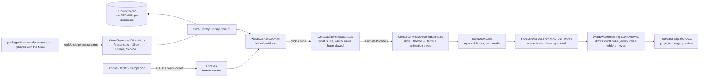

# How MxU Slides for Windows works

This guide walks through the app the way the data flows: from a song on disk to light on the projector. Each section names the files involved, so you can open them alongside. Every file is short enough to read in one sitting.

## The big picture



The code is split into projects:

- **`src/MxU.Slides.Core`** holds everything that isn't Windows-specific: the document models, the library on disk, turning lyrics into slides, working out what the screen should show, the animation engine, timers and stage-display text. It has no UI code, so it's easy to unit-test (`tests/MxU.Slides.Core.Tests`). It's also the part that mirrors the Mac's Swift code most closely.
- **`src/MxU.Slides.Windows`** is the WPF app: windows, buttons, drawing, video playback, and putting outputs on displays.
- **`src/MxU.Slides.LocalApi`** is the remote-control server (section 15).
- **`src/MxU.Slides.PptxImport`** and **`src/MxU.Slides.ProImport`** read PowerPoint and ProPresenter files (section 16).
- **`src/MxU.Slides.Audio`** plays music and captures the app's own sound (section 21).
- **`src/MxU.Slides.VideoIO`** sends to and receives from NDI and DeckLink, and reads cameras (sections 20 and 22).
- **`src/MxU.Slides.Broadcast`** records the program to MP4 and streams it over RTMP/RTMPS or HLS (section 25).

Each has its own test project under `tests/`. The Core/app split is the most important design decision. The Mac app has the same shape: its `PresenterCore` and `SlideScene` packages are the "core", and its SwiftUI/Metal code is the "app".

## 1. Documents: what a song *is*

Open `src/MxU.Slides.Core/Generated/Models.cs`. Every type there (a `Presentation`, a `Slide`, a `SlideObject`, a `Theme`, a `Service`) is generated from `packages/schema/documents.json`, the same file the Mac app generates its Swift models from. **Don't edit it by hand.** Change the schema, then run:

```powershell
node apps/windows/tools/codegen-csharp.mjs
```

Because both apps come from one schema, a song saved on Windows has the same field names and values as one saved on the Mac.

A song is a `Presentation` with these parts:

- **`Sections`**: Verse 1, Chorus, …
- **`Slides`**: each one points at its section with `SectionId`. A slide holds `Objects`, usually one text object called "Lyrics".
- **`Arrangements`** (optional): orders of section ids, for example "Verse 1, Chorus, Verse 2, Chorus".
- **`ThemeId`**: the theme it's drawn with.

## 2. The library: saving safely

`src/MxU.Slides.Core/Library/LibraryStore.cs` keeps one JSON file per document under folders such as `Presentations/` and `Services/`. Media files are copied into `Blobs/` and named by their SHA-256 hash, so the same video imported twice is stored once.

The part to study is `AtomicWrite`:

1. It writes to `song.json.tmp` and flushes it to disk.
2. It uses `File.Replace` to swap the new file in, keeping the old one as `song.json.bak`.

If the power goes in the middle, you have either the old file or the new one, never half of each. `TryRead` uses the `.bak` when a file is damaged. Deleting moves files to `Trash/`, and `BackupIfDue` snapshots everything once a day.

## 3. Lyrics → slides

`src/MxU.Slides.Core/Lyrics/` is a line-for-line port of the Mac's lyric code.

- **`LyricTextImporter`** works out what kind of text you pasted (SongSelect, ChordPro, a chord chart or plain lyrics), then pulls out the title, CCLI number and key.
- **`Reflow.Parse`** walks the lines:
  - a line that matches a section name starts a section (the regex is in `Reflow.LabelPattern`);
  - a blank line ends a stanza;
  - each stanza is cut into slides of *N* lines.
- **`Reflow.Build`** turns that into `Sections`, `Slides` and, if a section repeats ("Chorus" pasted twice), an "As Pasted" arrangement.
- **`SongEditing`** (Windows-only) is what the song editor uses. It also keeps a slide's background and notes when you re-edit the words, and parses play orders like `V1, C, V2, C x2`.

The tests in `tests/MxU.Slides.Core.Tests/Lyrics/` were ported from the Mac's tests. Reading them is the quickest way to see the rules.

## 4. Themes: how a slide gets its look

A slide's text box usually has no font or position of its own. It borrows them from a **theme slide** (a "design"). Open `SlideSceneBuilder.cs`, look at `ThemeSlide`, `PlaceholderAssignments` and `ComposedStack`, and follow these steps:

1. Pick the theme slide whose name matches `slide.ThemeSlideName` (for example "Lyrics" or "Lyrics (Lower Third)").
2. Match each text object on the slide to a text **placeholder** in the design, by name first and then in order.
3. Build the stack: the design's shapes (bands, rules), with the slide's text dropped into the placeholders' places.
4. Each text property is resolved as *slide's own style → placeholder's style → theme default*. See `StyledTextFor`.

So changing a song's theme restyles every slide at once, and a slide can still override one thing. `Library/StarterPacks.cs` builds the four starter themes with the Mac's coordinates and colours.

## 5. What's live: `ShowState`

`src/MxU.Slides.Core/Scene/ShowState.cs` is a small state machine for what is on the audience screen:

- the live **slide**, with its presentation and theme;
- live **media** on each layer: background loops, still graphics, foreground videos;
- **overlays** and a **message**.

Some rules worth spotting, all straight from the Mac:

- A background set to *until replaced* stays when the next slide comes up. Foreground media is swept off by the next slide (see `Fire`).
- Each clear (F1–F6) removes one "function" (`Clear(ShowFunction)`).
- It remembers where the live slide's **builds** are: which clicks have played and whether the exit has (section 14).
- `AnimatedScene()` produces the picture of all of it, each item carrying its animation steps and clock. `Scene()` is the same picture with everything at rest, used for thumbnails, the self-test and text checks.

## 6. The picture: `RenderScene`

`Scene/SceneModel.cs` describes a frame without saying how to draw it. A frame is a canvas (1920×1080) made of layers in order: background media, stills, videos, slide, overlays, alerts. Each layer holds `RenderItem`s, and each item is a text box, a shape or a piece of media with a frame, rotation, opacity and so on.

Because this is just data, the stage display, the slide thumbnails, the audience output and the self-test all build scenes the same way and differ only in where they're drawn.

## 7. Drawing: `SceneView` and `TextLayout`

`src/MxU.Slides.Windows/Rendering/SceneView.cs` is a WPF element that draws a `RenderScene`.

- It scales the 1920×1080 canvas to fit any window, letterboxing the rest.
- Each item becomes its own `DrawingVisual`, so WPF can apply shadows, blur, rotation and skew on the GPU.
- `Present(scene, transition)` changes the picture: audience views change layer by layer, as on the Mac (section 29), and the stage display still uses one whole-view cut, dissolve or fade. `Update(scene)` redraws in place without a transition, which is used every second for clocks and timers, and when a click plays a build.
- While anything moves, it asks the animation engine where every item is on each screen refresh (`OnFrame` → `Render`). It reuses each item's drawing and only changes its position, opacity, wipe or blur. It stops asking as soon as nothing is moving (`AnimationTimeline.IsAnimating`), so a still slide costs nothing.
- Text is laid out by `TextLayout.cs`, which copies the Mac's `TextRasterizer` rules:
  - insets, then word wrap;
  - a line-height multiple;
  - auto-shrink: a binary search down to the minimum size, exactly like the Mac;
  - line fills (the coloured bars behind lines) and letter tracking;
  - chords above lines.
- Media goes through `MediaHub.cs`. Images are decoded off the UI thread. Videos use one shared `MediaPlayer` per live item, so the projector and the operator preview show the same frame.

## 8. Outputs on real screens

`Outputs/OutputManager.cs` and `OutputWindow.cs` handle the displays.

- `Infrastructure/Displays.cs` asks Windows for every monitor, including friendly names like "EPSON PJ".
- Each output window is borderless and topmost, covers its monitor exactly, hides the cursor, and is marked *no-activate*, so pressing → still goes to the main window.
- When a display is plugged in or out, `SystemEvents.DisplaySettingsChanged` re-places the windows.
- With one screen, an output becomes an ordinary resizable window: `ShowAsPreviewWindow`.

## 9. The stage display

`src/MxU.Slides.Core/Stage/` is the confidence monitor.

- A **layout** (`ConfidenceLayoutTemplate.cs` has the Mac's six) is a set of text boxes with a `TextLink`: "current slide", "next slide", "clock", "timer", "video countdown", "stage message".
- Every second, `MainViewModel.BuildConfidenceInfo` gathers the live facts, and `LinkedText.ResolvedObjects` fills each box in.
- `TimerSnapshot` and `TimerController` do the timer maths: countdown, count up, count down to a time of day, plus the amber and red warnings.

## 10. The screen you click: MVVM

The WPF part uses **MVVM** (Model–View–ViewModel):

- **Views** (`Views/*.xaml`) are just layout. A button says `Command="{Binding NextCommand}"`.
- **ViewModels** (`ViewModels/`) hold the state and commands. `MainViewModel` is split by area into `.Live.cs`, `.Services.cs`, `.Media.cs`, `.Editing.cs`, `.Stage.cs` and `.Lyrics.cs`.
- `[ObservableProperty]` and `[RelayCommand]` come from CommunityToolkit.Mvvm. A source generator writes the property-changed and command boilerplate for you.

Trace one click from start to finish:

1. Clicking a slide tile calls `SlideTile_Click` in `MainWindow.xaml.cs`.
2. That runs `SlideClickedCommand` → `GoLive` → `Fire`.
3. `Fire` calls `ShowState.Fire` → `RenderOutputs`.
4. `RenderOutputs` calls `Show.AnimatedScene()` → `SceneView.Present` on the projector and the preview.

## 11. Overlays and masks (Phase 2)

An **overlay** is a free-standing set of objects: a name plate, a scripture lower third, a ticker or cinematic bars. It sits on its own layer above the slide, so it stays up while the slides change underneath. `Library/StarterPacks.cs` builds eleven per theme pack, with the Mac's coordinates and animation steps, and `ShowState.Fire(overlay)` / `DismissOverlay` put them up and take them down. Taking one down plays its Out animation first; it leaves the show once that finishes (`SweepFinishedExits`).

Several overlays use **masks**: text slides in from behind an invisible edge.

- A *matte* is a shape that other objects name in `MaskObjectId`.
- `SlideSceneBuilder.MaskWiring` works out which objects are mattes and which are masked.
- The renderer never draws a matte. It clips each masked item to its matte's shape (`SceneView.MatteGeometry`).

## 12. The canvas editor (Phase 2)

`Scene/EditorGeometry.cs` is a pure port of the Mac's editor maths:

- what's under the pointer, even when the object is rotated;
- the eight resize handles and their minimum size;
- snapping to the slide's edges, its centre and other objects within 8 units;
- marquee selection, and align and distribute.

Its tests are in `tests/.../Scene/EditorGeometryTests.cs`.

`Views/SlideCanvasEditor.cs` is the WPF control. It draws the slide with the real `SceneView`, and an overlay on top draws the selection, handles, guides and marquee and turns mouse gestures into frame changes.

A text box on a themed slide has no position of its own; it sits where its placeholder is. The first time you move it, it gets explicit `X/Y/Width/Height`, an *override*. **Reset to theme** clears them, just like the Mac. The inspector (`ViewModels/ObjectInspectorViewModel.cs`) follows the same rule: it shows the value you see, theme included, and writes any change onto the object itself.

## 13. Hot keys and MIDI (Phase 2)

- `Scene/HotKeyJump.cs` maps letters to sections. The Mac's defaults are A/S/D/F for Verses 1–4, C for Chorus and B for Bridge. `JumpStart` finds the next block of that section in the live arrangement, cycling through repeats.
- `Control/MidiControl.cs` maps MIDI note-on messages to commands with the same notes as the Mac and ProPresenter. For "select by index" commands, the velocity is the number: Trigger Slide with velocity 3 takes slide 3 live. It also parses raw MIDI bytes, including running status and SysEx.
- `Infrastructure/MidiInputService.cs` listens through Windows' own MIDI API (`Windows.Devices.Midi`). MIDI control is off until you switch it on in Settings.

**MIDI devices (Phase 4).** The Mac keeps a list of named MIDI devices ("Lighting desk", "Keys") in the library. Windows now does too (`MIDIDevice` documents, folder `MidiDevices`):

- Each device is on or off, In, Out or In + Out, and listens on one channel or all of them.
- On this PC each device is tied to the ports whose names match (`Core/Control/MidiDevices.cs`, a port of `MIDIDeviceResolver`), or to ports you picked (kept in `settings.json`, because port ids belong to this PC).
- MIDI control listens only to devices that are on, on their channel, once any listed device takes input. With no devices listed, it listens to every input, as before.
- A slide action's MIDI Out goes to its device's port. A device that's off, input-only or unplugged is skipped with a reason, and never sent to every port by mistake.
- Set them up in **Screens & Settings › MIDI › MIDI devices**. `GET /v1/midi/devices` lists them and `PUT …/enabled` switches one on or off.

## 14. Animations and builds (Phase 2)

Slides, theme designs and overlays can animate: text rising in, a plate wiping across, words appearing one by one. `src/MxU.Slides.Core/Animation/` is a line-for-line port of the Mac's engine.

- Each object has **steps** (`AnimationStep` in the schema): an In, Out, Emphasis or Morph, with an effect (fade, move, scale, wipe, blur, type, draw…) and a **trigger**: *With Previous*, *After Previous*, *On Click* or *On Dismiss*.
- `AnimationSequence.Groups` sorts the steps into an automatic group (plays when the slide fires), one group per click, and an exit group.
- A text box on a themed slide with no steps of its own borrows its placeholder's (`PlaceholderAnimations.Compose`). That's how every lyric slide gets the theme's animation.
- `ShowState` keeps the clock: when the slide fired, when each click happened, and when an exit or a clear was pressed. `SlideAnimationContext` hands those times to the scene.
- `AnimationEvaluator.Resolve(scene, now)` is a pure function: given the scene and a time, it says what to draw and how each piece is moved. That makes it easy to test (`tests/.../Animation/`) and to freeze at any instant. The self-test takes pictures 0.15, 0.35 and 0.6 s into a lower third.

What **Next** does depends on the slide, as on the Mac:

1. If the slide has click groups left, Next plays the next one and stays on the slide.
2. Then, if it has an exit group, Next plays that.
3. Otherwise Next moves to the next slide.

The starter lyric designs put the words' Out on a click, so the first Next plays the Out and the second moves on. **Alt+→** goes straight to the next slide, skipping any builds left (Option+→ on the Mac). The live label shows "build 1 of 1". Previous takes builds back.

What `SceneView` draws: moves, scales, rotation, fades, wipes with soft edges, blur, typewriter and word-by-word reveals, and line drawing. The 3-D tilt and swing are flattened into a squash. Burn, glitch and tint are drawn on the graphics card (section 18), and keystone by its own shader (section 37).
- Page turns (section 28) are morph steps, so they count as clicks: the stage display's "build 2 of 4" counts them.

## 15. Remote control: the Local API (Phase 2)

`src/MxU.Slides.LocalApi/` is a port of the Mac's LocalAPI package. It's a small web server built into the app (ASP.NET Core's Kestrel), off until you switch it on in **Screens & Settings › Network & API**. It speaks the same REST and WebSocket protocol as the Mac, so the same remotes and scripts work with both.

- `ApiRouteTable.cs` lists every endpoint: `GET /v1/status`, `POST /v1/show/slide`, `POST /v1/show/advance`, `POST /v1/alerts/fire` and the rest. Each one needs a **key** (`Authorization: Bearer mxu_…`) with enough scope: *View* reads, *Control* runs the show, *Edit* also changes the library.
- `ApiScope.cs` stores only salted hashes of keys, in `local-api-tokens.json`. The default key's secret is kept encrypted for your Windows account with DPAPI (`MainViewModel.ApiServer.cs`), so Settings can copy it again.
- The server knows nothing about WPF. It calls the app through one interface, `IApiBridge`, which `ViewModels/MainViewModel.Api.cs` implements. The server always calls it on the UI thread, so the bridge can touch the show directly.
- When the show, timers or library change, `PublishApi` pushes a fresh snapshot to every WebSocket client subscribed to that topic (`/v1/ws?token=…`).
- `/docs` serves a page listing every endpoint, and `/openapi.json` describes them for tools.

Try it: turn the API on, copy the default key, then in PowerShell:

```powershell
$key = "mxu_paste_your_key_here"
Invoke-RestMethod http://localhost:6980/v1/status -Headers @{ Authorization = "Bearer $key" }
Invoke-RestMethod http://localhost:6980/v1/show/advance -Method Post -Headers @{ Authorization = "Bearer $key" } -ContentType application/json -Body '{"steps":1}'
```

## 16. Importing PowerPoint and ProPresenter (Phase 2)

Both importers are ports of the Mac's and save straight into the `LibraryStore`. They run on a background thread and report progress, which the notice bar shows.

- **PowerPoint** (`src/MxU.Slides.PptxImport/`): unzips the `.pptx` safely (no `..` paths, no zip bombs), reads the slide XML with its master and layout inheritance, maps shapes, text, pictures, videos and animations, and bakes textures into PNGs. Importing the same file again replaces it in place.
- **ProPresenter 7** (`src/MxU.Slides.ProImport/`): ProPresenter stores documents as *protocol buffers*. `Proto/` holds the open `.proto` descriptions of that format (MIT licensed), and the build turns them into C# classes. The importer maps presentations with their groups, arrangements and media, playlists (each becomes a service), themes, props, messages and stage layouts. Before replacing something already in your library, it asks.
- **`.pro`** is also ChordPro's extension. `MainViewModel.IsProPresenterFile` tells them apart: ProPresenter's is binary, ChordPro's is text.
- **A whole ProPresenter library**: **Screens & Settings › Import ProPresenter library…** opens at `Documents\ProPresenter`. Run it again later to pick up changes; anything you've edited here is kept.

**Everything else a ProPresenter workspace holds (Phase 4).** A ProPresenter library import used to bring in presentations, media, themes, props, messages, stage layouts, playlists, macros and calendar events. It now also brings in:

- **Screens:** ProPresenter's screens become screens here (by name; a screen you already have is reused), with their role, colour and keystone corrections, slices and edge blends. `src/MxU.Slides.ProImport/ProWorkspacePlans.cs` does this; it is a port of the second half of the Mac's `WorkspaceImport.swift`. "Update unedited" never reconfigures a screen you already had; "Replace" does.
- **Looks** become **output presets** (each screen's layers, theme and mask), so switching a preset switches the look.
- **Timers** and **video inputs** join the timer list and the input inventory.
- **Stage layouts:** the first one ProPresenter assigns becomes the stage layout (this app has one stage layout for every confidence screen).
- **Group hot keys:** ProPresenter lets you change which key jumps to which group. The library now keeps a **group palette** (`Core/Library/GroupPalettes.cs`, one document, id `group-palette`, as on the Mac) and the hot keys come from it. `ProImport/ProGroupHotKeys.cs` applies imported letters under the import policy. The import ledger (`ImportLedger.json`) remembers each letter an import set, so "Update unedited" can tell your change from an untouched import.
- **MIDI devices** (below).

## 17. The program feed (Phase 3)

Recording, streaming, NDI and DeckLink all need the audience picture as a stream of frames, not just a window. `Outputs/ProgramFeed.cs` makes that stream, the way the Mac's OutputMirror does.

1. When something starts listening, it opens a hidden **program window** with its own `SceneView`. It's given exactly the same scenes as the projector, so transitions, animations and videos match. Videos share the projector's player (same playback key), so they stay in step.
2. `Outputs/WindowCapture.cs` reads that window's picture through the graphics card (Windows.Graphics.Capture plus Direct3D 11, via the Vortice library) and copies it into memory.
3. A pacing thread hands the newest picture to every destination 30 times a second. It repeats the last one when nothing changed, because encoders want a steady rate.

Destinations implement one small interface, `IProgramSink` in `Core/Media/ProgramFeed.cs`: `WriteVideo(VideoFrame)` and `WriteAudio(AudioBuffer)`. They must return quickly; if one falls behind, frames are skipped and counted rather than slowing your screen.

Two things learnt the hard way, both checked by the self-test:

- **WPF's own `RenderTargetBitmap` draws on the CPU.** It managed 13 frames a second at 1080p and stalled the operator screen. Capturing a real window uses the GPU and holds 30.
- **Windows doesn't draw windows that are entirely off-screen.** So the program window sits at the top-left of the main screen, behind everything, fully transparent (alpha 0) and click-through. You never see it, but Windows keeps its picture current.
- **The picture may be bigger than the screen.** A 1080p stream from a 1366 × 768 laptop, or 4K NDI from a 1080p one, needs more pixels than the screen has. Windows won't let a window be bigger than the screens, a WPF `Window` also caps its layout at the screen's size, and WPF only draws the part of a window that's on a screen anyway. So `HiddenCapture` cuts such a picture into screen-sized **pieces** (`Core/Outputs/CaptureTiles.cs` plans them: as few as possible, cut evenly). The content sits on a "stage" the size of the whole picture inside the first hidden window. Each other hidden window shows its own piece of the stage through a `VisualBrush`. Each window is captured separately, and its picture is copied into its place in the whole frame. The windows are bare `HwndSource`s (the thing inside every WPF `Window`), so nothing caps their size. One small cost: in fast motion, neighbouring pieces can be a frame apart for a moment. The software copy draws the stage itself, so in that mode only the first window is kept. On a PC without a graphics card, WPF draws every window in software, and each extra one would slow the whole app down.

**On a PC that can't capture (Phase 4).** Some PCs (virtual machines like the CI runner, some remote sessions) start Windows' capture but never get a picture from it. Two seconds without one, `HiddenCapture` switches to a **software copy**: WPF draws the program into a bitmap on the UI thread. It runs as often as it can without taking more than about a third of that thread's time, and later captures start on it straight away. WPF's software drawing skips pixel-shader effects, so pictures from the copy lack the graphics-card effects and the screen's output corrections (brightness, edge blends, masks). The projector itself still shows them; only NDI, recordings and streams from such a PC go without.

- Recordings, streams and NDI still work, at a lower frame rate.
- The copy can't draw pixel shader 3.0 effects, so GPU effects and output corrections are missing from those frames.
- `MXU_SLIDES_CAPTURE=software` forces it, to test it or on a PC whose capture misbehaves.

## 18. GPU shaders (Phase 3)

Some looks can only be drawn pixel by pixel on the graphics card: keystone correction, edge blending, and effects like pixelate or stained glass. WPF allows that through a `ShaderEffect` with an HLSL pixel shader.

- `Rendering/ShaderCompiler.cs` compiles the shader source when the app starts, with the compiler that's part of Windows (`d3dcompiler_47.dll`). The repo holds readable shader code and no compiled binaries.
- `Rendering/ItemEffect.cs` holds all of an object's picture effects in one shader: colour adjust, hue rotate, invert, posterize, pixelate, vignette, warp, scatter, stained glass and grain, plus the animation passes glitch, burn and tint. Each is a line-for-line port of the Mac's Metal shader in `RenderEngine/ShaderSource.swift`.
- `SceneView` gives each item one layer per effect, first effect innermost. Effects that move (warp, scatter, grain, stained glass) keep the frame loop running.
- `Rendering/OutputAdjustEffect.cs` is the per-screen correction pass: corner-pin keystone, brightness, contrast, gamma, black level, RGB levels, edge-blend ramps and masks. It's a port of `output_adjust_fragment`.
- Echo and ghost trails need what the item looked like a moment ago, which a WPF shader can't read; section 30 explains how they're drawn.
- On a PC without a graphics card that supports pixel shader 3.0, effects and corrections are skipped; the picture still shows.

## 19. Screens (Phase 3)

The Windows app used to have exactly two outputs, Audience and Stage. It now has the Mac's screen model, in `src/MxU.Slides.Core/Outputs/`:

- A **screen** has a name, a size (1920×1080, 4K, an odd LED-wall size…), a job (the audience program or the stage display) and a fit (show everything, or fill and trim).
- A screen has one or more **slices**: the part of its picture an output shows. One slice is the whole screen.
  - **Mirror** makes several outputs show the same thing.
  - **Grouped** splits a wide picture across side-by-side projectors.
  - **Edge blend** does the same with an overlap that ramps down so the seam disappears.
  - **LED wall** places the picture at an exact spot on a processor's input.
- Each slice is **carried** by a device id: `display:\\.\DISPLAY2`, `ndi:MxU Slides Stage`, or `decklink:<card>`.
- Each slice can be **corrected**: corner-pin keystone, rotation, brightness, contrast, gamma, black level, red/green/blue, edge-blend ramps and masks.
- `ScreenSetup` saves the whole thing in `settings.json` in the Mac's own JSON shape. On first run your old Audience and Stage display choices become two screens.
- A screen can show the live slide through a **look**: a theme it restyles the slide with (section 27).

The WPF half is in `src/MxU.Slides.Windows/Outputs/`:

- `OutputManager` opens one `OutputWindow` per display that carries slices, and one `DeviceFeed` per NDI source or DeckLink card. It sends every screen its picture: the program reshaped to its size (`Config.Program`), the stage display, or the alignment grid while you line projectors up.
- A `SliceView` shows its part of the screen's picture at full resolution: the scene is drawn larger than the slice and clipped. Then the correction shader runs on it (section 18). The maths (warp matrix, blend uniforms) comes from `Core/Outputs/OutputPass.cs`, so it's tested without a graphics card.
- `Views/ScreensWindow` is where you set it all up (**Screens & Settings › More screens, NDI, DeckLink, edge blending…**). Changes apply live and save themselves.

## 20. NDI and DeckLink (Phase 3)

`src/MxU.Slides.VideoIO/` is a port of the Mac's NDIKit and DeckLinkKit.

- **NDI:** nothing is shipped with the app. `NdiLibrary` loads the NDI runtime that NDI Tools installs, through a table of functions it checks against the DLL's exports. Without NDI Tools it reports "NDI runtime not installed" and nothing else changes.
  - A screen carried by `ndi:<name>` becomes a source other NDI programs (OBS, vMix, NDI Studio Monitor) can pick. The self-test checks it appears on the network.
- **DeckLink:** the app talks to Blackmagic's Desktop Video driver through COM. The interfaces are declared by hand in `DeckLinkInterop.cs`, with the IDs from Blackmagic's headers. Frames go out as BGRA, or are converted to 10-bit-safe 8-bit YUV (BT.709) when a mode needs it. Keying uses the picture's alpha.
- **Cards:** a DeckLink card shows up in the Screens window as an output if one is installed.

## 21. Music (Phase 3)

`src/MxU.Slides.Audio/` is a port of the Mac's AudioEngine, built on NAudio (MIT) and Windows' WASAPI.

- `AudioController` is the Audio function: playlists with crossfades, single songs, fades when stopping, next/previous/seek. The **Music** tab in the bottom bin plays them, and F5 stops them.
- Each output runs on its own sound device stream. With **no** sound device (a server, or speakers unplugged) the engine keeps time anyway, so playlists still advance and streams still get sound. It recovers when the device comes back. Which device music and video sound play on is chosen in Settings › Sound (section 38).
- `ProgramAudioTap` records *this app's* sound only, through Windows' "process loopback". That includes video sound and music, but not system sounds or other apps. It's what recordings and streams hear.
- Multitrack (stems and click tracks) is ported too: `MultitrackEngine`, and a separate tracks-player process so heavy decoding can't stall the show. The timeline editor (section 32) makes and edits them.

## 22. Live video inputs (Phase 3)

Cameras, capture cards, NDI sources and DeckLink inputs are **inputs**: named entries ("Pulpit camera") kept in `video-inputs.json` by `VideoInputInventory`.

- Set them up with **Media › Video inputs…**. Each one then appears as a tile at the start of the Media tab; clicking it puts it on the Video Input layer, under the slides.
- Their cue ids start with `input::item::`, as on the Mac. `MediaHub.LiveInputs` copies each input's newest frame into one `WriteableBitmap` per refresh, and every view showing it draws that bitmap, so all outputs stay in step.
- `LiveInputDelay` can hold an input back a few frames so lips line up with the sound.
- An input can also fill a shape on a slide: a picture-in-picture camera (section 37).

## 23. Show automation (Phase 3)

`src/MxU.Slides.Core/Automation/` is a port of the Mac's ActionRouter, scheduler, timecode readers and presentation timelines.

- **Slide actions:** a slide (or a media item) can carry actions that run when it goes live, such as firing a background, putting up a message, starting a timer, switching the output preset or sending MIDI. `ActionRouter.SlideDidFire` runs them, with their delays. Clear All (F1) cancels any still waiting.
- **Action combos:** a named list of actions. Run one from the **Combos** tab, with MIDI "Run Action Combo" (velocity = number), or with `POST /v1/action-combos/{id}/fire`. ProPresenter macros import as combos.
- **What actions can do:** the router never touches the show directly. It calls `IShowActions`, which `ViewModels/MainViewModel.Actions.cs` implements over the live show, timers, overlays, music, inputs and MIDI out. Anything this PC can't do yet is logged and skipped, so one missing piece doesn't stop a combo.
- **Scheduler:** schedule triggers run their actions on chosen days at a time, once on a date, or when a timer reaches a value. The scheduler's memory (`scheduler.json`) remembers what has fired, so a restart never fires anything twice. It looks again when the clock changes or the PC wakes. ProPresenter calendar events import as triggers.
- **Timecode and timelines:** see the next section.

## 24. Song timelines and timecode (Phase 3)

A **timeline** belongs to a song (one per arrangement). It is a list of cues at times in seconds: "slide 3 at 0:42", "this background at 1:10", "the music from 0:00", "run these actions at 2:05". `TimelinePlayer` (in `Core/Automation/Timelines/`, ported from the Mac's PresentationTimelineController) plays one song's timeline on its own clock, 30 ticks a second. Each tick it asks `PresentationTimelines.Crossing` what the playhead passed since the last tick and does it.

- **In the app:** the bar under the slides (**Timeline** in the song's header, or it shows by itself when the song has a timeline). ▶ plays, ⏮ goes back to the start, the slider moves the playhead.
- **Recording a take:** press **Record**, then click each slide when it should change while the song plays. `Fire` in `MainViewModel.Live.cs` calls `NoteSlideLanded`, and the player turns each click into a cue at the playhead. Press **Finish** to save it. **⋯ › Undo the last take** puts the timeline back as it was.
- **Music:** **⋯ › Play this music with the timeline** puts a song from the Music tab on the timeline's music lane, so pressing ▶ starts the music and the slides together. The music plays through the same `AudioController` as the Music tab (`TimelineMusic` in the Audio project is the adapter).
- **Where a slide cue points:** not at "slide 7" but at "the 2nd time the chorus plays, its first slide" (`TimelineSlideAnchor`). So changing the arrangement doesn't move cues onto the wrong words.
- **The app's half** is `ViewModels/MainViewModel.Timeline.cs`. It implements `ITimelineHost` (find a presentation, fire a slide, run actions, what's live) and draws the bar. A presentation opened from the library rather than a service gets an item id of `presentation:<id>`, so it can still have a timeline.
- **Stems (multitrack):** a timeline can carry stems (click, guide, pads). They play on a separate `MultitrackEngine`, made only the first time a song has stems (`LazyTracksPlayer`). The timeline editor (section 32) adds them on Windows too.

**Timecode in.** A playback rig (Ableton, QLab, a video playback machine) can send timecode, and the app follows it: each song whose timeline has **⋯ › Follow timecode** on, and a start time (**⋯ › Timecode start**, e.g. `01:00:00:00`), plays when the timecode reaches it.

- Choose the input in **Screens & Settings › Timecode in**: **LTC** from one channel of a sound input, or **MTC** from a MIDI input. The readout there shows the timecode and Locked / Stopped / No timecode.
- `TimecodeFollower` (Core) reads the input 30 times a second and drives the `TimelinePlayer`. The app supplies the readers (`ITimecodeInputs` in `MainViewModel.Timeline.cs`):
  - LTC: `AudioInputHub` captures the device; one channel goes to `LtcReader`, which decodes the audio waveform into frames.
  - MTC: `MidiInputService` hands every MIDI message's bytes to `MtcReader`, stamped with the time it arrived.
- The stage display can show the timecode (a Timecode text link), and `GET /v1/timecode` reports it to remotes.
- These settings belong to this PC (they name its devices), so they're kept in `settings.json`, not in the library.

## 25. Recording and streaming (Phase 3)

`src/MxU.Slides.Broadcast/` is a port of the Mac's StreamEngine and recorder. It has no WPF in it; the app gives it pictures and sound.

- **Pictures** come from the program feed (section 17): each recording or stream is one more `IProgramSink`. `FramePacer` thins the feed to the preset's frame rate, and each sink scales the picture to its own size.
- **Sound:** each recording or stream opens the sound its preset asks for (section 35). The default is `ProgramAudioTap` (section 21): the videos and music this app plays, and nothing else on the PC.
- **Encoding** uses Windows' own Media Foundation encoders (H.264 video, AAC sound), through hand-written COM declarations in `Media/MediaFoundationInterop.cs`. A hardware encoder (Intel Quick Sync, NVIDIA, AMD) is tried first; if it fails the rest of the run uses the software one.
- **Recordings** are MP4 files, filed into the media library when they finish (section 35), with an optional copy in a folder such as Videos\MxU Slides. The file is written as `name.partial.mp4` in fragments, so a crash or power cut still leaves a file that plays. It's renamed when the recording stops, and leftovers are renamed at the next launch (`RecoverInterrupted`).
- **Streams** go out over RTMP or RTMPS (YouTube, Facebook, Restream, any RTMP server: `Rtmp/RtmpPublisher.cs`, written from scratch) or HLS. A dropped connection reconnects with back-off; the status line says "Reconnecting (try 2)". When the network can't keep up, video is dropped until the next keyframe rather than letting a delay build up.
- **Stream keys are secrets.** `StreamKeyVault` keeps them encrypted for your Windows user (DPAPI) in `%LOCALAPPDATA%\MxU Slides\StreamKeys`. They are never written into the library, so a backup or a shared library never leaks them.
- **In the app:** **Stream & Record** in the toolbar opens `Views/BroadcastWindow.cs`. A **preset** says what to do: record only, or stream to the ticked destinations (and maybe record too), at what size, frame rate and bitrate. While anything runs, the toolbar button shows "REC 12:03" or "LIVE 4:10 · REC 4:10". It turns orange if a stream is struggling and red if one failed.
- **Automation:** the slide/combo actions "Start capture" and "Stop capture" start and stop presets (`StartBroadcast` in `MainViewModel.Broadcast.cs`).
- **Quitting** while recording asks first, then waits for the files to finish before closing.

Not on Windows (yet): SRT, HDR/HEVC streaming, ProRes recording, and signing in to YouTube or Facebook. Streams use a server URL and key.

## 26. Keeping it running

- `App.xaml.cs` catches unexpected errors, logs them (`Infrastructure/Log.cs`) and keeps going.
- **Show timing never waits for spare threads.** .NET has a shared "thread pool" that runs small background jobs and timer callbacks. If something ties it up (a big import, a slow disk, a busy PC), jobs on it run late. So anything a service depends on has its own threads, in `src/MxU.Slides.Core/Threading/`:
  - `ShowTimeProvider.Shared` is the show clock: one dedicated thread that fires the timers for timelines, delayed slide actions, the scheduler, timecode and the audio feeds.
  - A `WorkQueue` runs jobs in order on its own thread. The music engine has four (`MxU.Slides.Audio/AudioThreads.cs`): events (a song ended, so the playlist moves on), chores, stem preloading, and Windows' audio-device calls.
  - `BusyThreadPoolTests` and `BusyPoolThreadingTests` tie up every pool thread on purpose and check a song still ends on time, the next song still loads and the clock still ticks.
- A `running.marker` file shows when the last session crashed.
- `Infrastructure/SelfTest.cs` drives the real app through a service and checks what's on screen. It covers lyrics, builds, overlays, video, the Local API (over real HTTP and a WebSocket), both importers, the program feed, screens, NDI, music, live inputs, actions, timelines, recording, recording the stage screen, recording the Music tab's sound, 60 fps, recordings filed into the Media tab, replaying the newest recording, looks, page turns, transitions, trails, and the combo, scheduler, timeline, overlay and mask editors. Run `scripts/self-test.ps1` after any change. Checks that need hardware this PC doesn't have (a graphics card, NDI Tools, a sound device) report SKIP, not FAIL.
- **When a run never finishes.** The self-test writes its report so far to `report.partial.txt` every two seconds. A watchdog thread (`SelfTest.Trail.cs`) notices if the UI thread stops answering for 20 seconds. It then logs the last check reached and every thread's call stack, so the code that's stuck can be read straight off the report. Reading another thread's stack isn't something .NET can do by itself; `Infrastructure/ThreadStacks.cs` uses Microsoft's ClrMD library to read them from a snapshot of the app.
- **Pretending to be a different PC.** Two environment variables make this PC behave like the GitHub test machine, to reproduce its problems here:
  - `MXU_SLIDES_CAPTURE=software` makes recording and streaming use the slower software copy (no graphics-card capture);
  - `MXU_SLIDES_AUDIO=none` makes the app see no sound devices at all.

## 27. Looks: one slide, a different design on each screen (Phase 4)

A church often wants the projector to show the lyric full screen while the livestream shows the same words as a lower third over the camera. ProPresenter calls this *Looks*. Here a screen's look is a theme it shows the live slide through, while every other screen shows the slide as designed.

- **Setting one:** **Screens & Settings › More screens…**, pick the screen, then **Look**. Choose a theme, and in the second box which of its designs to use: all of them, one folder (*Only its "Lower Thirds" designs*), or one design (*Just "Lyrics (Lower Third)"*). The choice is saved with the screen in `settings.json` (`slideThemeId`, `slideThemeFolder`, `slideThemeSlideId`: the same names the Mac uses for this in output presets).
- **Output presets can switch looks too**, as on the Mac. A preset's *slide theme* for a screen beats the screen's own look while the preset is active. Switching presets (a slide action, a combo, the Local API) changes looks live. The active preset is now applied at launch, as on the Mac.
- **How a look restyles a slide:** `Scene/ShowState.cs` → `AddSlide`. The slide's text loses its own font, size and position and takes the look's placeholder instead, keeping only the emphasis the look allows (bold words stay bold, a bigger word stays bigger in proportion: `PlaceholderAnimations.OverrideObjects`). A slide can also choose which design it uses in a given theme (`OverrideDesigns`).
- **One scene per look:** `RenderOutputs` in `ViewModels/MainViewModel.Live.cs` builds the audience scene once as designed and once per look some screen shows (`Show.AnimatedScene(slideThemeOverride: look)`). `OutputManager.SceneFor` gives each screen the one for its look. The program feed (recording, streaming) and the operator preview show the slide as designed.
- **Builds count across looks:** every look shares the slide's clock. If only the stream's lower third has a click-off Out, the first Next plays it on the stream and the second moves on, everywhere. `ShowState.SlideClickCount` takes the most clicks any look needs.
- **Holding a look:** going from verse 1 to verse 2 on the same lower-third design, the stream doesn't rebuild the plate; it keeps it up and fades the new words in (`HoldsLook`, `HoldFade`).
- **Hand-offs:** when the next slide makes a look go away (its preset drops it, the slide needs another design, or the slide is blank), that look plays its Outs first, then the slide lands everywhere (`ShowState.Handoff`, `MainViewModel.Fire`). The wait is timed on the show clock, and pressing anything else meanwhile cuts straight through.

## 28. Long lyrics turn pages (Phase 4)

A lower third has room for two lines. Put a long verse on it and the text would shrink to nothing, so designs mark their text box *page on click*: text that doesn't fit becomes pages, and Next turns to the next page before the slide moves on.

- `Rendering/TextLayout.cs` → `Pages` measures it, the way the Mac's `TextRasterizer.pages` does: shrink as far as the minimum size allows, then cut into runs of whole lines that fit. Text on a path, a ticker and a block scroll never page.
- `Core/Animation/Paging.cs` turns the pages into click steps: the text box shows page 1 and each further page is a *morph* step that swaps in the next page's text, placed after the build-in and before the design's Out.
- `ShowState.Pager` is set to `TextLayout.Pager` the first time the outputs are drawn. Without it nothing pages, which is how the unit tests can count clicks without fonts.
- Pages turn the way slides change (Settings › Transitions › Slides): a cut, or a fade of the same length (`ShowState.PageTurn`).
- The stage display's "build 2 of 4" counts page turns, because they are clicks.

## 29. Each layer changes its own way (Phase 4)

Until now every change on the outputs used one app-wide cut or dissolve. Now each layer changes on its own, decided exactly as the Mac decides it (`Core/Animation/LiveTransitions.cs`):

- A slide comes in with **its own transition**, else **its presentation's**, else the **room default** (Settings › Transitions › Slides).
- A background a slide brings uses the **media item's own transition**, else the presentation's. Media fired on its own uses its own transition, and so does media cleared off. Otherwise media follows **Settings › Transitions › Media** (a 0.7 s dissolve unless you change it), and slides follow **Slides**: the Mac's two room defaults.
- Overlays, alerts and live cameras cut: overlays play their own In and Out animations.
- Only layers whose items actually change transition. A clock ticking, a build playing or a page turning never fades.

The transitions are Cut, Dissolve, Fade Black/White/Colour, Blur Dissolve and Film Burn (the Mac has no push or wipe). `Core/Animation/SceneTransitionEngine.cs` composites them: leaving items get `::leaving` ids and fade, blur or burn out while arriving ones come in, and a fade puts a coloured plate over the layer. `SceneView.PresentLayered` runs one engine per view and draws its result every frame until the transition lands. A video fading out keeps its player (`PlaybackId`), and players nothing draws any more are let go every frame (`ReleaseUnusedPlayers`).

## 30. Echo and ghost trails (Phase 4)

These two effects need what the item looked like a moment ago, which a WPF shader can't read. So:

1. Each frame, `Rendering/TrailStore.cs` takes a small picture of the item (at most 384 pixels across) with `RenderTargetBitmap`.
2. `Core/Animation/EffectTrail.cs` keeps the history and works out the *trail*: Echo fades the old picture (to a tenth after the effect's fade time), Ghost Trails also pushes it about with slow noise. It's plain arithmetic on pixels, so it has unit tests.
3. `Rendering/TrailEffect.cs`, a small shader, combines the live picture with the trail: the brighter of the two for Echo, a mix for Ghost Trails.
4. Without pixel shader 3.0 the trail is drawn under the item instead. It never stops the frame: a failure shows the item without its trail.

The projector, its preview and the program feed share one trail, so the work is done once a frame. As on the Mac, the trail follows the item: moving an item doesn't smear it, but anything changing inside it (a video, a colour, words swapping) leaves a trail. Trails only run on live views; thumbnails and the editor show the item as it is.

**Self-test.** `Infrastructure/SelfTest.Render.cs` checks all four: two stand-in network screens show the same slide through a lower-third and a side-third look; a long lyric shows page 1 on the lower third and Next turns to page 2; a verse with its own Fade White passes through white on the program feed; and Echo and Ghost Trails show in the program feed's pictures (`20-*` to `23-*`).

## 31. Editing show automation (Phase 4)

Section 23 explains how actions, combos and schedule triggers *run*. Phase 4 adds the windows that *make and change* them. There are three, and they share one piece:

- **The action list** (`Views/ActionListEditor.cs`) edits a list of steps. Each step is a card: its kind at the top ("FIRE MEDIA"), its settings, and a Delay box. ↑ ↓ move it, ✕ removes it, **+ Add action** opens the Add Action menu (Clear ›, Alert ›, Timer › Start › Sermon …). The same control sits in all three windows, because a combo, a slide, a media item and a trigger all hold the same kind of list.
- **Action Combos** (`Views/ActionCombosWindow.cs`): every combo on the left, in folders and in your order; the selected combo on the right with its name, colour, icon, "Run when MxU Slides starts" and its steps. Ctrl+click or Shift+click picks several to colour, move or delete at once.
- **Slide Actions** (`Views/SlideActionsWindow.cs`): the steps a slide runs each time it goes live, or a media item runs each time it's fired.
- **Scheduler** (`Views/SchedulerWindow.cs`): every trigger, in folders, with when it fires next ("Sun 09:00"), an On/Paused chip, and the selected trigger's conditions and steps. Right-click a trigger to skip its next fire, pause it until a moment, or give it an end date. **History…** shows every run on this PC and one-time triggers that have finished.

**Where the rules live.** The windows only draw things. What each kind of step lets you set, its defaults and its limits (MIDI channel 1–16, a delay of 0–3600 seconds in tenths), what the Add Action menu holds, how a trigger's summary reads, what the On/Paused chip does: all of that is in Core, ported from the Mac, with unit tests:

- `Core/Automation/Actions/ActionEditing.cs`: each step kind's settings (`Fields`), what its pickers list (`Entries`), the Add Action menu (`AddMenu`) and reading a typed delay. The window turns each setting into a control: a picker becomes a drop-down (or, for media, songs and music, a search window: `Views/LibraryPickerWindow.cs`), a number becomes a box with − and +.
- `Core/Automation/Scheduling/ScheduleEditing.cs` and `ScheduleConditionFormat.cs`: new conditions (Sundays at 9:00; an hour from now; the first timer at 0:00), the summaries, what a row shows on its right, the chip, and reading typed dates and times ("25/10/2026", "tomorrow", "9:30 pm").
- `Core/Automation/AutomationLibrary.cs`: making, changing, duplicating and deleting combos and triggers, keeping their **boards** (the folders and order) in step. It always changes a *copy* of a document and saves the copy, so nobody else holding the old one (the scheduler, for instance) sees a half-made change. On the Mac documents are Swift values, which gives the same safety for free.
- `Core/Automation/BoardSteps.cs` (Windows-only): Move up / Move down and the Folder picker. The Mac reorders by dragging.

**Saving.** Every change saves straight away, as on the Mac: there is no Save button, only Done. Text boxes (names, delays, times) save when you press Enter or click elsewhere, not on every key, so a half-typed name never fires anything. Esc puts the old text back.

**Keeping up.** Each window listens to `LibraryStore.Changed`. Its own saves just redraw the list; a change from somewhere else (an import, the Local API) redraws everything. The Scheduler window also listens to `Scheduler.Changed`, which fires after each sweep, so the "next" times move on by themselves. Saving a trigger makes the scheduler sweep again (`MainViewModel.Scheduler.cs`), which is how a new trigger's next time appears a moment after you make it.

**Try it.** Make a combo with two steps, an alert and then an overlay with a 2-second delay, and press Run: the message comes up at once, the overlay two seconds later. Then open `ActionCombos/` in your *test* library and find the combo's JSON: the delay is stored as `"delaySeconds": 2`, and a zero delay isn't stored at all.

The self-test (`Infrastructure/SelfTest.Editors.cs`) drives all three windows: it makes a two-step combo and runs it, gives a slide a background and a timer and fires it, and makes a trigger and checks its next time is listed. Pictures: `30-editor-combos-window`, `30b`/`30c` (the Add Action menu and a submenu), `31-editor-slide-actions-window`, `32-editor-scheduler-window`.

Open them from the **Combos** tab (**Edit combos…**, **Scheduler…**), a slide's right-click menu (**Actions: N**), and **Actions…** on a media tile or a service item.

## 32. Editing a timeline (Phase 4)

Section 24 is how a timeline *plays*. This is how you *edit* one: the Mac's timeline card,
as a window. Open a song, then **Timeline › ⋯ › Edit timeline…**. The window follows the
song open in the main window, so you can leave it open and pick another song.

### What you see

- **Lanes**, one row each: Slides, Background Media, Music always; Alerts, Overlays, Foreground
  Videos, Still Graphics, Video Input and Actions once they hold a cue (or **+ Add a layer**).
- **Track rows** for the song's stems (click, guide, keys…), folded into one bar
  ("12 stems") or one row per track (click **▸ Tracks**).
- A **ruler** along the top (click or drag it to move the playhead) and the song's
  **sections** as a coloured line under it.
- A **slide cue** is a pin with the slide's first words; a **block** (an overlay, a video,
  a music clip, a stem) spans its length. Music clips and stems show their **waveform**.
- The song's **transition** to the next service item (**Song › Transition to the Next
  Item**) is drawn as curves on the music: drag the blue dot to change how long it takes.

### What you can do

| Do this | And |
|---|---|
| **+** beside a lane | adds at the playhead: a slide, a background or video, an overlay, an alert, a video input, a music clip, an action |
| Drag a cue | moves it, on the 30 fps grid, snapping to other cues' edges and the playhead (hold **Alt** to drag freely) |
| Drag a block's right edge | changes how long it runs |
| Drag a block's left edge | trims its start (a music clip keeps its audio where it was: it reads further into the file) |
| Ctrl-click or Shift-click | picks several; drag one and they move together |
| Drag across empty lane | picks a stretch of time: **Copy** it, or **Ripple Delete** it (everything after moves up) |
| **←** **→** (Shift: a second) | nudges a frame; or type a time in the box |
| **Delete**, **Ctrl+B**, **Ctrl+C**, **Ctrl+V** | remove, split at the playhead, copy, paste at the playhead |
| **Ctrl+Z**, **Ctrl+Y** | undo and redo every edit |
| Right-click a music clip | fades (five curve shapes), crossfades where clips overlap or butt together, edge fades |
| Drag a fade's square handle / round handle | its length / how its curve bends |
| **Ctrl+wheel**, wheel, Shift+wheel | zoom, scroll along, scroll up and down |
| Space, Home | play/pause, go to the start |

### Stems (multitrack)

**+ beside Tracks › Import Audio Files…** (or **a Song's Folder…**, or drop files on the
track rows) copies the files into the library and puts each one on the track its name
matches: "EG 2.wav" goes on *Electric Guitar 2*, "Click.wav" on *Click*. Tracks are made
for names nothing matches; with tracks already set up, a dialog asks first. The files of
one download become a **track set**, so dropping the same folder again reuses them and the
stems remember their tracks. A MultiTracks.com download's `MultiTrack.als` becomes the
song's **section map** (**Song › Section Map…**): where each section is in the recording, so
every arrangement lays its audio out in its order.

**Song › Track Outputs and Interface…** says where this computer plays them: the audio
interface, how many of its outputs go to the sound board (each family, click, guide, drums,
keys…, then gets its own) and each track's **M**ute and **S**olo. Click and guide never go
to the house. This is per computer, kept in `tracks-setup.json` next to `settings.json`.

### How it's built

- **The rules are Core's**, pure functions you can test without a window:
  - `Automation/Timelines/TimelineEditing.cs`: which lanes show, what moves together, what a
    drag, nudge, delete, split, copy or paste does, fades and crossfades, snapping, new cues.
    Every edit returns a *new* list of cues, so the old one can be kept for undo.
  - `TimelineEditorLayout.cs`: the rows and cards in points, and **hit-testing** (which card
    and which edge is under the pointer). `TimelineCardDrag` is one press: it becomes a drag
    after three points, the edge grabbed picks move/stretch/trim, and the distance snaps.
  - `TimelineEditHistory.cs`: undo and redo. Before each edit the song's timelines and
    section map are copied; Undo puts the copy back. One history per song.
- **The Audio project** adds what needs it: cue labels (`Timeline/TimelineLabels.cs`), fade
  handles (`ClipFadeGeometry.cs`), the tracks' mixer (`TrackRouting.cs`), importing stems
  (`StemImport.cs`) and waveforms (`TimelineWaveformStore.cs`).
- **The window** is `Views/TimelineEditorWindow.cs` (+ `.Menus.cs`, `TimelineEditorDialogs.cs`).
  `Views/TimelineLanesView.cs` draws the lanes straight onto a `DrawingContext`, only the part
  in view, and turns the mouse into `PointerPressed/Moved/Released` on the view model; the
  playhead is a separate layer (`TimelinePlayheadLayer`) so it can move 30 times a second
  without redrawing everything under it.
- **The view model** `ViewModels/TimelineEditorViewModel.cs` (+ `.Input.cs`, `.Tracks.cs`)
  applies the rules to the library. Every edit goes through `EditTimeline`: copy for undo,
  change a copy of the timeline, save it through the `TimelinePlayer`. Edits wait while a take
  is recording (the take is writing the timeline as it plays).
- **Waveforms never block the screen.** The editor asks for a clip's waveform while drawing;
  the first time it gets nothing and the store works it out on its own thread, then the
  lanes draw again. Each file's peaks are kept on disk (`Waveforms` in the local folder).

Two things learnt while building it:

- **Starting music used to hold the slides up.** A new music engine opens the sound device on
  the thread that plays it: for a timeline that's the UI thread, and it took up to 0.8 s, so
  the slide cue just after the music fired late. Now the main mix's engine is opened in the
  background (`AudioController.Warm`) as soon as a song with music on its timeline is opened
  or played. The self-test checks the slides still fire on time with music.
- **Stems were silent on Windows** until now: the stems player had no mixer settings, so every
  track went nowhere. `TrackRouting` builds the mixer from the track list, and the tracks
  player gets it before each song.

The self-test (`Infrastructure/SelfTest.Timeline.cs`) opens the editor on the sample song,
adds a music clip and two slide cues, drags one, trims the clip, undoes and redoes, adds a
fade, plays and checks the slides fire at their new times, imports two stems, sets and drags
a transition, makes a section map and pictures every dialog (`20-…` to `31-…`).

### Things to try

1. **Drag a slide cue onto another.** It steps a frame at a time until it's clear: slide cues
   can't share a frame (`SteppingSlideCuesApart`). Then Ctrl+Z.
2. **Trim a music clip and watch its waveform.** The audio stays where it was; only where it
   starts changes (`TimelineClips.TrimmedStart`). Open the song's JSON in your *test* library:
   the cue gained an `inPoint`.
3. **Make two stems from any audio file.** Copy one file as `Click.wav` and `Keys.wav`, drop
   both on the track rows. `TimelineTracks.Plan` decides where each goes; read its tests.

## 33. Designing overlays (Phase 4)

Section 11 explains what an overlay is: a lower third, a scripture plate, a ticker, sitting on its own layer above the slides. Until now you could only put the starter ones up and type into their fields. The **overlay editor** lets you make your own and change any of them.

Open it with **Edit…** in the Overlays bin. It has three parts:

- **Left: the overlays, by pack.** A *pack* is just the first part of an overlay's folder: "Clean Geometric" in "Clean Geometric/Lower Thirds" (the rest, "Lower Thirds", is its *category*). So a pack exists while something is filed in it, and renaming a pack re-files every overlay in it. You can make, duplicate, rename and delete overlays and packs here.
- **Middle: the canvas.** It is the slide editor's canvas (`Views/SlideCanvasEditor.cs`, section 12), so moving, resizing, snapping, the arrow keys, Delete and Ctrl+D all work the same way. Below it, ▶ plays the overlay going up, a short hold, then coming down; the slider lets you stop it at any moment. **Go live** puts it on the program for real.
- **Right: three tabs.**
  - *Object*: the slide editor's inspector (font, colour, size, position), plus the label, what a text box shows (typed text, or the clock, the current slide…), and its **mask**.
  - *Animation*: add an effect to the selected objects, and see every step in the order it plays.
  - *Overlay*: its name, pack, category and layer, and its **fields**: the text boxes the operator types into in the bin.

**How editing works.** The editor changes the overlay itself: the library's own copy, the same one the bin and the program use. The Mac edits an overlay in its slide editor as a "one-slide composition"; Windows does the same trick. `OverlayEditorViewModel` makes a stand-in `Slide` (the *mirror*) whose object list *is* the overlay's object list, and gives that to the canvas. When the canvas moves an object, it is moving the overlay's object.

The canvas doesn't draw the mirror the way it draws a slide. `SlideCanvasEditor.SceneBuilder` lets the overlay editor supply the picture: `OverlayPreview.Still` (in `Core/Animation/OverlayPreview.cs`) draws the overlay exactly as the overlay layer does. It also adds pale blue "ghosts" of the *mattes*, because a matte is never drawn on an output and would otherwise be invisible while you design.

After every change, `MainViewModel.OverlayChanged` does three things:

1. It redraws the overlay's thumbnail in the bin.
2. If the overlay is up, it calls `ShowState.OverlayEdited`, which swaps the edited overlay in without replaying its entrance. A typo fixed while a lower third is up is fixed on the screen straight away.
3. It saves the file 600 ms after the changes stop, as the slide editor does.

**Masks inside an overlay.** An object can be *masked* by another (section 11): "Mask with" names the matte, and "Keep" chooses inside or cut out. `Core/Scene/ObjectMasks.cs` holds the rules from the Mac's inspector. For example, it won't offer a matte whose own mask leads back to this object, because that would be a loop.

**Animations.** Each object carries its own steps, and the overlay's `AnimationOrder` says what order they play in (section 14). `Core/Animation/AnimationEditing.cs` is the non-UI half of the Mac's animation editor: add a step, swap its effect, re-time, reorder or remove it, and the words for each ("Name · Slides in from bottom", "After · 0.5s").

The list shows the steps grouped by when they run (`AnimationSequence.Groups`):

- **When it goes up**: everything that plays as soon as it is fired.
- **When it's taken down**: the exit, which plays when you take it down or press F4.

An overlay never gets a click. So an In step left waiting for a click would never play, and the editor flags it. That is also why the editor's **Bring in** effects go into "when it goes up" (the Mac starts them on a click).

**The preview** is built the same way as the program. `OverlayPreview.PlayThrough` makes the overlay's items with `AnimationSequence.PreviewContext` as their clock, just as `ShowState` makes a live overlay's items with the time it was fired. So what you preview is what the audience will see. Dragging the slider freezes that clock at one moment.

**Starter overlays** are the ones the app ships (their ids start with `pack.`). The app puts them back when they're missing and refreshes them when its starter packs change (`LibrarySeeder.RefreshStarterPacks`). So the editor says so, and offers **Make my copy**.

## 34. Output masks (Phase 4)

An **output mask** blacks out part of a screen: the pillar in front of the projection, the stage wings, or everything except a window in an LED wall. Section 19's screens already applied masks imported from ProPresenter. The **mask editor** (`Views/MaskEditorWindow.cs`) is where you draw your own. The Screens window opens it for a screen (**Masks…** under Corrections).

- A mask is a shape stored as SVG path data in the screen's *unit square*: 0 to 1 across and down, whatever the screen's size. So "M 0.25 0 L 0.75 0 L 0.75 1 L 0.25 1 Z" is the middle half.
- **Draw a mask**: click to place points. Drag while placing one to pull out a curve. Click the first point again, double-click, or press Enter to close the shape; Esc gives up.
- **Edit points**: drag a square point to move it, or a round handle to bend the curve. Right-click a point to remove it.
- **+ Rectangle** drops in a rectangle to drag into place.
- Each mask can **black out what's inside** or **show only what's inside**. **Feather** softens its edge. **Always on** means it's part of the room; turn it off and an output preset switches it on when needed. On a screen with several outputs (edge blend, mirrors), **On** picks which output it darkens.

The pen's rules are in Core, so they are tested without a window. `Core/Outputs/OutputMaskEditing.cs` holds `OutputMaskPen` (what each click, drag and key does) and `OutputMaskLibrary` (adding, changing and removing masks). `Core/Scene/PathAnchors.cs` holds `PathAnchorCodec`, which reads and writes the path data as a list of points with Bézier handles.

Every change goes to `OutputConfiguration.SetMasks`, which saves the setup. The mask raster is rebuilt and the outputs' correction shader multiplies the picture by it (section 18), so the real screens change as you edit.

The editor draws over the screen's live picture (`OutputManager.Picture`), or over the alignment grid. It darkens the parts the mask will black out, using the same coverage raster the outputs use.

### Things to try

- **Make a lower third from nothing.** Open Overlays › Edit…, press + New, add a Box and a Text. Select the box, pick *Slide* under Bring in; select the text, pick *Fade*, then set its Plays to *After previous*. Press ▶. Then Go live, and type a new name in the bin while it's up.
- **Hide a pillar.** In Screens, open a screen's masks, press + Rectangle, and drag its corners over where the pillar is. Turn up Feather so the edge isn't harsh.
- **Read the pen.** Open `OutputMaskPen.Press` and follow what a click does while drawing, then while editing. The tests in `OutputMaskEditingTests.cs` do exactly what a user does with the mouse.

## 35. What a preset records and streams (Phase 4)

A preset now says three things: what the **picture** is, what the **sound** is, and where **recordings** are filed. You set them in **Stream & Record**.

**The picture**

- **The audience program** (the default): what the audience sees, from the program feed (section 17).
- **One screen**: the stage display, a lower-thirds-only screen, an LED wall. `Outputs/ScreenFeeds.cs` makes a hidden copy of that screen, exactly like the program feed does for the audience: a `SceneView` in a hidden window, captured by `HiddenCapture`.
  - It shows exactly what that screen's outputs show (`OutputManager.Picture`): the program reshaped to the screen's size with its layer routing and its look, the stage display, or the alignment grid while you line projectors up.
  - It gets every new scene at the same moment the real outputs do. `RenderOutputs` and `RenderStage` hand their scenes to `ScreenFeeds.Show` right after they send them to the outputs, so transitions, builds and videos match the real screen.
  - A screen feed only exists while something records or streams that screen. Two destinations wanting the same screen at the same size share one.
- **60 frames a second**: the program feed runs at 30. A 60 fps preset gets the program from a screen feed running at 60 instead.
- **A media file ("replay")**: a stream preset can play out a video from the library, or **the newest recording** in a folder. Use this to stream a pre-recorded service. `Broadcast/Media/MediaFileSource.cs` decodes the file with Windows' own decoders (the Media Foundation source reader), and two threads hand its pictures and sound to the stream in real time. The stream ends by itself when the video does, and the toolbar counts down ("REPLAY 41:10"). A replay isn't recorded again.
  - `Broadcast/Library/StreamSources.cs` works out which file a preset means, and why it can't play if it can't: "no finished recording in “Recordings”", "newest recording … is 3 days old — over the 24h limit", "“Intro” isn't ready to play". The window shows this line under the preset before you go live.

The code that picks the picture is `CaptureSources` (in `Broadcast/Control/`). The app fills it in with the program feed, `ScreenFeeds` and the sound opener described next. The controllers just ask it for "the pictures of screen X at this size and rate". The tests give it fakes.

**The sound**

Each recording or stream opens its own sound, chosen by its preset. `Audio/SessionAudioFeed.cs` is a port of the Mac's `SessionAudioFeed`.

- **Program audio** (the default): everything this app plays, from `ProgramAudioTap` (section 21).
- **The main mix**: just the Music tab (playlists, songs, timeline music), with no video sound. `Audio/AudioMixFeeds.cs` takes each music bus's sound after its fader and adds them up on a steady 10 ms clock (`AudioMixFeed`). This works even on a PC with no sound card.
- **A sound input**: for example, the mixing desk plugged into a USB sound interface. Pick the device, then which channels (1–2, 3–4, or one channel in mono). `Audio/AudioInputInventory.cs` remembers these inputs in `audio-inputs.json` beside the settings, because they name this PC's devices. The device is opened only while a recording or stream uses it, so Windows' "microphone in use" light isn't on all service.
- **Add the program audio too**: mixes the program into a mix or input (`ProgramAudioSummer`).
- **Delay the sound** (0–2000 ms): holds the sound back so lips line up with a late picture (`AudioDelayLine`).
- If the chosen mix or input can't be opened (unplugged, or blocked in Windows Settings › Privacy › Microphone), the session falls back to program audio. The app shows a notice saying why.

The program feed no longer carries sound itself: every session opens exactly the sound it asked for (`OpenSessionAudio` in `MainViewModel.Broadcast.cs`).

**Recordings in the media library**

As on the Mac, a finished recording is filed into the media library, so it appears in the **Media** tab:

1. While recording, the file is written to the library's `spool` folder (on the same disk, so filing it is just a rename).
2. When it's finished, `Broadcast/Library/RecordingLibrary.Adopt` fingerprints it, saves a `MediaItem` (folder "Recordings" unless the preset says otherwise, with when and by which preset it was recorded) and moves the file into the library's Blobs folder. This runs on its own thread (`BroadcastController.FileRecordingsIntoLibrary`), so the screen never waits for a long recording.
3. **Also copy to** puts a copy in an ordinary folder too, such as Videos\MxU Slides, OneDrive or Dropbox.
4. If the app stops before a recording is filed, the file is still in the spool. The next launch files it. The item is saved before the file moves, so this never makes two items.

**Something learnt the hard way:** in a COM interface, .NET sends a `byte[]` as a SAFEARRAY unless told otherwise. Media Foundation expects a plain pointer. So reading a blob overwrote memory and crashed the app, and the MP4 writer had been giving Windows a garbage H.264 header; recordings only played because the decoder found the real one inside the video. Every blob in `MediaFoundationInterop.cs` is now marked `LPArray`, and `MediaFoundationBlobTests` checks a blob round-trips byte for byte.

**And another:** a graphics-card encoder (Intel Quick Sync, NVIDIA, AMD) works *asynchronously*. It says "need input" when it wants a picture, and "have output" when one is encoded. `MftEncoder` used to hand a waiting picture over only after the *next* event arrived. If the encoder had already asked while no picture was waiting, it then waited for a picture that never came: each picture stalled a quarter of a second and was dropped. Quick Sync does exactly that (it asks for two pictures at the start, and for the next one as soon as it hands one back), and a busy graphics card (OBS, a second stream) makes it much worse. Now a "need input" is kept like an IOU and spent on the next picture straight away. `MftEncoderTests` checks this with a fake encoder that behaves like Quick Sync (the old code dropped 27 of 30 pictures), and runs two real encoders at once.

**And two from the GitHub test machine,** which has no graphics card, so Windows' fast capture gives nothing and the slower software copy (`Outputs/HiddenCapture.cs`) does the work:

- *The picture came out shrunk, with black bars.* That machine's screen is small (about 1024 × 768), and **Windows won't let a window be bigger than the screens** unless the window says otherwise. On top of that, a WPF `Window` caps its own layout at the screen's size. So the hidden 1920 × 1080 program window was really screen-sized, the 16:9 slide was letterboxed inside it, and the copy stretched that back to 1080p. It would have happened on a real PC too: a 1366 × 768 laptop streaming in 1080p, or any laptop sending 4K NDI. Just letting the window be bigger wasn't enough. WPF then drew only the on-screen part, and the rest came back blank. So a picture bigger than the screen is now drawn in screen-sized pieces and put back together (see "The picture may be bigger than the screen" above). The self-test makes a 4K capture on a smaller screen and checks each corner of the picture shows its own colour. The software copy's brush also now frames exactly the window's area (`ViewboxUnits = Absolute`), rather than whatever the content draws, which reaches off screen when the next page of a lyric is waiting.
- *A replay froze on a slow PC.* Like the Mac, a replayed file drops a picture that's more than a quarter of a second late. But dropping a picture doesn't save decoding it, so a PC that decodes slower than the file plays fell further and further behind until it dropped every picture. `Broadcast/Media/ReplayPacer.cs` adds two rules: a picture goes out at least every half second, even a late one; and more than a second behind, the reader jumps to the present instead of decoding the backlog. The sound plays on time throughout. `ReplayPacerTests` acts out a decoder that can't keep up.

## 36. A show that runs itself, and the service list (Phase 5)

The Windows app used to ignore a slide's timer: imported announcement loops sat on their first slide. Now:

- **Auto-advance.** `Core/Automation/AutoAdvanceController.cs` (a port of the auto-advance half of the Mac's `ServiceControls.swift`) arms a timer on the show clock when a slide with a timer goes live. It covers:
  - "advance after 8 seconds";
  - a presentation set to loop back to its first slide (a walk-in loop);
  - a video that moves on when it ends, to the next slide or the next service item.

  A manual Next, Clear, Hold, or firing something else cancels the timer, as on the Mac. The live area's chip shows the time left, and a click holds it. A looping *background* video never moves anything on; only the slide's own video does.
- **Music rows play.** A song or playlist in a service plays when you double-click it or arrive on it with Next (`MainViewModel.ServiceMusic.cs`). Selecting it shows a card with its songs.
- **The transport strip** controls the live video: play/pause, scrub, time left, back to start, and go to a typed time (`MainViewModel.Transport.cs`, `Core/Media/MediaTransport.cs`).
- **Clear** has Music and Inputs buttons, one button per layer (green while something is on it), and a checklist for what Clear All clears (`Core/Scene/ClearAllScope.cs`).
- **Service tracking timers.** "Item Remaining", "Service Elapsed" and eight more are timed from this PC's own fires (`Core/Stage/ServiceTiming.cs`). They're filed in the Timers board's read-only "Service Tracking" folder (section 39), and a stage layout can show them like any timer.
- **The service list:**
  - hide and unhide rows (a "HIDDEN" group);
  - give a row its own look;
  - duplicate a service and change its date;
  - **service versions** (9am and 11am of the same service). Each PC remembers which version it runs (`Core/Library/ServiceVersions.cs`, `Infrastructure/ThisComputer.cs`).

The full walkthrough is [phase5/show.md](phase5/show.md).

## 37. Drawing Mac documents faithfully (Phase 5)

Several things a Mac or ProPresenter document asks for were drawn wrongly, or not at all:

- **Each slide's own theme.** A slide can name its own theme (or "Blank", none), not just the deck's. `Core/Library/PerSlideTheme.cs` and `MainViewModel.ThemeFor` decide, everywhere a slide is drawn.
- **Trim and speed.** A video's in point, out point and play rate are honoured (`Rendering/MediaHub.Trim.cs`). WPF's player has no "stop here", so a trimmed video's position is checked on every screen refresh. A loop goes back to the in point. `VideoEnded` fires once per pass.
- **Fonts saved in the library.** Fonts that came inside a PowerPoint or a `.mxuslides` file are loaded privately for drawing (`FontMap.ActivateStored`); nothing is installed into Windows.
- **Tickers, and text on a path or a shape's edge** (`Core/Scene/PathTextLayout.cs`, `Rendering/PathTextRenderer.cs`).
- **Live inputs and screen mirrors inside a shape**: a camera picture-in-picture on a slide. A placeholder shows while the input isn't there.
- **Keystone on objects**, drawn by a small shader (`Rendering/KeystoneEffect.cs`).
- **A warning triangle** on a slide tile whose text doesn't fit its box.

The full walkthrough is [phase5/render.md](phase5/render.md).

## 38. Where the sound goes (Phase 5)

Before, music and video sound always played on the Windows default device. Now **Settings › Sound** chooses, for music and separately for video sound, an output (device, channels, delay), in the Mac's own shape (`Audio/Routing/`). An unplugged device falls back to the default and moves back when it returns.

Video sound needed real engineering, because WPF's video player can't choose a device. So the picture's player is muted, and our own engine plays the file's sound track:
- `Audio/Video/VideoSoundPlayer.cs` decodes the track with Media Foundation and plays it on the chosen output.
- `Rendering/MediaHub.Sound.cs` reads the picture player's clock 25 times a second, and straight away on a pause, seek or loop.
- `VideoClockFollower` keeps the sound on that clock. It nudges the speed by at most half a percent, so lips stay in sync: the self-test measures 0 to 8 ms between sound and picture.
- A sped-up or slowed video keeps its pitch (`TimeStretch.cs`).
- A file our engine can't read is handed back to WPF's player.

The **Music tab** can now make and edit playlists: add, reorder and remove songs, Repeat, Shuffle and crossfade, and fades on play, pause and stop (`Views/MusicBin.xaml`, `MusicManagerWindow.cs`, `Core/Library/PlaylistLibrary.cs`).

The full walkthrough is [phase5/sound.md](phase5/sound.md).

## 39. The operator's panels (Phase 5)

The right-hand column is now made of panels (`Views/Operator/`):

- **Alerts:** saved alerts with folders, and `{blanks}` you fill in before sending ("Parent of child {number}"). Each has a target (stage, audience or both), a layer, a theme, and Flash or Persist. Send Update changes one that's already up. Imported ProPresenter messages appear here (`Core/Stage/AlertLibrary.cs`, `AlertScene.cs`).
- **Timers:** a board with folders, saved in `timer-board.json` in the Mac's shape (`Core/Stage/TimerBoard.cs`). Each timer can have warning colours and a count-up limit, and there's a quick-length menu. The service-tracking timers (section 36) sit in their own read-only folder.
- **Screens:** turn each screen Live or Off (an Off screen goes black, but recordings and previews keep their picture), and switch the look (output preset) from a chip.
- **Stage:** each stage screen has its own layout, saved under `confidence.screenLayouts` as on the Mac.
- **Previews:** pick which screen or stage layout the preview shows, and pop it out into its own window (handy on a second monitor).

The full walkthrough is [phase5/operator.md](phase5/operator.md).

## 40. Moving presentations between the Mac and Windows, and missing media (Phase 5)

- **`.mxuslides` files.** A `.mxuslides` file is one presentation with its themes, media and fonts, zipped (`Core/Library/SlidesPresentationFile.cs`). It's the way documents move between the two apps today: the Mac's library itself is Automerge, which Windows can't read yet (that's Phase 10). The layout matches the Mac's byte for byte: a test builds a file exactly as the Mac writes one and imports it. Import asks Keep Both, Replace or Skip.
- **Missing media.** A media file that isn't on this PC shows a "FILE MISSING" badge, on its tile, on slides that use it and on service rows:
  - **Locate** finds it in a folder by its contents, and suggests files with the same name.
  - **Replace Everywhere** swaps it in every place it's used.
  - **Delete** says where a file is still used before removing it.
- **Probing on import.** Each video is opened with Media Foundation as it's imported: its length, size and codec are read, and the first frame is decoded. A file Windows can't play is flagged then, not during the service. "Transcode now" makes an H.264 copy.
- **The duplicate prompt.** Importing a file the library already has asks Use Existing or Add as New Copy.

The full walkthrough is [phase5/library.md](phase5/library.md).

## 41. Windows-only additions a Mac can still open (Phase 6)

Phase 6 goes beyond the Mac: transitions it hasn't got, production steps, Planning Center links. But the library is shared with the Mac, and the Mac's reader is strict. The shared format's lists of kinds (`TransitionKind`, `StepAnimation`, `SlideActionKind`…) are closed, and **a Mac refuses a whole document that names a kind it doesn't know**. So Phase 6 never writes a new kind or a new field into a shared document. It does two things instead:

- **The document keeps something the Mac can play.** A slide set to Push gets a Dissolve of the same length in its shared `transition` field: the nearest thing the Mac has.
- **The Windows-only part is kept beside the library**, in `Windows extras/<kind>/<owner id>.json`, where the Mac never looks (`Core/Library/WindowsExtras.cs`, reached through `LibraryStore.Extras`). Backups include that folder.

Each extra is saved with a **fingerprint**: a short hash of the shared part it was made against (`WindowsExtras.Fingerprint`). When Windows reads the extra back, it compares the fingerprint with the document as it is now. If a Mac has changed that part since (say, the slide's transition to Fade Black), they no longer match and the extra is ignored, so **the Mac's edit wins** instead of being silently overridden.

Settings that belong to one PC (`settings.json`, `production.json`) aren't shared, so they may hold Windows-only values directly.

## 42. Looks, lower thirds and kinetic text (Phase 6)

- **Fonts.** 15 fonts ship with the app, all under the SIL Open Font License: Poppins, Montserrat, Bebas Neue and DM Serif Display. They're copied into every library's `fonts` folder (`Core/Library/BundledFonts.cs`), so they're drawn without being installed into Windows, and a `.mxuslides` export carries them to a Mac. **Settings › About** shows the credits and the licence.
- **Lower-thirds gallery.** **Gallery…** in the Overlays bin opens 27 designed, animated overlays in four looks (Clean, Broadcast, Glass, Editorial). They cover speakers, scripture, sermon points, song credits with the CCLI line, social handles, giving, announcements, prayer, celebrations, welcome, a LIVE bug, starting soon and countdowns (`Core/Library/LowerThirdGallery.cs`, `Views/LowerThirdGalleryWindow.cs`). Point at a tile to play it, fill in its fields, then **Add to library** or **Add and go live**. Once added, each is an ordinary overlay, so the Mac can play it too.
- **Worship looks.** Four new starter themes, Arena, Broadcast, Modern Serif and Minimal Sans, each with the full set of designs (lyrics, lower and side thirds, scripture, name, points, quote, countdown…). Their lyrics build in line by line. That build is a Windows extra beside the theme (`Core/Library/KineticExtras.cs`, `Core/Animation/KineticText.cs`), so on a Mac the same slides simply appear.
- **Countdowns.** A Pre-Service Countdown deck and countdown overlays, whose digits are linked to a timer (a `textLink`, which the Mac already understands).
- **Animation presets.** The Mac's preset catalogues are ported (`Core/Animation/AnimationPresets.cs`), plus 17 Windows kinetic-text presets: word-by-word rise, typewriter, blur in, scale pop and more. They're all built from the step kinds the Mac already has, using its `ranges` field to aim a step at one word or line. In the overlay editor's Animation tab, a **presets gallery** plays each preset on a sample; **One step per Line / Word** splits a text box's animation.

The full walkthrough is [phase6/looks.md](phase6/looks.md).

## 43. Eighteen more transitions (Phase 6)

The Mac has seven transitions. Windows adds eighteen, drawn by the graphics card:
- push, slide over and slide reveal, and whip pan;
- zoom in, zoom out, zoom through and cross zoom;
- iris, diamond, clock, soft wipe and luma wipe;
- cube and flip;
- light leak, glitch and ripple.

Choose them for a slide or a presentation (right-click › **Transition…**), a media item, or the room defaults (the live header's chips, or Settings › Transitions). The picker's tiles play themselves.

- **How they're drawn.** Each kind is a small pixel shader (`Rendering/TransitionShaders.cs`) that gets the old picture, the new one and how far along it is. The geometry (where a pushed picture is, the cube's faces) is worked out in Core (`Core/Animation/PictureTransitions.cs`), where it's unit-tested. The shaders are compiled at start-up on a thread of their own, and each live view draws each one once out of sight, so the first push of a service doesn't stutter.
- **Mac compatibility.** As in section 41, the document keeps the nearest Mac kind (`WindowsTransitions.ToShared`), and the real kind is a Windows extra (`Core/Library/TransitionExtras.cs`).
- **Drawing without the graphics card.** WPF's software drawing is slow: about half a second for one 1080p frame of a push. A stream or recording that's copied in software (the software copy, section 17), and every live view on a PC with no graphics card, play a plain Dissolve instead (`LiveTransitions.InSoftware`). So does the Mac's Blur Dissolve, whose blur costs about 9 s a frame there and would freeze the operator's screen. The projectors still play the real transition.

The full walkthrough is [phase6/transitions.md](phase6/transitions.md).

## 44. The Bible (Phase 6)

Press **Ctrl+B** and type a reference the way people say it: `John 3:16`, `jn 3 16`, `1 Cor 13:4-8`, `Psalm 23`, `Rom 8:28,31-39`, or words to search, like `love is patient`. **Enter** puts it on screen. **↓**, **PageDown** (a clicker) or **Next** go to the next verse, past the end of a chapter and into the next book. The KJV, WEB and ASV are built in (`Core/Scripture/Bibles/`, made by `tools/bible-convert.py`), and a second translation can sit beside the first, on screen too.

- **References** are read by `Core/Scripture/PassageReference.cs`. The Mac's `ScriptureReference.swift`, which spots references inside pasted text, is ported line by line.
- **The engine** (`Core/Scripture/Bible.cs`) loads a translation on first use, on its own thread. **Search** (`BibleSearch.cs`) reduces words to rough stems, so "loved" and "loveth" both find "love". A verse scores for each search word it has, more for rare words than common ones, and most when the words stand together as the phrase you typed.
- **Slides.** `ScriptureSlides.cs` turns a passage into an ordinary presentation in a theme's scripture design (full screen, lower third or side third). It splits a long passage with the app's own text measuring, so nothing overflows, and shrinks a long reference line to fit. A saved passage is a plain shared document, so a Mac can open it.
- **Safe keys.** While a song is on screen, the Bible window's keys move the song on, as the main window's would. Scripture goes up only on Enter or **Show**, never by accident.

The full walkthrough is [phase6/scripture.md](phase6/scripture.md).

## 45. Planning Center and the browser remote (Phase 6)

- **Planning Center Services.** Paste the church's Personal Access Token in **Screens & Settings › Planning Center**, then **Service ⋯ › Import from Planning Center…**. A plan becomes a service (`Core/PlanningCenter/`):
  - **Songs:** each song is matched to the library's own copy by CCLI number, then by title and author. If there's no copy, a new song is made from Planning Center's lyrics through the usual lyrics pipeline (section 3).
  - **Lengths:** each item's length becomes the row's Duration, which the service-tracking timers count down (section 36).
  - **Re-importing:** importing a plan again updates the service in place and keeps the operator's own changes. It's a three-way merge: what Planning Center said last time, what it says now, and what the operator did.
  - **Safety:** the token is kept with DPAPI (only this Windows user can read it) and never appears in a log or a web address. Rate limits (HTTP 429) are waited out.
- **Browser remote** (`LocalApi/Remote/`). With the Local API on, any phone on the church Wi-Fi can open `http://<this PC>:<port>/remote` (Settings shows a QR code). It pairs once with a short code, and then shows the service, the slides as thumbnails (tap one to go live), Next and Previous, the clears, timers, and the stage message.
  - **The key:** a View key can look but not control. It stays in the browser's storage and is never put in a web address; it travels in a header, or in the WebSocket's first message.
  - **Live updates:** the page updates live over the WebSocket.
- **Stage view** (`/remote/stage`). Any spare screen with a browser becomes a confidence monitor: the slide, the next slide, the clock, timers and the stage message, in big type.

The self-test opens these pages in the PC's own Edge with no window (`Infrastructure/HeadlessBrowser.cs`) and photographs them. The full walkthrough is [phase6/connect.md](phase6/connect.md).

## 46. Production control: switchers, OBS, vMix and lights (Phase 6)

A slide, a combo, a schedule trigger or a timeline cue can now also switch an ATEM to camera 2, change the OBS scene, cut in vMix, or bring the lights to the sermon look over 3 s. All of it lives in its own project, `src/MxU.Slides.Production`:

- **Blackmagic ATEM** (`Atem/`): its UDP protocol on port 9910, as the open-source atem-connection library documents it. That covers the handshake, numbered packets with acks and resends, keepalives, input names, cut, auto, fade to black, macros, aux and keyers.
- **OBS Studio** (`Obs/`): obs-websocket v5, with its SHA-256 password challenge, over a small WebSocket client of our own.
- **vMix** (`Vmix/`): its HTTP API.
- **DMX lighting** (`Dmx/`, `Lighting/`): Art-Net and sACN packets, looks and a cue list with fades, and a grand master. An engine on its own thread sends about 40 times a second and merges looks the way lighting desks do (highest takes precedence for brightness, latest for colour and position).

The steps are stored as Windows extras (kind `production`) and run beside the slide's shared actions, honouring their delays (`Core/Automation/Actions/IExtraSteps.cs`). **A missing device never holds up the show:** it times out quickly on its own thread, its light goes red, and the next steps skip it at once. Devices are added in **Screens & Settings › Production (Windows)**. The tests and the self-test use pretend devices (`Simulators/`) on this PC only.

The full walkthrough is [phase6/production.md](phase6/production.md).

## Things to try, to learn by doing

1. **Add a section name.** Make "Spontaneous" a recognised label. In `Lyrics/Reflow.cs`, add it to the list of names just above `LabelPattern`, then add a test in `ReflowTests.cs` and run `dotnet test`.
2. **Change the default transition time.** Find `TransitionSeconds` in `Infrastructure/AppSettings.cs`.
3. **Add a keyboard shortcut.** Make B clear the slide, ProPresenter-style. Look at `OnPreviewKeyDown` in `Views/MainWindow.xaml.cs`.
4. **Make a stage layout.** Copy `CurrentAndNext` in `Stage/ConfidenceLayoutTemplate.cs`, move the boxes, and add it to `WorkspaceStarters`. It appears in the Stage menu on a new library.
5. **Script the show.** Turn on the Local API, then write a PowerShell loop that calls `POST /v1/show/advance` with `{"steps":1,"settled":true}` every 5 seconds: an instant announcement loop.
6. **Slow an animation down.** In `Library/StarterPacks.cs`, find `TextIn` and double its duration. Delete `starter-revision.txt` in your *test* library so the themes are rebuilt, then fire a lyric slide.
7. **Record a timeline.** Open a song, press **Timeline › Record**, and click through the slides while you sing it in your head. Press ▶ and watch it run itself. Then look at the cues it wrote: open the song's JSON in your *test* library and find `timelines`.
8. **Give the stream a lower third.** Add a screen, set its Look to a starter theme and *Just "Lyrics (Lower Third)"*, then make a stream preset that sends that screen (section 35). The stream gets lyrics along the bottom while the projector keeps the full-screen design.
9. **Follow an upstream change.** When MxU changes a Swift file, find its C# twin in [PORTING.md](PORTING.md), compare the two, and port the change.
10. **See a Windows extra at work.** In your *test* library, give a slide a Push transition. Open its presentation's JSON: the slide says Dissolve. Then look in `Windows extras/slide transitions/` for the file named after the slide's id: that's where the Push is (section 41).
11. **Teach the Bible a nickname.** Make `Revs` mean Revelation. Find the book names in `Core/Scripture/BibleBooks.cs`, add it, and add a case to `PassageReferenceTests.cs`.
12. **Run the show from your phone.** Turn on the Local API, open the address Settings shows on your phone (same Wi-Fi), pair with the code, and press Next (section 45).
