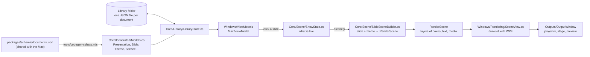

# How MxU Slides for Windows works

This guide walks through the app the way the data flows: from a song on disk to light on the projector. Each section names the files involved, so you can open them alongside. Every file is short enough to read in one sitting.

## The big picture



There are two projects:

- **`src/MxU.Slides.Core`** holds everything that isn't Windows-specific: the document models, the library on disk, turning lyrics into slides, working out what the screen should show, timers and stage-display text. It has no UI code, so it's easy to unit-test (`tests/MxU.Slides.Core.Tests`). It's also the part that mirrors the Mac's Swift code most closely.
- **`src/MxU.Slides.Windows`** is the WPF app: windows, buttons, drawing, video playback, and putting outputs on displays.

That split is the most important design decision. The Mac app has the same shape: its `PresenterCore` and `SlideScene` packages are the "core", and its SwiftUI/Metal code is the "app".

## 1. Documents: what a song *is*

Open `src/MxU.Slides.Core/Generated/Models.cs`. Every type there (a `Presentation`, a `Slide`, a `SlideObject`, a `Theme`, a `Service`) is generated from `packages/schema/documents.json`, the same file the Mac app generates its Swift models from. **Don't edit it by hand.** Change the schema, then run:

```powershell
node apps/windows/tools/codegen-csharp.mjs
```

Because both apps come from one schema, a song saved on Windows has the same field names and values as one saved on the Mac.

A song is a `Presentation` with these parts:

- **`Sections`**: Verse 1, Chorus, …
- **`Slides`**: each one points at its section with `SectionId`. A slide holds `Objects`, usually one text object called "Lyrics".
- **`Arrangements`** (optional): orders of section ids, for example "Verse 1, Chorus, Verse 2, Chorus".
- **`ThemeId`**: the theme it's drawn with.

## 2. The library: saving safely

`src/MxU.Slides.Core/Library/LibraryStore.cs` keeps one JSON file per document under folders such as `Presentations/` and `Services/`. Media files are copied into `Blobs/` and named by their SHA-256 hash, so the same video imported twice is stored once.

The part to study is `AtomicWrite`:

1. It writes to `song.json.tmp` and flushes it to disk.
2. It uses `File.Replace` to swap the new file in, keeping the old one as `song.json.bak`.

If the power goes in the middle, you have either the old file or the new one, never half of each. `TryRead` uses the `.bak` when a file is damaged. Deleting moves files to `Trash/`, and `BackupIfDue` snapshots everything once a day.

## 3. Lyrics → slides

`src/MxU.Slides.Core/Lyrics/` is a line-for-line port of the Mac's lyric code.

- **`LyricTextImporter`** works out what kind of text you pasted (SongSelect, ChordPro, a chord chart or plain lyrics), then pulls out the title, CCLI number and key.
- **`Reflow.Parse`** walks the lines:
  - a line that matches a section name starts a section (the regex is in `Reflow.LabelPattern`);
  - a blank line ends a stanza;
  - each stanza is cut into slides of *N* lines.
- **`Reflow.Build`** turns that into `Sections`, `Slides` and, if a section repeats ("Chorus" pasted twice), an "As Pasted" arrangement.
- **`SongEditing`** (Windows-only) is what the song editor uses. It also keeps a slide's background and notes when you re-edit the words, and parses play orders like `V1, C, V2, C x2`.

The tests in `tests/MxU.Slides.Core.Tests/Lyrics/` were ported from the Mac's tests. Reading them is the quickest way to see the rules.

## 4. Themes: how a slide gets its look

A slide's text box usually has no font or position of its own. It borrows them from a **theme slide** (a "design"). Open `SlideSceneBuilder.cs`, look at `ThemeSlide`, `PlaceholderAssignments` and `ComposedStack`, and follow these steps:

1. Pick the theme slide whose name matches `slide.ThemeSlideName` (for example "Lyrics" or "Lyrics (Lower Third)").
2. Match each text object on the slide to a text **placeholder** in the design, by name first and then in order.
3. Build the stack: the design's shapes (bands, rules), with the slide's text dropped into the placeholders' places.
4. Each text property is resolved as *slide's own style → placeholder's style → theme default*. See `StyledTextFor`.

So changing a song's theme restyles every slide at once, and a slide can still override one thing. `Library/StarterPacks.cs` builds the four starter themes with the Mac's coordinates and colours.

## 5. What's live: `ShowState`

`src/MxU.Slides.Core/Scene/ShowState.cs` is a small state machine for what is on the audience screen:

- the live **slide**, with its presentation and theme;
- live **media** on each layer: background loops, still graphics, foreground videos;
- **overlays** and a **message**.

Some rules worth spotting, all straight from the Mac:

- A background set to *until replaced* stays when the next slide comes up. Foreground media is swept off by the next slide (see `Fire`).
- Each clear (F1–F6) removes one "function" (`Clear(ShowFunction)`).
- `Scene()` produces the picture of all of it as a `RenderScene`.

## 6. The picture: `RenderScene`

`Scene/SceneModel.cs` describes a frame without saying how to draw it. A frame is a canvas (1920×1080) made of layers in order: background media, stills, videos, slide, overlays, alerts. Each layer holds `RenderItem`s, and each item is a text box, a shape or a piece of media with a frame, rotation, opacity and so on.

Because this is just data, the stage display, the slide thumbnails, the audience output and the self-test all build scenes the same way and differ only in where they're drawn.

## 7. Drawing: `SceneView` and `TextLayout`

`src/MxU.Slides.Windows/Rendering/SceneView.cs` is a WPF element that draws a `RenderScene`.

- It scales the 1920×1080 canvas to fit any window, letterboxing the rest.
- Each item becomes its own `DrawingVisual`, so WPF can apply shadows, blur, rotation and skew on the GPU.
- `Present(scene, transition)` crossfades from the old frame to the new one. `Update(scene)` redraws in place without a transition, which is used every second for clocks and timers.
- Text is laid out by `TextLayout.cs`, which copies the Mac's `TextRasterizer` rules:
  - insets, then word wrap;
  - a line-height multiple;
  - auto-shrink: a binary search down to the minimum size, exactly like the Mac;
  - line fills (the coloured bars behind lines) and letter tracking;
  - chords above lines.
- Media goes through `MediaHub.cs`. Images are decoded off the UI thread. Videos use one shared `MediaPlayer` per live item, so the projector and the operator preview show the same frame.

## 8. Outputs on real screens

`Outputs/OutputManager.cs` and `OutputWindow.cs` handle the displays.

- `Infrastructure/Displays.cs` asks Windows for every monitor, including friendly names like "EPSON PJ".
- Each output window is borderless and topmost, covers its monitor exactly, hides the cursor, and is marked *no-activate*, so pressing → still goes to the main window.
- When a display is plugged in or out, `SystemEvents.DisplaySettingsChanged` re-places the windows.
- With one screen, an output becomes an ordinary resizable window: `ShowAsPreviewWindow`.

## 9. The stage display

`src/MxU.Slides.Core/Stage/` is the confidence monitor.

- A **layout** (`ConfidenceLayoutTemplate.cs` has the Mac's six) is a set of text boxes with a `TextLink`: "current slide", "next slide", "clock", "timer", "video countdown", "stage message".
- Every second, `MainViewModel.BuildConfidenceInfo` gathers the live facts, and `LinkedText.ResolvedObjects` fills each box in.
- `TimerSnapshot` and `TimerController` do the timer maths: countdown, count up, count down to a time of day, plus the amber and red warnings.

## 10. The screen you click: MVVM

The WPF part uses **MVVM** (Model–View–ViewModel):

- **Views** (`Views/*.xaml`) are just layout. A button says `Command="{Binding NextCommand}"`.
- **ViewModels** (`ViewModels/`) hold the state and commands. `MainViewModel` is split by area into `.Live.cs`, `.Services.cs`, `.Media.cs`, `.Editing.cs`, `.Stage.cs` and `.Lyrics.cs`.
- `[ObservableProperty]` and `[RelayCommand]` come from CommunityToolkit.Mvvm. A source generator writes the property-changed and command boilerplate for you.

Trace one click from start to finish:

1. Clicking a slide tile calls `SlideTile_Click` in `MainWindow.xaml.cs`.
2. That runs `SlideClickedCommand` → `GoLive` → `Fire`.
3. `Fire` calls `ShowState.Fire` → `RenderOutputs`.
4. `RenderOutputs` calls `Show.Scene()` → `SceneView.Present` on the projector and the preview.

## 11. Keeping it running

- `App.xaml.cs` catches unexpected errors, logs them (`Infrastructure/Log.cs`) and keeps going.
- A `running.marker` file shows when the last session crashed.
- `Infrastructure/SelfTest.cs` drives the real app through a service and checks what's on screen. Run `scripts/self-test.ps1` after any change.

## Things to try, to learn by doing

1. **Add a section name.** Make "Spontaneous" a recognised label. In `Lyrics/Reflow.cs`, add it to the list of names just above `LabelPattern`, then add a test in `ReflowTests.cs` and run `dotnet test`.
2. **Change the default transition time.** Find `TransitionSeconds` in `Infrastructure/AppSettings.cs`.
3. **Add a keyboard shortcut.** Make B clear the slide, ProPresenter-style. Look at `OnPreviewKeyDown` in `Views/MainWindow.xaml.cs`.
4. **Make a stage layout.** Copy `CurrentAndNext` in `Stage/ConfidenceLayoutTemplate.cs`, move the boxes, and add it to `WorkspaceStarters`. It appears in the Stage menu on a new library.
5. **Follow an upstream change.** When MxU changes a Swift file, find its C# twin in [PORTING.md](PORTING.md), compare the two, and port the change.
