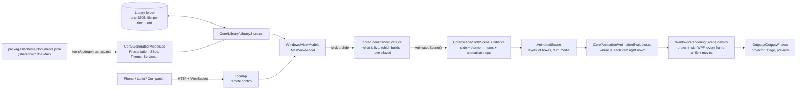

# How MxU Slides for Windows works

This guide walks through the app the way the data flows: from a song on disk to light on the projector. Each section names the files involved, so you can open them alongside. Every file is short enough to read in one sitting.

## The big picture



The code is split into projects:

- **`src/MxU.Slides.Core`** holds everything that isn't Windows-specific: the document models, the library on disk, turning lyrics into slides, working out what the screen should show, the animation engine, timers and stage-display text. It has no UI code, so it's easy to unit-test (`tests/MxU.Slides.Core.Tests`). It's also the part that mirrors the Mac's Swift code most closely.
- **`src/MxU.Slides.Windows`** is the WPF app: windows, buttons, drawing, video playback, and putting outputs on displays.
- **`src/MxU.Slides.LocalApi`** is the remote-control server (section 15).
- **`src/MxU.Slides.PptxImport`** and **`src/MxU.Slides.ProImport`** read PowerPoint and ProPresenter files (section 16).

Each has its own test project under `tests/`. The Core/app split is the most important design decision. The Mac app has the same shape: its `PresenterCore` and `SlideScene` packages are the "core", and its SwiftUI/Metal code is the "app".

## 1. Documents: what a song *is*

Open `src/MxU.Slides.Core/Generated/Models.cs`. Every type there (a `Presentation`, a `Slide`, a `SlideObject`, a `Theme`, a `Service`) is generated from `packages/schema/documents.json`, the same file the Mac app generates its Swift models from. **Don't edit it by hand.** Change the schema, then run:

```powershell
node apps/windows/tools/codegen-csharp.mjs
```

Because both apps come from one schema, a song saved on Windows has the same field names and values as one saved on the Mac.

A song is a `Presentation` with these parts:

- **`Sections`**: Verse 1, Chorus, …
- **`Slides`**: each one points at its section with `SectionId`. A slide holds `Objects`, usually one text object called "Lyrics".
- **`Arrangements`** (optional): orders of section ids, for example "Verse 1, Chorus, Verse 2, Chorus".
- **`ThemeId`**: the theme it's drawn with.

## 2. The library: saving safely

`src/MxU.Slides.Core/Library/LibraryStore.cs` keeps one JSON file per document under folders such as `Presentations/` and `Services/`. Media files are copied into `Blobs/` and named by their SHA-256 hash, so the same video imported twice is stored once.

The part to study is `AtomicWrite`:

1. It writes to `song.json.tmp` and flushes it to disk.
2. It uses `File.Replace` to swap the new file in, keeping the old one as `song.json.bak`.

If the power goes in the middle, you have either the old file or the new one, never half of each. `TryRead` uses the `.bak` when a file is damaged. Deleting moves files to `Trash/`, and `BackupIfDue` snapshots everything once a day.

## 3. Lyrics → slides

`src/MxU.Slides.Core/Lyrics/` is a line-for-line port of the Mac's lyric code.

- **`LyricTextImporter`** works out what kind of text you pasted (SongSelect, ChordPro, a chord chart or plain lyrics), then pulls out the title, CCLI number and key.
- **`Reflow.Parse`** walks the lines:
  - a line that matches a section name starts a section (the regex is in `Reflow.LabelPattern`);
  - a blank line ends a stanza;
  - each stanza is cut into slides of *N* lines.
- **`Reflow.Build`** turns that into `Sections`, `Slides` and, if a section repeats ("Chorus" pasted twice), an "As Pasted" arrangement.
- **`SongEditing`** (Windows-only) is what the song editor uses. It also keeps a slide's background and notes when you re-edit the words, and parses play orders like `V1, C, V2, C x2`.

The tests in `tests/MxU.Slides.Core.Tests/Lyrics/` were ported from the Mac's tests. Reading them is the quickest way to see the rules.

## 4. Themes: how a slide gets its look

A slide's text box usually has no font or position of its own. It borrows them from a **theme slide** (a "design"). Open `SlideSceneBuilder.cs`, look at `ThemeSlide`, `PlaceholderAssignments` and `ComposedStack`, and follow these steps:

1. Pick the theme slide whose name matches `slide.ThemeSlideName` (for example "Lyrics" or "Lyrics (Lower Third)").
2. Match each text object on the slide to a text **placeholder** in the design, by name first and then in order.
3. Build the stack: the design's shapes (bands, rules), with the slide's text dropped into the placeholders' places.
4. Each text property is resolved as *slide's own style → placeholder's style → theme default*. See `StyledTextFor`.

So changing a song's theme restyles every slide at once, and a slide can still override one thing. `Library/StarterPacks.cs` builds the four starter themes with the Mac's coordinates and colours.

## 5. What's live: `ShowState`

`src/MxU.Slides.Core/Scene/ShowState.cs` is a small state machine for what is on the audience screen:

- the live **slide**, with its presentation and theme;
- live **media** on each layer: background loops, still graphics, foreground videos;
- **overlays** and a **message**.

Some rules worth spotting, all straight from the Mac:

- A background set to *until replaced* stays when the next slide comes up. Foreground media is swept off by the next slide (see `Fire`).
- Each clear (F1–F6) removes one "function" (`Clear(ShowFunction)`).
- It remembers where the live slide's **builds** are: which clicks have played and whether the exit has (section 14).
- `AnimatedScene()` produces the picture of all of it, each item carrying its animation steps and clock. `Scene()` is the same picture with everything at rest, used for thumbnails, the self-test and text checks.

## 6. The picture: `RenderScene`

`Scene/SceneModel.cs` describes a frame without saying how to draw it. A frame is a canvas (1920×1080) made of layers in order: background media, stills, videos, slide, overlays, alerts. Each layer holds `RenderItem`s, and each item is a text box, a shape or a piece of media with a frame, rotation, opacity and so on.

Because this is just data, the stage display, the slide thumbnails, the audience output and the self-test all build scenes the same way and differ only in where they're drawn.

## 7. Drawing: `SceneView` and `TextLayout`

`src/MxU.Slides.Windows/Rendering/SceneView.cs` is a WPF element that draws a `RenderScene`.

- It scales the 1920×1080 canvas to fit any window, letterboxing the rest.
- Each item becomes its own `DrawingVisual`, so WPF can apply shadows, blur, rotation and skew on the GPU.
- `Present(scene, transition)` crossfades from the old frame to the new one. `Update(scene)` redraws in place without a transition, which is used every second for clocks and timers, and when a click plays a build.
- While anything moves, it asks the animation engine where every item is on each screen refresh (`OnFrame` → `Render`). It reuses each item's drawing and only changes its position, opacity, wipe or blur. It stops asking as soon as nothing is moving (`AnimationTimeline.IsAnimating`), so a still slide costs nothing.
- Text is laid out by `TextLayout.cs`, which copies the Mac's `TextRasterizer` rules:
  - insets, then word wrap;
  - a line-height multiple;
  - auto-shrink: a binary search down to the minimum size, exactly like the Mac;
  - line fills (the coloured bars behind lines) and letter tracking;
  - chords above lines.
- Media goes through `MediaHub.cs`. Images are decoded off the UI thread. Videos use one shared `MediaPlayer` per live item, so the projector and the operator preview show the same frame.

## 8. Outputs on real screens

`Outputs/OutputManager.cs` and `OutputWindow.cs` handle the displays.

- `Infrastructure/Displays.cs` asks Windows for every monitor, including friendly names like "EPSON PJ".
- Each output window is borderless and topmost, covers its monitor exactly, hides the cursor, and is marked *no-activate*, so pressing → still goes to the main window.
- When a display is plugged in or out, `SystemEvents.DisplaySettingsChanged` re-places the windows.
- With one screen, an output becomes an ordinary resizable window: `ShowAsPreviewWindow`.

## 9. The stage display

`src/MxU.Slides.Core/Stage/` is the confidence monitor.

- A **layout** (`ConfidenceLayoutTemplate.cs` has the Mac's six) is a set of text boxes with a `TextLink`: "current slide", "next slide", "clock", "timer", "video countdown", "stage message".
- Every second, `MainViewModel.BuildConfidenceInfo` gathers the live facts, and `LinkedText.ResolvedObjects` fills each box in.
- `TimerSnapshot` and `TimerController` do the timer maths: countdown, count up, count down to a time of day, plus the amber and red warnings.

## 10. The screen you click: MVVM

The WPF part uses **MVVM** (Model–View–ViewModel):

- **Views** (`Views/*.xaml`) are just layout. A button says `Command="{Binding NextCommand}"`.
- **ViewModels** (`ViewModels/`) hold the state and commands. `MainViewModel` is split by area into `.Live.cs`, `.Services.cs`, `.Media.cs`, `.Editing.cs`, `.Stage.cs` and `.Lyrics.cs`.
- `[ObservableProperty]` and `[RelayCommand]` come from CommunityToolkit.Mvvm. A source generator writes the property-changed and command boilerplate for you.

Trace one click from start to finish:

1. Clicking a slide tile calls `SlideTile_Click` in `MainWindow.xaml.cs`.
2. That runs `SlideClickedCommand` → `GoLive` → `Fire`.
3. `Fire` calls `ShowState.Fire` → `RenderOutputs`.
4. `RenderOutputs` calls `Show.AnimatedScene()` → `SceneView.Present` on the projector and the preview.

## 11. Overlays and masks (Phase 2)

An **overlay** is a free-standing set of objects: a name plate, a scripture lower third, a ticker or cinematic bars. It sits on its own layer above the slide, so it stays up while the slides change underneath. `Library/StarterPacks.cs` builds eleven per theme pack, with the Mac's coordinates and animation steps, and `ShowState.Fire(overlay)` / `DismissOverlay` put them up and take them down. Taking one down plays its Out animation first; it leaves the show once that finishes (`SweepFinishedExits`).

Several overlays use **masks**: text slides in from behind an invisible edge.

- A *matte* is a shape that other objects name in `MaskObjectId`.
- `SlideSceneBuilder.MaskWiring` works out which objects are mattes and which are masked.
- The renderer never draws a matte. It clips each masked item to its matte's shape (`SceneView.MatteGeometry`).

## 12. The canvas editor (Phase 2)

`Scene/EditorGeometry.cs` is a pure port of the Mac's editor maths:

- what's under the pointer, even when the object is rotated;
- the eight resize handles and their minimum size;
- snapping to the slide's edges, its centre and other objects within 8 units;
- marquee selection, and align and distribute.

Its tests are in `tests/.../Scene/EditorGeometryTests.cs`.

`Views/SlideCanvasEditor.cs` is the WPF control. It draws the slide with the real `SceneView`, and an overlay on top draws the selection, handles, guides and marquee and turns mouse gestures into frame changes.

A text box on a themed slide has no position of its own; it sits where its placeholder is. The first time you move it, it gets explicit `X/Y/Width/Height`, an *override*. **Reset to theme** clears them, just like the Mac. The inspector (`ViewModels/ObjectInspectorViewModel.cs`) follows the same rule: it shows the value you see, theme included, and writes any change onto the object itself.

## 13. Hot keys and MIDI (Phase 2)

- `Scene/HotKeyJump.cs` maps letters to sections. The Mac's defaults are A/S/D/F for Verses 1–4, C for Chorus and B for Bridge. `JumpStart` finds the next block of that section in the live arrangement, cycling through repeats.
- `Control/MidiControl.cs` maps MIDI note-on messages to commands with the same notes as the Mac and ProPresenter. For "select by index" commands, the velocity is the number: Trigger Slide with velocity 3 takes slide 3 live. It also parses raw MIDI bytes, including running status and SysEx.
- `Infrastructure/MidiInputService.cs` listens through Windows' own MIDI API (`Windows.Devices.Midi`). MIDI control is off until you switch it on in Settings.

## 14. Animations and builds (Phase 2)

Slides, theme designs and overlays can animate: text rising in, a plate wiping across, words appearing one by one. `src/MxU.Slides.Core/Animation/` is a line-for-line port of the Mac's engine.

- Each object has **steps** (`AnimationStep` in the schema): an In, Out, Emphasis or Morph, with an effect (fade, move, scale, wipe, blur, type, draw…) and a **trigger**: *With Previous*, *After Previous*, *On Click* or *On Dismiss*.
- `AnimationSequence.Groups` sorts the steps into an automatic group (plays when the slide fires), one group per click, and an exit group.
- A text box on a themed slide with no steps of its own borrows its placeholder's (`PlaceholderAnimations.Compose`). That's how every lyric slide gets the theme's animation.
- `ShowState` keeps the clock: when the slide fired, when each click happened, and when an exit or a clear was pressed. `SlideAnimationContext` hands those times to the scene.
- `AnimationEvaluator.Resolve(scene, now)` is a pure function: given the scene and a time, it says what to draw and how each piece is moved. That makes it easy to test (`tests/.../Animation/`) and to freeze at any instant. The self-test takes pictures 0.15, 0.35 and 0.6 s into a lower third.

What **Next** does depends on the slide, as on the Mac:

1. If the slide has click groups left, Next plays the next one and stays on the slide.
2. Then, if it has an exit group, Next plays that.
3. Otherwise Next moves to the next slide.

The starter lyric designs put the words' Out on a click, so the first Next plays the Out and the second moves on. **Alt+→** goes straight to the next slide, skipping any builds left (Option+→ on the Mac). The live label shows "build 1 of 1". Previous takes builds back.

What `SceneView` draws: moves, scales, rotation, fades, wipes with soft edges, blur, typewriter and word-by-word reveals, and line drawing. The 3-D tilt and swing are flattened into a squash. Keystone, burn, glitch and tint need GPU shaders and aren't drawn yet.

## 15. Remote control: the Local API (Phase 2)

`src/MxU.Slides.LocalApi/` is a port of the Mac's LocalAPI package. It's a small web server built into the app (ASP.NET Core's Kestrel), off until you switch it on in **Screens & Settings › Network & API**. It speaks the same REST and WebSocket protocol as the Mac, so the same remotes and scripts work with both.

- `ApiRouteTable.cs` lists every endpoint: `GET /v1/status`, `POST /v1/show/slide`, `POST /v1/show/advance`, `POST /v1/alerts/fire` and the rest. Each one needs a **key** (`Authorization: Bearer mxu_…`) with enough scope: *View* reads, *Control* runs the show, *Edit* also changes the library.
- `ApiScope.cs` stores only salted hashes of keys, in `local-api-tokens.json`. The default key's secret is kept encrypted for your Windows account with DPAPI (`MainViewModel.ApiServer.cs`), so Settings can copy it again.
- The server knows nothing about WPF. It calls the app through one interface, `IApiBridge`, which `ViewModels/MainViewModel.Api.cs` implements. The server always calls it on the UI thread, so the bridge can touch the show directly.
- When the show, timers or library change, `PublishApi` pushes a fresh snapshot to every WebSocket client subscribed to that topic (`/v1/ws?token=…`).
- `/docs` serves a page listing every endpoint, and `/openapi.json` describes them for tools.

Try it: turn the API on, copy the default key, then in PowerShell:

```powershell
$key = "mxu_paste_your_key_here"
Invoke-RestMethod http://localhost:6980/v1/status -Headers @{ Authorization = "Bearer $key" }
Invoke-RestMethod http://localhost:6980/v1/show/advance -Method Post -Headers @{ Authorization = "Bearer $key" } -ContentType application/json -Body '{"steps":1}'
```

## 16. Importing PowerPoint and ProPresenter (Phase 2)

Both importers are ports of the Mac's and save straight into the `LibraryStore`. They run on a background thread and report progress, which the notice bar shows.

- **PowerPoint** (`src/MxU.Slides.PptxImport/`): unzips the `.pptx` safely (no `..` paths, no zip bombs), reads the slide XML with its master and layout inheritance, maps shapes, text, pictures, videos and animations, and bakes textures into PNGs. Importing the same file again replaces it in place.
- **ProPresenter 7** (`src/MxU.Slides.ProImport/`): ProPresenter stores documents as *protocol buffers*. `Proto/` holds the open `.proto` descriptions of that format (MIT licensed), and the build turns them into C# classes. The importer maps presentations with their groups, arrangements and media, playlists (each becomes a service), themes, props, messages and stage layouts. Before replacing something already in your library, it asks.
- **`.pro`** is also ChordPro's extension. `MainViewModel.IsProPresenterFile` tells them apart: ProPresenter's is binary, ChordPro's is text.
- **A whole ProPresenter library**: **Screens & Settings › Import ProPresenter library…** opens at `Documents\ProPresenter`. Run it again later to pick up changes; anything you've edited here is kept.

## 17. Keeping it running

- `App.xaml.cs` catches unexpected errors, logs them (`Infrastructure/Log.cs`) and keeps going.
- A `running.marker` file shows when the last session crashed.
- `Infrastructure/SelfTest.cs` drives the real app through a service and checks what's on screen. It covers lyrics, builds, overlays, video, the Local API (over real HTTP and a WebSocket) and both importers. Run `scripts/self-test.ps1` after any change.

## Things to try, to learn by doing

1. **Add a section name.** Make "Spontaneous" a recognised label. In `Lyrics/Reflow.cs`, add it to the list of names just above `LabelPattern`, then add a test in `ReflowTests.cs` and run `dotnet test`.
2. **Change the default transition time.** Find `TransitionSeconds` in `Infrastructure/AppSettings.cs`.
3. **Add a keyboard shortcut.** Make B clear the slide, ProPresenter-style. Look at `OnPreviewKeyDown` in `Views/MainWindow.xaml.cs`.
4. **Make a stage layout.** Copy `CurrentAndNext` in `Stage/ConfidenceLayoutTemplate.cs`, move the boxes, and add it to `WorkspaceStarters`. It appears in the Stage menu on a new library.
5. **Script the show.** Turn on the Local API, then write a PowerShell loop that calls `POST /v1/show/advance` with `{"steps":1,"settled":true}` every 5 seconds: an instant announcement loop.
6. **Slow an animation down.** In `Library/StarterPacks.cs`, find `TextIn` and double its duration. Delete `starter-revision.txt` in your *test* library so the themes are rebuilt, then fire a lyric slide.
7. **Follow an upstream change.** When MxU changes a Swift file, find its C# twin in [PORTING.md](PORTING.md), compare the two, and port the change.
