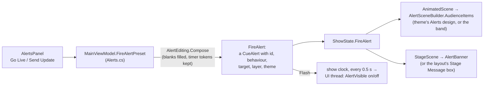

# Operator panels (Phase 5)

This is what an operator works with during a service, on the right of the main window, top to bottom:

1. **The live toolbar**, above the preview: which screen the preview shows, a button to pop the preview out into its own window, the **look** (output preset) chip, and two **transition chips** (media and slides).
2. **The live preview**, Previous/Next and the Clear buttons (the Clear buttons and the video strip belong to the show work, not this one).
3. **Screens**: every screen with its own **Live / Off** switch.
4. **Stage**: each stage screen (confidence monitor) with the layout it shows, a preview of one of them, and the stage message.
5. **Timers**: timers in folders, with warning colours, limits and quick lengths.
6. **Alerts**: saved messages with blanks to fill in, sent to the stage, the room or both.

Each panel is its own control in `src/MxU.Slides.Windows/Views/Operator/`, built in code like the automation editors (`EditorKit`), and placed in `Views/MainWindow.xaml` with one line. Each one finds the app's view model through its `DataContext` and listens to one or two events from it, so it redraws only when something it shows changes. As elsewhere, the **rules** live in Core, with unit tests, and the panels only draw.

The Mac files these come from are `Sources/Modules/AlertsModule.swift`, `TimersModule.swift`, `ConfidenceModule.swift`, `OutputsModule.swift`, `Sources/LivePanel.swift`, `OutputPresetChip.swift`, `ConfidenceMonitorController.swift`, `TimersController.swift` and the transition chips in `AppShell.swift` / `PerformanceHUD.swift`.

## 1. Alerts

### What you can do

- **+ › New Alert** makes "New alert {message}". Click a row to open its editor:
  - **Name** and **Text**. Words in braces, like `{plate}`, are **blanks**: the row shows a box for each one, and you fill them in before sending ("Car {plate}, your lights are on").
  - **Output location**: Confidence Monitors, Audience Screens, or both.
  - For the audience: the **layer** it draws on (Alerts unless you pick another, so an output preset can route it) and the **theme** that dresses it. A theme with a design called "Alerts" puts the message in that design's text box, with its shapes and animations. Without one it is the amber band.
  - **Behaviour**: **Flash** blinks twice a second; **Persist** holds steady.
- **Go Live** sends it (Enter in a blank does too). While it's up the button reads **Turn Off**, and **Send Update** resends it with the blanks as they read now.
- `{Sermon}`, where Sermon is a timer's name, isn't a blank: it stays in the message and the outputs show the timer counting.
- Folders (**+ › New Folder**), search, and a right-click menu: Move up, Move down, Folder ›, Delete. The Mac reorders by dragging.
- **Imported ProPresenter messages are alerts too.** A library import turns each message into an alert (its tokens become blanks, its template's theme gets an "Alerts" design), and it appears in the list like any other, ready to fire by hand.
- The **stage message** box in the Stage panel is the Mac's Confidence module "Stage Message": a steady message to the stage (tick **Audience too** to show the room as well).

### How it works

- **Core:** `Core/Stage/AlertEditing.cs` holds the module's rules (which tokens are blanks, composing the message, the menu titles, what's stored as absent). `Core/Stage/AlertLibrary.cs` makes, changes and deletes alerts and keeps the **alert board** (the folders and order, a `ControlBoard` document with id `alert-board`, as on the Mac) in step. `Core/Stage/AlertScene.cs` draws an alert for the audience.
- **ShowState** (`Core/Scene/ShowState.cs`) now keeps the whole alert (`LiveAlert`), not just its text: its id, behaviour, target, layer and theme. It draws it on its own layer, gives a themed one the alert's clock so its In and Out animations play, and, like a slide or an overlay, lets a themed alert play its Outs when it is taken down (`Clear(…, atHostTime)`, then `SweepFinishedExits`). `AlertVisible` is the Flash off-beat.
- **The app:** `ViewModels/MainViewModel.Alerts.cs`. `FireAlert` is the Mac's `ServiceControls.fireAlert`; every way of firing an alert goes through it now: the panel, a slide action or combo, MIDI, a timeline cue and the Local API. (Before, a combo or MIDI ignored the alert's behaviour, layer and theme.)
- **Flash** runs on the show clock (`ShowTimeProvider.Shared`), never the shared thread pool. The clock's callback only hands the blink to the UI thread, which flips `AlertVisible` and redraws. When the alert stops flashing, the clock stops and the alert is left visible.
- What you type in the blanks is kept while the app runs (`AlertBlanks`), not saved, as on the Mac.

## 2. Timers

### What you can do

- **+** adds a countdown of 5, 10, 15, 20, 30, 45 or 60 minutes, a **Custom…** length, a **Countdown to Time…** (it offers the next half hour), a **Count Up Timer**, or a **folder**.
- Each row shows the readout (green while running, in a warning's colour once one is reached), the timer's name, start/pause, reset (a countdown to a time re-arms for the next day) and a progress bar.
- Click a row to edit it: **Name**; **Length** (HH:MM:SS) for a countdown, **Until** (a time) for a countdown to a time, or **Count to** (a limit) for a count up; and its **warnings**: at so many minutes and seconds left, turn a colour (Amber, Red, Orange, Yellow, Green, Blue, Purple, White). **+** adds one at a minute left.
- A folder row shows the folder's most urgent running timer. Right-click a timer for Duration ›, Move up/down, Folder › and Delete.

### How it works

- `Core/Stage/TimerBoard.cs` is a port of the Mac's `TimerBoard`: the board holds only **timer ids** and folders, in order. `TimerController` now owns one, and keeps it in step as timers are added and removed (`Reconcile`). The timers list is always kept in board order, so "the first timer" a stage layout shows is the first on the panel.
- `Core/Stage/TimerPanel.cs` holds the panel's rules: the quick lengths, the editor's fields and what **Apply** changes (only what changed: re-applying a running countdown's length doesn't restart it), the warning palette, and how rows and folders read.
- `Core/Stage/ServiceTrackingTimers.cs` is the Mac's set of read-only "Service Tracking" timers (item, section, service, video and timeline, remaining and elapsed) and how they are merged into their own folder. The folder and the merge are here; what feeds them on the Mac (`ServiceTimingController`, the service's planned lengths) isn't on Windows yet.
- **Saving:** `timers.json` as before, and the board in `timer-board.json` beside it, in the Swift encoding of `TimerBoard` (`{"nodes":[{"timer":{"_0":"…"}}, {"folder":{"_0":{…,"timerIDs":[…]}}}]}`). Both belong to this PC, as the Mac keeps them in its preferences.
- **Readouts** change four times a second. The panel updates the digits, colours and bars in place on `TimersTicked`; it only redraws the rows when something else changed (a name, a length, a folder). That way a timer started by a slide action doesn't wipe out what you were typing in another timer's editor.

## 3. Screens and looks

- **Live / Off, one screen at a time.** `Outputs/OutputManager.cs` keeps a set of screens the operator has switched off. An Off screen's outputs show black; a display left with nothing to show is uncovered (its window hidden); its preview window closes. Its **picture carries on**, so a recording or stream of that screen, or a preview of it, keeps going: Off only takes it off the glass. Switching it on puts it back on its display or device, or (with no device) opens it in a preview window, as the toolbar does on a one-screen laptop.
- The toolbar's **Audience** and **Stage** buttons use the same switch for every screen with that job. Outputs set not to come on at launch start Off, so switching one screen on doesn't bring the rest.
- **The look chip** (and the Screens panel's menu) lists *Default — All Layers* and every output preset, the active one ticked, as the Mac's `OutputPresetMenu`. Picking one calls `ActivateOutputPreset`, so looks the new preset drops still play their Outs first. A preset switched by a slide action, a combo, MIDI or the API updates the chip too. Its name is shortened to 13 characters (`Core/Outputs/OutputPresetMenu.cs`).
- The gear opens the Screens window. There is no output preset editor on Windows, so the chip's last item opens the Screens window too.

## 4. A layout for each stage screen

On the Mac each confidence screen picks its own layout: the band's monitor shows chords, the pastor's shows the clock and the next slide. Windows used to have one layout for every stage screen.

- `Core/Stage/ConfidenceScreenLayouts.cs` is the assignment half of the Mac's `ConfidenceMonitorController`: screen → layout id. A screen with nothing chosen shows the **built-in layout**; a layout deleted from the library falls back to it.
- It is saved in `settings.json` in the Mac's shape and under the Mac's name: `"confidence.screenLayouts": { "UPPER-CASE-SCREEN-UUID": "layout-id" }`.
- **Moving over:** the first time, every confidence screen starts on the layout they all shared (`StageLayoutId`, Classic unless changed), so nothing on stage changes when you update.
- `RenderStage` (`MainViewModel.Stage.cs`) draws one scene per layout in use and hands each stage screen its own (`OutputManager.PresentStage`). Recordings of a stage screen follow, because they copy what the screen shows.
- The **Set Confidence Layout** action now sets the screen it names, or every stage screen; a ProPresenter library import gives each screen the layout ProPresenter gave it.
- Click a stage screen's name in the panel to preview that one below.

## 5. The preview and pop-out windows

- The chip above the preview picks what it shows: any **screen** (exactly what that screen shows: its look, its layers, the stage for a stage screen) or any **stage layout**, even one no screen is showing yet. It is remembered as `"preview.screenTarget"` (a screen id, or `layout::` and a layout id: `Core/Outputs/PreviewTargets.cs`).
- **⧉ › Open in Window** opens the preview in its own window; **Open Preview Window ›** opens any other screen or layout. Drag them onto a second monitor in the booth. Each window keeps following its target until you close it (`Views/Operator/PreviewPopOutWindow.cs`). It opens at its target's shape (a tall layout opens tall).
- How the pictures get there: after the outputs are given a new audience scene, `ShowPreviews` gives each preview of an audience screen `OutputManager.Picture(screen)`. After the stage is drawn, `ShowStagePreviews` does the same for previews of a stage screen or a layout. Previews of the stage use the stage's video players, so a video is in step with its screen.

## 6. Present settings and the transition chips

- **Settings › Present** has the Mac's two settings, with its wording (`Views/Operator/PresentSettingsSection.cs`). Both save at once and take effect at once.
  - **Show a repeated chord-only section once** (`present.emptyRepeatsOnce`, off by default): an Interlude the order plays twice in a row, with nothing but chords on it, is one slide. On the Mac every arrangement read defaults to this setting; here `SlideSceneBuilder.EmptyRepeatsOnce` plays the same part, so the slide grid, Next, hot keys and timelines all follow.
  - **Confidence NEXT skips blank slides** (`confidence.nextSkipsBlankSlides`, on by default): the stage's NEXT shows the next slide with words.
- **The transition chips** show and change the media and slide **room defaults**: the same settings as Settings › Transitions. A chip opens a small panel with the Mac's five choices (Cut, Dissolve, Fade Black, Fade White, Blur Dissolve) and the length (`Core/Animation/TransitionChips.cs`). Fade White and Blur Dissolve are new room defaults on Windows, so Settings › Transitions lists them too.

## Learnt the hard way

- **The Settings window couldn't open.** Its sliders report a change while the window is still loading (setting a slider's Minimum moves its value), before the labels under them exist, and the handler threw. The app's error catcher kept the show running and put "Something went wrong" in the problem bar, but the window never appeared. The self-test never opened that window; now it does, and the handlers check the label is there.
- **The main window's menus don't draw ticks.** The app's menu style has no check mark, so a ticked `MenuItem` looks like any other. `OperatorKit.Choice` draws its own tick column.
- **One line in someone else's XAML.** A XAML namespace can be declared on the element that uses it (`<v:PresentSettingsSection xmlns:v="…" />`), so adding a control to the Settings window is one line, not two edits far apart.
- **Redrawing a panel while someone types loses their typing.** That's why the Timers panel only redraws for real changes, and why the editors keep what you typed until you press Apply or Enter.
- **"Off" shouldn't stop the picture.** The first try blanked the screen's scene, which would have blacked out a recording of that screen too. The outputs are blanked instead; the screen's picture carries on.
- **A PC on the software copy sends fewer pictures.** The self-test waits for a picture that shows a change instead of a fixed time.

## Things to try

1. **A car-park call.** Add an alert "Car {plate}, your lights are on", set it to Confidence and Audience, type a plate and press Go Live. Change the plate and press Send Update.
2. **Give an alert a design.** Make a theme with a design called "Alerts" (a band and one text box with an Out animation), choose it as the alert's theme, and press Turn Off: the band plays its Out before it goes.
3. **Two stage screens.** In Screens & Settings › More screens, add a screen with the Stage job. In the Stage panel give it a different layout, then point the preview chip at it.
4. **Pop out the preview** and drag it to another monitor. Switch the Audience screen Off in the Screens panel: the pop-out still shows what the screen would show.
5. **Read the rules.** `TimerPanel.Apply` is what the timer editor's Apply does; its tests in `TimerPanelTests.cs` read like a list of what the editor promises.

## Different from the Mac

- **Reordering:** the Mac drags alerts and timers; Windows has Move up, Move down and a Folder › menu.
- **No undo** for alert and timer edits or board moves (the Mac's `MoveUndoJournal`).
- **Service Tracking** timers aren't fed yet (the Mac's `ServiceTimingController` and Service Tracking module): the folder and the merge are ported, nothing sends them.
- **Live / Off** is per screen. The Mac's switches are for displays shown directly ("System Displays — Direct"), which Windows doesn't have.
- **No stage layout editor**, so the Stage panel has no "Edit Layout in Library", and its layout menu is a flat list (the Mac groups layouts by folder).
- **No output preset editor**: the look chip's last item opens the Screens window instead of "Edit Output Presets…".
- **The main preview stays 16:9**; a tall layout is pillarboxed there. Pop-out windows open at the target's shape.
- **The transition chips** show their length in their caption and change it in their panel; the Mac also shows a slider in the header when it is wide.
- **Volunteer (run-only) mode** isn't on Windows, so the panels are never locked.
- **The alert editor** saves a name or phrase when you press Enter or leave the box (the Windows editors' rule), not on every key as the Mac does.

## For the integrator

### Changes to shared files

- `Views/MainWindow.xaml`: one line at the top of the live panel (`<v:LiveToolbar />`); the Stage, Timers and Message panels replaced by four lines (`ScreensPanel`, `StagePanel`, `TimersPanel`, `AlertsPanel`).
- `Views/MainWindow.xaml.cs`: the `StagePreview` lines in the constructor removed (the Stage panel sets it), and the timer and message handlers (`TimerName_MouseDown`, `AlertText_KeyDown`) removed.
- `Infrastructure/SelfTest.cs`: one line, `await OperatorCheck();`, after `BroadcastExtrasCheck`.
- `Views/SettingsWindow.xaml`: the two transition sliders go to 3 s (the Mac's range); one line adds the Present section. `SettingsWindow.xaml.cs`: Fade through white and Blur dissolve in the transition list; the slider handlers no longer throw while the window loads.
- Not on the shared list, but touched: `MainViewModel.Live.cs` (F6 plays a themed alert's Outs; the room defaults map the two new kinds; one line hands the audience scene to the previews), `Outputs/OutputManager.cs` (per-screen stage scenes and Live/Off), `Infrastructure/AppSettings.cs` (four settings with the Mac's names; two `OutputTransition` kinds), `MainViewModel.Actions.cs`, `.Api.cs`, `.Import.cs`, and in Core `Scene/ShowState.cs` (the alert region), `Scene/SlideSceneBuilder.cs` and `Scene/HotKeyJump.cs` (the empty-repeats default), `Stage/TimerController.cs` (the board) and `Automation/Timelines/ITimelineHost.cs`.

### HOW-IT-WORKS.md

- Section 16's Phase 4 note ("the first one ProPresenter assigns becomes the stage layout (this app has one stage layout for every confidence screen)") is out of date: each stage screen has its own layout now, and an import gives each screen the one ProPresenter gave it. Section 9 can say so too.
- Section 26's self-test list can add "the operator panels (alerts, timers, screens, stage layouts, previews, looks, present settings)".

### PORTING.md rows to add

Ported line by line:

| Swift | C# |
|---|---|
| `Sources/Modules/AlertsModule.swift` (the rules: tokens, timer identity, locations, layers, themes, commit) | `MxU.Slides.Core/Stage/AlertEditing.cs` |
| `Sources/AppModel.swift` (`createAlertPreset`, `updateAlertPreset`, `alertBoard`, `updateAlertBoard`) | `MxU.Slides.Core/Stage/AlertLibrary.cs` |
| `SlideScene/…/ConfidenceScene.swift` (`AlertSceneBuilder.audienceItems`), `ShowState.swift` (`liveAlert`, the alert's clock, `clearAlert`, the alert's layer) | `MxU.Slides.Core/Stage/AlertScene.cs`, `Scene/ShowState.cs` |
| `Sources/ServiceControls.swift` (`fireAlert`, `show(alert:)`, `fire(alertPreset:)`, `dismissAlert`, `syncFlashClock`, `nextSkipsBlanks`) | `MxU.Slides.Windows/ViewModels/MainViewModel.Alerts.cs`, `MainViewModel.Stage.cs` |
| `SlideScene/…/TimerBoard.swift`, `ServiceTrackingTimers.swift` | `MxU.Slides.Core/Stage/TimerBoard.cs`, `ServiceTrackingTimers.cs` |
| `Sources/TimersController.swift` (the board: `moveTimer`, `moveFolder`, `addFolder`, `renameFolder`, `removeFolder`, `setSystemTimers`) | `MxU.Slides.Core/Stage/TimerController.cs` |
| `Sources/Modules/TimersModule.swift` (the rules: quick lengths, the editor's apply, warnings, rows) | `MxU.Slides.Core/Stage/TimerPanel.cs` |
| `Sources/ConfidenceMonitorController.swift` (assignments, apply, pruning, storage) | `MxU.Slides.Core/Stage/ConfidenceScreenLayouts.cs`, `MainViewModel.Stage.cs` |
| `PresenterCore/…/Library/PreviewTargetLogic.swift`, `Sources/LivePanel.swift` (`PreviewTargets`) | `MxU.Slides.Core/Outputs/PreviewTargets.cs` |
| `Sources/Modules/OutputsModule.swift` (`OutputPresetMenu`), `Sources/OutputPresetChip.swift` | `MxU.Slides.Core/Outputs/OutputPresetMenu.cs` |
| `Sources/PerformanceHUD.swift` (`TransitionChip`), `AppShell.swift` (`transitionChips`) | `MxU.Slides.Core/Animation/TransitionChips.cs` |
| `SlideScene/…/SlideSceneBuilder.swift` (`emptyRepeatsOnce`) | `MxU.Slides.Core/Scene/SlideSceneBuilder.cs` (`EmptyRepeatsOnce`) |

The Mac tests ported: `TimerBoardTests.swift`, `ServiceTrackingTimersTests.swift`, the `PreviewTargetLogic` cases of `MultiViewTests.swift`, the alert cases of `ConfidenceSceneTests.swift`, `ShowStateTests.swift` (`alertAnchorRidesItsItems`) and `SlideSceneBuilderTests.swift` (`emptySectionPlayedTwiceInARowShowsOnceOnlyWhenChosen`).

Re-implemented for Windows:

| Mac | Windows |
|---|---|
| `Sources/Modules/AlertsModule.swift`, `TimersModule.swift`, `ConfidenceModule.swift`, `OutputsModule.swift`, `Sources/LivePanel.swift` (preview, screen picker, Open in Window), `OutputPresetChip.swift`, `AppShell.swift` (transition chips), `SettingsView.swift` (present.emptyRepeatsOnce, present.nextSkipsBlanks) | `MxU.Slides.Windows/Views/Operator/*` (`AlertsPanel`, `TimersPanel`, `StagePanel`, `ScreensPanel`, `LiveToolbar`, `PreviewPopOutWindow`, `PresentSettingsSection`, `OperatorKit`), `ViewModels/MainViewModel.{Alerts,Timers,Outputs,Present}.cs` |

Windows-only:

- `TimerBoard.StepTimer`, `StepFolder`, `PutInFolder` (Move up / Move down / Folder ›) and the same for alerts through `BoardSteps`.
- `ConfidenceScreenLayouts.Migrated` (the one shared stage layout becomes each screen's).
- Per-screen Live / Off in `Outputs/OutputManager.cs`.
- `Infrastructure/SelfTest.Operator.cs`.

### "Not ported yet": add

- **Operator panel extras:** dragging alerts and timers (Move up/down and Folder › instead); undo for alert and timer edits and board moves; the Service Tracking module and `ServiceTimingController` (its timers' folder and merge are ported, nothing feeds them); volunteer (run-only) mode; the Stage panel's "Edit Layout in Library" and folder submenus (no stage layout editor); the preview keeping its target's shape in the main window (pop-outs do); the transition chips' inline slider; displays shown directly, so Live / Off is per screen.

### "Not ported yet": change

- **Looks, Windows differences:** "There is no output preset editor on Windows yet" still holds; the look chip switches presets, and its last item opens the Screens window.
