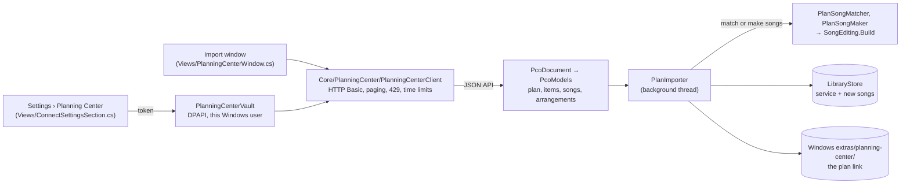
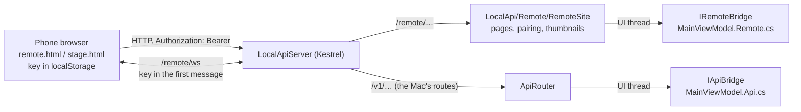

# Connect: Planning Center and the browser remote (Phase 6)

Two things a large church uses every week, neither of which the Mac app has here:

1. **Planning Center import.** Most churches plan their services in Planning Center Services. The worship leader builds the plan (songs, keys, the welcome, the sermon, lengths) days ahead. Importing it turns that plan into a service, so the operator doesn't type it all in again on Sunday morning.
2. **A browser remote and a stage view.** Any phone or tablet on the church Wi-Fi can run the show (Next, Previous, tap a slide, the clears, timers, the stage message), and any spare screen with a browser can be a confidence monitor. Nothing to install: it's a web page the app serves itself.

Both build on things that already exist: the library and the lyrics-to-slides pipeline (sections 2 and 3 of [HOW-IT-WORKS.md](../HOW-IT-WORKS.md)), and the Local API server (section 15).

## 1. Planning Center

### What you can do

- **Connect.** Planning Center lets a church make a *Personal Access Token* for its own scripts: sign in at [api.planningcenteronline.com](https://api.planningcenteronline.com), open *Personal Access Tokens*, and make one. It's a pair of strings, an **Application ID** and a **Secret**. In **Screens & Settings › Planning Center**, paste both and press **Connect**. The app checks them with Planning Center first and shows the church's name; only a token that works is kept.
- **Import a plan.** **Service ⋯ › Import from Planning Center…** (or **Import a plan…** in Settings) opens a window with the church's service types on the left and the chosen type's plans on the right: upcoming ones first, then the last two. Pick one and press **Import**. The new service opens, and the notice bar says what came in: "10 rows · 2 songs from your library · 2 new songs made from Planning Center's lyrics · media to add: 5 Minute Countdown (Dark)".
- **Update it.** Plans change during the week. **Service ⋯ › Update from Planning Center** (or importing the same plan again) brings the service up to date *in place*: no second copy, and nothing the operator changed is lost. The window marks a plan that's already been imported, and its button reads **Update service**.
- **Disconnect** removes the token from this PC. Services already imported stay.

What each plan item becomes:

| In Planning Center | In the service |
|---|---|
| A header ("Worship") | A header row |
| A song | A row playing a library song: the church's own copy if the library has one, otherwise a new song made from the arrangement's lyrics |
| A song with no words in Planning Center, or one the library has twice under the same name | An unlinked row ("Song to link: not in the library"), for the operator to deal with |
| Media (a countdown, a video) | A row saying "Media to add": the file isn't downloaded |
| Any other item (the welcome, the sermon) | A row with its length ("Planning Center · 30:00") |

Every row gets the item's **length** as its Duration, which the service-tracking timers (section 36) count down. The plan's **date** becomes the service's date, read in this PC's time zone (Planning Center sends it in UTC, so a 7 pm Sunday service in Chicago would otherwise land on Monday).

### How it works

The code splits the same way as the rest of the app: everything that can be tested without a window is in Core (`src/MxU.Slides.Core/PlanningCenter/`); the app (`ViewModels/MainViewModel.PlanningCenter.cs`) only stores the token, calls Core and refreshes the screen.

**Talking to Planning Center** (`PlanningCenterClient.cs`). Planning Center's API speaks *JSON:API*, a common convention: every answer has `data` (what you asked for), `included` (things it points at, pulled in with `include=song,arrangement,…` so one request is enough), and `links.next` when there are more pages. `PcoDocument.cs` reads that shape; `PcoModels.cs` turns resources into plain records (`PcoPlan`, `PcoPlanItem`, `PcoSong`, `PcoArrangement`), reading each attribute by name, so a field Planning Center adds or leaves out never breaks anything.

- *Authentication* is HTTP Basic: the Application ID and Secret, joined by a colon and base64-encoded, in the `Authorization` header of every request.
- *Paging*: `GetAllAsync` follows `links.next` until there's none.
- *Rate limits*: Planning Center allows about 100 requests every 20 seconds. Past that it answers **429 Too Many Requests** with a `Retry-After` header saying how many seconds to wait. The client waits exactly that (twice at most, and never more than a minute), telling the window "Planning Center is busy: waiting 5 s…".
- *Time limits*: each request, including reading its answer, gives up after 20 seconds. The window's Close cancels whatever is still waiting.
- *Errors* become sentences for the operator, keyed by what to do about them (`PlanningCenterProblem`): a 401 says to check the token, a 403 to ask for Services access, a 5xx is tried once more, no network says so.

**Matching songs** (`PlanSongs.cs` → `PlanSongMatcher`). The importer reuses the church's own slides whenever it can:

1. By **CCLI number**: the same number is the same song. If several copies share it, the one whose title and author fit is taken.
2. Then by **title**, ignoring case and punctuation (`ServiceLinkLogic.Normalize`, ported from the Mac: "Way-Maker (Live)" reads "way maker live"). Two *different* songs can share a title ("Holy"), so when several fit, the **author** must pick exactly one. Otherwise nothing is guessed: the row is left for the operator, and the notice says why.

**Making songs** (`PlanSongMaker`). A song the library lacks is made from Planning Center's arrangement through the same pipeline as typing lyrics into the song editor (`SongEditing.Build`): section labels become sections, stanzas become slides. The lyrics are used when there are some, as they're what the room should read; the chord chart only when there are none (it can hold chord-only bars and layout commands like `COLUMN_BREAK`, which are dropped). The arrangement's **sequence** ("Verse 1, Chorus 1, Verse 2, Chorus, Bridge") becomes an arrangement of the song with Planning Center's name, and the row plays it. Each label is read like a typed play order, so "V1" and "Chorus 1" both find their sections. New songs go in a **Planning Center** folder, with the CCLI number and author, so the next import finds them.

**Where the link is kept.** The library is shared with the Mac, so the import may not invent new fields. The shared format already has places for a row's Planning Center details (`mxuPcoItemId`, `mxuPcoSongId`, `mxuPcoArrangementId`, `mxuPcoKeyId`, `mxuSongTitle`, `mxuCcliNumber`, `mxuSongAuthor`, `mxuSongKey`, `mxuNotes`, …), and the import fills them in. It has no place for the *plan's* id: the service's `mxuPlanHexId` belongs to MxU's own planning server. So the plan id, and a snapshot of what the import produced, are kept as a **Windows extra** (`Core/Library/WindowsExtras.cs`): `Windows extras/planning-center/<service id>.json` beside the library, where the Mac never looks (`PlanLink.cs`).

**Importing again** (`PlanImporter.Merge`). This is the interesting part. For every row there are three versions: what the last import set (the snapshot), what the row says now, and what Planning Center says now. Comparing them tells the operator's changes apart from the planner's:

| Last import | Now | Planning Center | Result | Why |
|---|---|---|---|---|
| 240 s | 240 s | 300 s | 300 s | only the planner changed it |
| Welcome | Welcome to church | Welcome | Welcome to church | only the operator changed it |
| "Open Skies" was there | the operator deleted it | still there | stays deleted | deleting is a change too |
| — | — | a new item | added, after the item it follows in the plan | |
| "Steady Ground" | untouched | gone | removed | |
| "Steady Ground" | renamed by the operator | gone | kept | it's theirs now |

A few more rules: a row keeps the library song it plays while Planning Center's song for it is unchanged (so a second copy appearing in the library can't move it); rows the operator added stay after the row they followed; the order follows the plan's unless the operator reordered the plan's rows; row ids never change, so service versions and timelines still find them. The snapshot always records *Planning Center's* values, never the merged ones, so an operator's change is still recognised as theirs at the next import, and the one after.

**Secrets.** The token is as good as a password to the church's Planning Center.

- `PlanningCenterVault` encrypts it with Windows' DPAPI for the current Windows user, in the local data folder (`%LOCALAPPDATA%\MxU Slides\Connect`), never in the library, settings or a backup.
- It goes only in the `Authorization` header, only to the address the client was made with. Redirects aren't followed, and a `links.next` pointing at another site is refused, because either would carry the header somewhere else.
- The log gets "Planning Center: GET service_types?… → 200" and nothing more. `PcoCredentials.ToString()` prints "(hidden)", so even a mistaken `Log.Info($"{credentials}")` can't leak it.
- Tests check all of this, including that the secret and its base64 form appear in no request address, log line or message.

### Not done (yet)

- **Media files aren't downloaded.** Planning Center hands out a media file through a short-lived link from its file storage. Downloading would mean another site (so the token's rules above don't cover it), files of any size and type, and a wait during the import. So media items are listed as "Media to add", and the operator adds the file from the Media tab.
- **Signing in with a Planning Center account** (OAuth) needs the app registered with Planning Center by its publisher; a Personal Access Token works for one church today.
- **Nothing is written back** to Planning Center, and plan times, people and the song's planned key (it's kept on the row as `mxuSongKey`, but not applied to the song's display key) aren't used yet.
- **Real Planning Center hasn't been tried here**, as it needs a church's token. The tests and the self-test use recorded answers written from Planning Center's documentation. To try it: make a Personal Access Token, connect in Settings, and import next Sunday's plan. If anything reads wrongly, the log (Settings › Open logs) lists each request and its status.

## 2. The browser remote and the stage view

### What you can do

1. Turn on **Screens & Settings › Network & API** and press Save. Open Settings again: **Browser remote** now shows this PC's address (`http://192.168.1.20:6980/remote`) and a QR code of it.
2. On a phone on the same Wi-Fi, scan the code (or type the address). The page asks for a pairing code.
3. On the PC, choose **Control the show** or **View only**, and press **Pair a phone**. A 6-digit code appears for five minutes. Type it on the phone.

The phone now has its own key, listed under **Manage keys** as "Browser remote: iPhone", where it can be revoked; a revoked phone goes back to the pairing screen. A paste-a-key option is there too, for a key made in Manage keys.

The **remote** (`/remote`) has four tabs on a phone, and on a tablet or laptop shows the service, the slides and the messages side by side:

- **Service**: the rows, the live one outlined in red. Tap a row to see its slides; **Go** takes it live.
- **Slides**: thumbnails of the live (or chosen) item's slides, with their groups' colours. Tap one to go live. **Follow live** keeps it on whatever is live.
- **Timers**: start, pause and reset the church's timers; the automatic service-tracking timers are listed after them.
- **Messages**: send or take down the stage message, and send any saved alert, filling in its `{blanks}` first.
- Always at the bottom: **Prev**, a big **Next**, and the clears (Slide, Media, Overlays, Alerts, Clear all). On a keyboard, → and ← (and a presenter clicker) work too.

With a **View only** key the page shows everything but its buttons are switched off, and the app would refuse them anyway.

The **stage view** (`/remote/stage`) is for a TV by the stage or the pastor's tablet: the clock, up to three timers, the current slide's words as big as they fit, the next slide, and the stage message in an amber band when there is one. Touch it (or move the mouse) for a **Full screen** button. A View only pairing is enough.

### How it works

- **The pages** are four small files (`LocalApi/Remote/Web/`: HTML, CSS and plain JavaScript, no frameworks) built into the DLL as resources. Nothing comes from the internet, so they work on a church network with no outside access. The HTML is served with a strict *Content-Security-Policy*: only the app's own scripts run, and the page can't be framed by another site.
- **Running the show** uses the Mac's own endpoints (`/v1/show/advance`, `/v1/show/slide`, `/v1/alerts/fire`, `/v1/timers/{id}/play`…), so every rule they have (scopes, errors, builds) applies unchanged. The Windows-only routes live under `/remote` and do only what those can't: `GET /remote/service` (the service with every row's slides, in the Mac's own `APIServiceSnapshot` shape), `/remote/alerts`, `/remote/session`, `/remote/thumbnails/{presentationId}/{slideId}` (a PNG) and `POST /remote/stage-message`. They aren't in `/openapi.json`, which stays the Mac's contract. The server serves them only when the app's bridge implements `IRemoteBridge`, so `LocalApiServer` needed just a few lines (`RemoteSite.Owns(path)`).
- **Pairing** (`RemotePairing.cs`). One code at a time, six random digits, five minutes, used once, and five wrong guesses burn it: a million codes and five tries make guessing hopeless. A match makes a new key in the app's key store, with the scope chosen in Settings. The PC keeps only the key's salted hash, as for every key, so the key itself exists only on the phone.
- **The key never goes in an address.** Addresses end up in browser history, bookmarks and logs. The page sends it in the `Authorization` header, and for the WebSocket (where a browser can't set headers) in the first message: `{"type":"auth","token":"mxu_…"}`. That's why the remote uses its own `/remote/ws` rather than the Mac's `/v1/ws?token=…`; after the first message it's the same protocol (subscribe, events, commands). The thumbnails are fetched with the header too, and shown from memory (`blob:` addresses). The QR code holds only the address.
- **Thumbnails** (`Rendering/ScenePictures.cs`) are drawn like the self-test's pictures: an off-screen `SceneView` given the slide's scene, captured with `RenderTargetBitmap` and saved as PNG. That's UI-thread work, so it waits until the thread has nothing more urgent (`Dispatcher.Yield(DispatcherPriority.Background)`), the phone asks for two at a time, and the last 240 are kept. Each slide in `/remote/service` carries a checksum of what its picture depends on (the slide, the deck's background, the theme), so a phone fetches a picture again only when it would look different.
- **Live updates.** The page subscribes to the `show`, `timers` and `library` topics. Timers are pushed when they start, stop or change; in between, the page moves the readouts on itself from the moment the last push arrived, so it never depends on the phone's clock being right.
- **Other sites can't use it.** The remote's answers carry no CORS headers (a page from elsewhere can't read them), `/remote/pair` only accepts a JSON body (which another site can't send without asking first), and `/remote/ws` refuses a page from another origin.

### Learnt the hard way

- **The remote showed the slide before last.** Firing a slide changes the show first (`Show.Fire`, which tells the API) and records which service row and position is live just after (`Live = …`). The push was taken in between, so remotes, Companion included, were told the new slide with the old row and position. Now `PublishApi` (`MainViewModel.ApiServer.cs`) pushes a moment later, once the change is finished, and several changes in one go push once.
- **The page's own security rule blocked its colours.** `style-src 'self'` also refuses `style="…"` attributes set from script. Group and row colours are now set through the element's `style` object (`node.style.setProperty('--group', …)`), which the rule allows.
- **Three timers widened the stage view** past a portrait tablet's screen, and the words with it. A CSS grid column grows to fit its content unless told `minmax(0, 1fr)`.
- **A window with a margin round its content** came out shifted in the self-test's picture: the content is drawn at its offset. A border with padding draws from the corner.

### Things to try

1. **Read the merge.** Open `PlanImporter.Merge` beside `PlanImportTests.ImportingAgainKeepsWhatTheOperatorChanged`: the test does what an operator does, then checks each rule in the table above.
2. **Change a fixture.** In `tests/MxU.Slides.Core.Tests/PlanningCenter/Fixtures/items.json`, change "Morning Light"'s `ccli_number`, and watch which tests notice.
3. **A stage view beside the app.** Open `http://localhost:6980/remote/stage` in a browser window next to MxU Slides, pair it View only, and click through a song.
4. **See the scopes work.** Pair a View only phone, then try `Invoke-RestMethod http://localhost:6980/v1/show/advance -Method Post -Headers @{ Authorization = "Bearer <its key>" }`: 403, insufficient scope.
5. **Fetch a thumbnail yourself**: `Invoke-WebRequest "http://localhost:6980/remote/thumbnails/<presentation id>/<slide id>?width=480" -Headers @{ Authorization = "Bearer $key" } -OutFile slide.png`.

### Different from the Mac

The Mac app in this repo has neither a browser remote nor its own Planning Center import: the shared format's plan fields (`mxuPlanHexId`, the rows' `mxuPco…` ids) are filled in by MxU's planning service, which the Mac syncs with. What the Mac does have, and Windows now shares:

- its song-linking rule, `ServiceLinkLogic.swift`, ported to `Core/Library/ServiceLinkLogic.cs` with its tests (the importer adds an author tie-break on top, as it makes songs and mustn't make duplicates);
- the origin labels "Planning Center lyrics" and "Planning Center chart" (`PresentationOriginSource`), which the songs made here carry, so the Mac shows where they came from, and treats their lines the same way when they're re-flowed (`LyricPhrasing.Applies`).

## Summary for HOW-IT-WORKS.md

*A suggested section, for whoever merges Phase 6:* **Planning Center and the browser remote (Phase 6).** Service ⋯ › Import from Planning Center… turns a Planning Center Services plan into a service: songs the library has are used (by CCLI number, then title and author), others are made from the arrangement's lyrics with its sequence as an arrangement, media are listed as "to add", lengths become durations. Importing again updates the service and keeps the operator's changes (`Core/PlanningCenter/`). The token is kept with DPAPI. With the Local API on, `/remote` is a phone remote and `/remote/stage` a stage view, paired with a 6-digit code from Settings (`LocalApi/Remote/`). The full walkthrough is [phase6/connect.md](phase6/connect.md).

## For PORTING.md

**Ported line by line** (add to that table):

| Swift | C# |
|---|---|
| `PresenterCore/…/Library/ServiceLinkLogic.swift` | `MxU.Slides.Core/Library/ServiceLinkLogic.cs` (all of it: `normalize`, `resolve`, `matchingRule`, `merged`, `stampRule`, `removeRule`, `matchArrangement`, `suggestions`, `pendingSongKey`, `songKeyUpdate` as `SongKeyUpdateFor`); tests in `tests/MxU.Slides.Core.Tests/Library/ServiceLinkLogicTests.cs` |

**Windows-only** (add to that list):

- Planning Center Services import: `Core/PlanningCenter/` (`PlanningCenterClient`, `PcoDocument`, `PcoModels`, `PcoCredentials`, `PlanImporter`, `PlanSongs`, `PlanLink`), `Windows/Infrastructure/PlanningCenterVault.cs`, `ViewModels/MainViewModel.PlanningCenter.cs`, `Views/PlanningCenterWindow.cs`. The plan link is a Windows extra (`Windows extras/planning-center/`).
- The browser remote and stage view: `LocalApi/Remote/` (`RemoteSite`, `RemotePairing`, `IRemoteBridge`, `Web/*`), `ViewModels/MainViewModel.Remote.cs`, `Rendering/ScenePictures.cs`, `Views/QrCode.cs` (QRCoder, MIT). Its routes are under `/remote` and aren't part of the Mac's contract (`/openapi.json` is unchanged).
- `Views/ConnectSettingsSection.cs` (Settings › Planning Center and Browser remote).
- `Infrastructure/SelfTest.Connect.cs` (pictures 60–66).
- `MainViewModel.ApiServer.cs` → `PublishApi` pushes after the change that raised it has finished (the Mac publishes from its own observation of the model, so it doesn't have the stale-position problem).

**Not ported yet / not done** (add to that list):

- **Planning Center extras:** downloading media attachments (listed as "to add"), OAuth sign-in (Personal Access Tokens only), writing back to Planning Center, plan times and people, applying the plan's song key to the song (`ServiceLinkLogic.PendingSongKey` is ported but not wired), and sticky link rules (`ServiceLinkRules` isn't a Windows library document yet, so the import passes none).
- **Browser remote extras:** media and overlay bins, audio, a stage layout chosen per device (the stage view has one built-in look), and https (browsers allow the wake lock and some other features only on https, so the stage view can't keep a tablet awake by itself).
