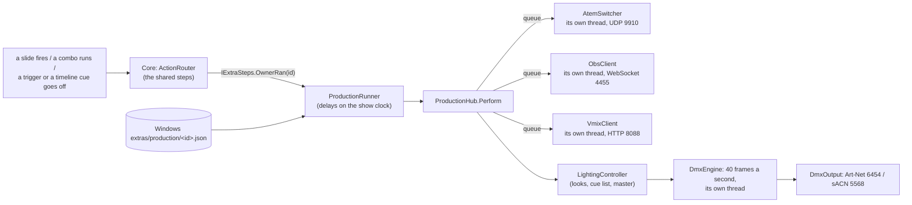

# Phase 6: production control (cameras, OBS, vMix and lights)

A big church's Sunday isn't only slides. Someone cuts between cameras on a Blackmagic ATEM,
someone runs OBS or vMix for the stream, someone brings the lights down for the sermon. Most
of that follows the service order exactly as the slides do, so this phase lets a slide, a
combo, a schedule trigger or a timeline cue do it too: "switch the ATEM to camera 2", "OBS:
scene Worship", "vMix: Cut", "Lights: Sermon look, 3 s fade", "run ATEM macro 4".

The Mac app has none of this. Everything here is Windows-only, and is built so that a Mac
sharing the same library never notices it is there.

## What you can do now

- **Screens & Settings › Production (Windows)** lists this PC's devices, each with a status
  light: green connected, amber connecting, red not answering (the app keeps trying quietly),
  grey off or waiting. A light changing only repaints its own dot and words; the rows are
  made again only when a device is added, changed or removed, so a button never disappears
  from under the mouse while a device is connecting.
  - **+ Add a device** › Blackmagic ATEM, OBS Studio, vMix, Art-Net or sACN. Give it a name
    and an address; OBS and vMix can have a password; a DMX node has a way of sending
    (broadcast, multicast or straight to its address) and the universes it gets.
  - **On** turns a device off without forgetting it. **Edit…**, **Remove**.
  - **Lighting looks and cues…** opens the lighting window.
- **The lighting window**:
  - **Looks** on the left (+ New, Duplicate, Delete). Pick one to edit it on the right: its
    name, its fade time, and a slider for each channel, 32 to a page (‹ › for more), in the
    universe you choose. A channel the look doesn't use shows "–"; move its slider to add it,
    right-click it to leave it out.
  - **Groups**: a name and some channels ("Front wash", 1-6) in a universe. One slider sets
    them all. Tick **Attribute** for colour, position or gobo channels (see "the merge" below).
  - **Fire**, **Fire now** (no fade), **Add on top**, **Release**.
  - **Cue list**: **+ Add the look** puts the look being edited at the end. A cue can have its
    own fade. **GO** fires the next cue, **Back** the one before; double-click a cue to jump to it.
  - At the bottom: **Grand master**, **Blackout**, **All off** (a 3 s fade), and each DMX node's light.
  - **Show on the rig while I edit** (on by default) sends the look you're editing straight to
    the lights as you move the sliders, over everything else, until you untick it or close the window.
- **Production (Windows)** steps, under the ordinary steps in every action editor: **Slide
  Actions** (a slide's right-click menu), a media item's **Actions…**, **Action Combos**,
  the **Scheduler**, and a timeline's **actions cue**. **+ Add production step** › ATEM ›,
  OBS ›, vMix ›, Lights ›. Each card has its device's light, a **▶** to try it now, ↑ ↓ ✕,
  its settings and its own **Delay**. A source, scene, input or macro box has a **▾** that
  lists what the device reported (the ATEM's input names, OBS's scenes, vMix's inputs); you
  can also just type.
- **The Local API** (when it's on) has three Windows-only routes:
  `GET /v1/windows/production` (the devices, their lights and the lights' state),
  `POST /v1/windows/production/owners/{id}/fire` (run a slide's, combo's, trigger's or cue's
  production steps) and `POST /v1/windows/production/steps/fire` with one step as JSON, for
  example `{"kind":"atemProgram","source":2}`.

### What each device can do

| Device | Steps |
|---|---|
| **ATEM** | Program input, Preview input, Cut, Auto, Fade to black, Run macro, Aux source, Upstream key on/off, Downstream key on/off (with the M/E, from 1) |
| **OBS** | Program scene (with a transition and length, if you like), Preview scene (studio mode), Transition preview to program, Start/stop streaming, Start/stop recording, Show/hide a source in a scene |
| **vMix** | Cut, Fade (with a length), Overlay 1-4 in/out, Preview input, Output (active) input, Start/stop streaming, Start/stop recording |
| **Lights** | A look (crossfade to it, or add it on top; its own fade or the step's), Release a look, Cue list GO (or a chosen cue), Blackout on/off/toggle, Grand master %, All off |

## Trying it with real devices

You need nothing installed: every protocol is written in the app itself.

- **ATEM** (any model, ATEM Mini to Constellation): the PC and the switcher on the same
  network; the switcher's IP address is in *ATEM Setup › Network* (the factory one is
  192.168.10.240). Up to about five programs can be connected to one switcher at once; ATEM
  Software Control counts as one.
- **OBS Studio 28 or later**: *Tools › WebSocket Server Settings › Enable WebSocket server*.
  *Show Connect Info* gives the port (4455) and the password. Use 127.0.0.1 when OBS runs on
  this PC. Windows Firewall must allow OBS if it runs on another PC.
- **vMix**: *Settings › Web Controller* on (port 8088). If you set a user name and password
  there, type them in the device too. Use 127.0.0.1 when vMix runs on this PC.
- **Art-Net**: a DMX node (an Enttec ODE, a DMXking, a lighting desk that takes Art-Net…).
  Show universe 1 goes out as Art-Net 0:0:0. Broadcast reaches every node on the network;
  sending straight to the node's address is kinder to a busy network.
- **sACN (E1.31)**: most modern nodes and desks. Multicast (239.255.0.x) needs nothing set up
  on a simple network; on a managed switch, IGMP snooping should be on (ask whoever looks
  after the network). Priority 100 is the usual; a desk at a higher priority wins.
- Nothing is sent to the lights until the first lighting step runs, so starting the app in the
  middle of a service never takes the rig from the lighting desk.

Try a device with the ▶ on a step: the main window says whether it got there.

## How it works

### The shape of it



The code is in a new project, **`src/MxU.Slides.Production`** (no WPF, so it has its own
tests, `tests/MxU.Slides.Production.Tests`). The app's half is
`ViewModels/MainViewModel.Production.cs` and the windows in `Views/Production/`.

### Why the steps aren't in the slide

A slide's actions are a list of `SlideAction`s whose kind comes from a fixed list shared with
the Mac (`packages/schema/documents.json`). There's no "ATEM" kind, and the Mac refuses a
*whole document* that contains a kind it doesn't know: adding one would make the Mac lose the
song. So production steps live beside the library, in **Windows extras**
(`Core/Library/WindowsExtras.cs`): `Windows extras/production/<owner id>.json`, one file per
slide, media item, combo, trigger or timeline cue that has any. The Mac never looks in that
folder. Open one and you'll see the steps as plain JSON:

```json
{
  "Value": [
    { "id": "…", "kind": "atemProgram", "source": 2 },
    { "id": "…", "kind": "lightsLook", "lookId": "…", "fadeSeconds": 3, "delaySeconds": 1.5 }
  ],
  "Basis": null
}
```

(`Basis` is the fingerprint other extras use to notice a Mac edit; production steps don't
depend on the shared steps, so they have none.) The lighting looks and the cue list are the
library's too: `Windows extras/lighting/show.json`. The *devices* are not: an address belongs
to the room a PC is in, so they're in **`production.json`** beside `settings.json`, and the
OBS and vMix passwords are encrypted with Windows' DPAPI for your Windows account in
`%LOCALAPPDATA%\MxU Slides\ProductionSecrets` (`Devices/DeviceSecrets.cs`, the same idea as
the stream keys). Passwords never go in the log.

`ProductionAction` (`Actions/ProductionAction.cs`) is one flat record, like `SlideAction`, whose
kind says which fields matter. The kind is stored as text, so a list written by a newer
version, with a kind this one doesn't know, still loads: that step is skipped, not the list.

### How a step gets run

Core's `ActionRouter` (a port of the Mac's) gained one small hook, `ExtraSteps`
(`Core/Automation/Actions/IExtraSteps.cs`). It calls `OwnerRan(id)`:

- when a slide fires (before it looks at the slide's own steps, so a slide with only
  production steps still runs them), and when a media item fires;
- when a combo runs, including a combo fired by another combo's step (after that step's delay);
- when a schedule trigger or a timeline actions cue goes off: the scheduler and the timeline
  player now pass the trigger's or the cue's id to the app (`ISchedulerHost.Run(id, …)`,
  `ITimelineHost.RunActions(id, …)`), and a cue with no shared steps still counts;
- **Clear All** calls `CancelPending()`, which drops production steps still waiting on their
  delays, as it drops the shared ones.

`ProductionRunner` reads the owner's steps from memory (they're read from disk once at start,
in the background; saving refreshes them), groups them by delay, and hands each over at its
time. The delays are timed by the **show clock** (`Core/Threading/ShowTimeProvider.cs`), a
thread of its own, not the UI thread, so a busy screen can't make a camera cut late.

### Never holding up the show

A device on the network can be slow, switched off or gone. The rule is that **none of that
may ever delay a slide, the lights or another device**:

| Thread | What it does | Why it's its own |
|---|---|---|
| `MxU ATEM: <name>` | the ATEM session: hellos, acks, resends, pings | UDP needs constant attention |
| `MxU OBS: <name>` | reads OBS's messages, reconnects | a blocked read must not block anything else |
| `MxU vMix: <name>` | asks vMix for its state every 3 s | HTTP has no connection to watch |
| one work queue per device | runs that device's commands, in order | a slow device only delays its own commands |
| `MxU DMX engine` | 40 frames a second to the nodes | DMX is a stream, and fades must be smooth |
| the show clock | times the steps' delays | the UI thread can be busy |

- Handing a step over only *queues* it: the slide fires in microseconds.
- A command for a device that isn't connected is **skipped at once**, never saved for later:
  a cut that happens half a minute late, when the switcher comes back, is worse than none.
- A command that waited more than 3 s behind a slow one is dropped for the same reason
  (`ProductionDevice.StaleAfter`).
- Every network wait has a limit: 2 s to connect to OBS or vMix, 2 s for an answer, about a
  second for the ATEM to ack a command (it's sent again every 100 ms, ten times). The limits
  are kept on the device's own thread: `Network.ConnectTcp` (`Devices/Network.cs`) starts a
  connect without waiting and then asks the socket whether it has finished, because the usual
  .NET ways of putting a limit on a connect finish on the thread pool, and an import or a busy
  PC can hold that up for far longer than the limit.
- **One unanswered command costs one time limit, not one each.** A device that stops
  answering in the middle of a service (the switcher unplugged, OBS frozen, vMix busy) is
  treated as gone the moment a command times out: the ATEM's session is dropped, OBS's
  connection is closed, vMix is marked offline. The commands queued behind it then find it
  not connected and are skipped at once. Five cuts fired at a switcher that has just been
  unplugged take about a second in all, not five.
- Then the device's thread **reconnects quietly** in the background, and the light shows how
  it's going. An OBS that signs in but then doesn't answer (its main thread stuck) waits its
  turn before the next try, so its light doesn't flicker between green and red. A step for a
  device this PC hasn't got at all is skipped with a line in the log, so a library made in a
  room with an ATEM still runs, without the cuts, on a laptop at home.

### The ATEM protocol

Blackmagic never published it; the open-source atem-connection (Sofie/NRK) and libqatem
projects worked it out, and `Atem/AtemPacket.cs` follows their notes. Every packet starts
with 12 bytes:

```
bytes 0-1   five flag bits and the packet's length (11 bits)
bytes 2-3   session id
bytes 4-5   "I've got your packets up to N"        (with the Ack flag)
bytes 6-7   "send me everything again from N"     (with the RetransmitRequest flag)
bytes 10-11 this packet's id                       (with the AckRequest flag)
```

1. We send a 20-byte **hello** (flag Hello, session 0x53AB) every second until the switcher answers.
2. It answers with a hello of its own; we ack it, and it starts using its own session id
   (we copy whatever session id each packet has).
3. It sends its **whole state** as numbered packets, each full of commands: four-letter names
   with data. We ack each one *in order* and read the few we need (`Atem/AtemState.cs`): `_pin`
   (the model), `InPr` (each input's name), `MPrp` (macro names), `PrgI`/`PrvI` (what's on
   program and preview), and `InCm`, "initialisation complete": the light goes green. A packet
   that arrives out of order isn't acked, so the switcher sends the missing one again.
4. From then on it sends changes, and when there are none an empty **ping** twice a second.
   Acking them is what keeps the session alive (a switcher gives up on a client that stops
   acking); we also repeat our last ack each second as a keepalive. A packet we already have
   that comes again means our ack was lost, so we ack it again. Nothing heard for 5 s: the
   session is lost and we start again from step 1.
5. **Commands** go the other way the same way: `CPgI` (program input: M/E, source), `CPvI`,
   `DCut`, `DAut`, `FtbA`, `MAct` (macro), `CAuS` (aux), `CKOn` (upstream key), `CDsL`
   (downstream key), each in a numbered packet that we send again every 100 ms until it's
   acked, or at once when the switcher asks for it again (the RetransmitRequest flag). A
   resend is the same bytes again, as atem-connection sends it: the packet id is what tells the
   switcher it has had it before. Each command waits for its ack before the next goes, so they
   arrive in order.

The switcher counts from 0 (M/E 1 is 0, macro 1 is 0); the steps count from 1, as its panel
does, and `AtemSwitcher` converts. Sources keep the switcher's numbers: 1-20 cameras, 0 black,
1000 colour bars, 3010 media player 1, 10010 M/E 1 program.

### OBS (obs-websocket v5)

OBS 28 and later have a WebSocket server built in. `Obs/MiniWebSocket.cs` is a small
WebSocket client on blocking sockets (the HTTP "Upgrade" handshake, masked text frames,
pings answered, fragments joined) so it runs on the device's own threads. Every message is
JSON with an `op` and a `d`:

1. OBS sends **Hello** (op 0); with a password it includes a `challenge` and a `salt`.
2. We send **Identify** (op 1) with the answer
   `base64(SHA-256(base64(SHA-256(password + salt)) + challenge))` (`ObsAuth.Response`). OBS
   never sees the password, and an answer overheard once is no use with the next challenge.
3. OBS says **Identified** (op 2), or closes with code 4009 when the password is wrong (the
   light then says "OBS refused the password").
4. Then **Requests** (op 6: `SetCurrentProgramScene`, `SetCurrentPreviewScene`,
   `TriggerStudioModeTransition`, `StartStream`, `StopRecord`, `GetSceneItemId` +
   `SetSceneItemEnabled`…), each with an id that its **answer** (op 7) carries back; and
   **Events** (op 5) when something changes, so the light can say "Program: Worship · streaming".

A blocked read would wait for hours if the OBS PC were unplugged, so the socket uses TCP
keepalives that notice a vanished peer within about 8 s.

### vMix

The simplest: every command is one GET, `http://host:8088/api/?Function=Cut`, with its
settings added (`&Input=3`, `&Duration=1000`). `/api` on its own answers with vMix's state as
XML (its inputs, what's active, streaming), which a thread asks for every 3 s to set the light
and fill the input picker. `Vmix/MiniHttp.cs` does one request on a plain socket, with a hard
time limit however the far end behaves.

### DMX: Art-Net and sACN

DMX levels are 512 numbers (0-255) per **universe**. Over a network they're sent as a stream,
every universe about 40 times a second whether it changed or not: a lost packet is mended
25 ms later, and sACN receivers give a source up after 2.5 s of silence.

- **ArtDmx** (`Dmx/DmxPackets.cs`): "Art-Net\0", opcode 0x5000 (low byte first, the only
  little-endian field), version 14, a sequence number, the universe as a 15-bit
  port-address, the length, then the levels. 18 bytes plus the levels.
- **sACN data packet** (E1.31-2018): 638 bytes in three nested layers (root, framing, DMP),
  each with a "flags and length" field. It carries the source's **CID** (a UUID made once per
  PC and kept in production.json), its name, a priority, a sequence number and the universe.
  Multicast goes to 239.255.*hi*.*lo* for universe *hi*×256+*lo*. When a node is removed or the
  app closes, three "stream terminated" packets let receivers drop us at once.
- **The engine** (`Dmx/DmxEngine.cs`) keeps to a schedule (start + n × 25 ms) rather than
  "wait 25 ms each time", so Windows' coarse timer can make one gap shorter and the next longer
  but the rate never drifts. A change (a look fired) wakes it so the first frame goes at once,
  but never sooner than 1/44 s after the last one (DMX's own top speed), so a dragged slider
  doesn't flood the network. With no node, or before the first lighting step, it just sleeps.

### The merge (`Lighting/DmxMixer.cs`)

The mixer is pure arithmetic: it's given the time rather than reading a clock, so every fade
in the tests is exact.

- **The main look** (a cue, or "Lights: Sermon"): firing a new one **crossfades** in a straight
  line from whatever is showing *now*, even half way through another fade. Brightness the new
  look doesn't mention fades out.
- **Looks on top** fade in over the main look and out when released. **Brightness merges
  highest-takes-precedence (HTP)**: the brighter wins, so adding the house lights never dims
  the stage. **Attributes merge latest-takes-precedence (LTP)**: the look added last sets the
  colour, blended in as it fades, and a main look that doesn't mention an attribute leaves it
  where it is, so a moving light doesn't swing home between cues. Which channels are attributes
  comes from the groups ticked **Attribute**; everything else is brightness.
- **The programmer** (the lighting window's live editing) overrides everything until let go.
- **The grand master** scales brightness (with a fade); **blackout** takes brightness to zero
  at once. Neither touches attributes.
- Nothing is sent for a universe until something touches it.

### The editors

`Actions/ProductionEditing.cs` holds the rules the windows draw: what each kind of step lets
you set (`Fields`), how it reads ("ATEM: Program Wide"), the Add menu, and new steps' defaults
(the first scene, the first look). `Views/Production/ProductionStepsSection.cs` draws them and
attaches itself under an `ActionListEditor` (one line in each window that has one). It saves
each change at once, to the extras, never to the shared document.

### Tests

- `tests/MxU.Slides.Production.Tests`:
  - **ATEM**: the packets byte for byte, then whole sessions against a pretend switcher that
    behaves like a real one: it keeps every numbered packet until it's acked, sends it again
    every 200 ms, and drops a client that stops acking. The tests make it lose a state packet
    (the client must not ack past the gap, and gets it when it's sent again), lose the client's
    acks (the client must ack the resends), ignore a command packet (the client sends it
    again), ask for a command again, go quiet, or not be there at all.
  - **OBS**: the sign-in sum against one worked out in Python; the WebSocket client against
    .NET's *own* WebSocket server (masking, fragments, long messages, the close code); then
    requests against a pretend OBS whose server half is written separately, on threads of its
    own (wrong password, no password, OBS not running, OBS quitting, OBS frozen, OBS coming back).
  - **vMix**: the URLs, its state XML, sign-in, and a slow vMix (one time limit, then the
    next command is skipped until it answers again).
  - **DMX**: Art-Net and sACN packets byte for byte against the specifications, the engine's
    rate and sequence numbers, sACN's universes and "stream terminated".
  - **Lighting**: the fades and merges, the cue list.
  - **Steps**: the extras folder, a kind from a newer version, the delays and Clear All, and
    "a missing device never holds the show up".

  The pretend devices (`src/MxU.Slides.Production/Simulators/`) are written from the protocol
  notes, not from the app's packet code, so a mistake in one shows up instead of cancelling
  out. Each runs on threads of its own with blocking sockets, like the app's devices, so a
  busy thread pool can't make them slow when the self-test runs them inside the app.
- `tests/MxU.Slides.Core.Tests/Automation/ExtraStepsTests.cs`: the router, scheduler and
  timeline name the owner that ran.
- `tests/MxU.Slides.LocalApi.Tests/WindowsRoutesTests.cs`: the Windows-only routes.
- **The self-test** (`Infrastructure/SelfTest.Production.cs`) runs the real app against the
  pretend devices: adds them through the device dialog and waits for green lights, builds a
  look and a cue in the lighting window, gives a slide four production steps in its Slide
  Actions window and fires it (the ATEM cut, the OBS scene, the vMix cut half a second later,
  the Art-Net levels), runs a combo with only a production step, checks a missing switcher costs
  nothing (handing its steps over is timed on the UI thread; its answer is timed on a thread of
  its own, so a busy screen or a busy PC doesn't count against it), and fires a macro through
  the Local API. Its waits are for conditions (the lights going green), with generous limits,
  rather than fixed times. Pictures: `90-production-settings`,
  `91-production-device`, `92-production-lighting`, `93-production-add-menu`,
  `94-production-slide-actions`.

### Things to try

1. **Watch the packets.** Add an Art-Net device sending straight to 127.0.0.1, open Wireshark
   on the loopback adapter with the filter `udp.port == 6454`, and fire a look: the levels are
   right there after the 18-byte header. Fade a look and watch them count.
2. **Feel HTP and LTP.** Make a look with channel 1 at 100 and another with channel 1 at 200.
   Fire the first, **Add on top** the second: 200 wins. Now make a group with channel 1 ticked
   Attribute and do it again: the newer one wins, whatever its level.
3. **Read a session.** `AtemSwitcherTests.ALostCommandPacketIsSentAgainUntilItIsAcked` drops two
   packets on purpose. Step through `AtemSwitcher.Maintain` in the debugger to see the resends.
   `ALostStatePacketIsNeverAckedPastAndArrivesWhenSentAgain` does it the other way round: put a
   breakpoint in `AtemSwitcher.Handle` where an out-of-order packet is left unacked.
4. **Break it on purpose.** Change `AtemSwitcher.Handle` to ack any new packet id, not just the
   next one, and run the ATEM tests: the lost-state-packet test fails, because the switcher would
   never send the missing packet again. Each of the session tests is there to catch one such slip.

## Where this goes beyond the Mac (and what's not here yet)

- The Mac has no production control at all; none of this has a Swift twin.
- **Not here yet:** ATEM transition settings (mix rate, wipe style), SuperSource, audio
  mixer, and tally; OBS's per-scene transition overrides and filters; vMix's many other
  functions (scripts, titles' text); sACN universe discovery packets; a fixture library
  (channels are numbers, grouped by hand); undo for production edits; copying production steps
  when a slide, combo or cue is duplicated or pasted (the copy has a new id, so it starts with
  none); and a timeline actions cue with only production steps still reads "No actions" on the
  lane.
- Art-Net is sent from a port Windows picks rather than 6454, so it never fights another
  lighting program on the same PC for that port; nodes accept ArtDmx from any port.

## For PORTING.md

Windows-only (no Swift twin), to list under the Windows-only additions:

| Windows | What |
|---|---|
| `MxU.Slides.Production/*` | Production control: ATEM (`Atem/`), OBS (`Obs/`), vMix (`Vmix/`), DMX (`Dmx/`), lighting (`Lighting/`), production steps (`Actions/`), the hub, the simulators used by the tests and self-test |
| `MxU.Slides.Core/Automation/Actions/IExtraSteps.cs`, `ActionRouter.ExtraSteps` and `Execute(ownerId, …)`, `ISchedulerHost.Run(triggerId, …)`, `ITimelineHost.RunActions(cueId, …)` | The hook that runs Windows-only steps beside an owner's shared ones. **When porting a change to ActionRouter.swift, keep the `ExtraSteps?.OwnerRan(…)` calls** in SlideDidFire, MediaDidFire, Fire, RunStartupCombos and the FireCombo step, and `ExtraSteps?.CancelPending()` in CancelPendingDelayedActions; when porting SchedulerController or PresentationTimelineController, keep passing the trigger's and cue's id |
| `MxU.Slides.LocalApi/ApiRouteTable.Windows.cs` | `/v1/windows/production` routes (`IProductionApi`); `RouteTableMatchesTheMac` ignores `/v1/windows/` |
| `MxU.Slides.Windows/ViewModels/MainViewModel.Production.cs`, `Views/Production/*`, `Infrastructure/SelfTest.Production.cs` | Settings › Production, the lighting window, the Production (Windows) section of the action editors, the self-test |
| Windows extras kinds `production` (steps by owner id) and `lighting` (owner `show`); `production.json` beside settings.json; `ProductionSecrets` in the local folder | Where it's stored |

*This is the walkthrough; see also [HOW-IT-WORKS.md](../HOW-IT-WORKS.md) and [PORTING.md](../PORTING.md).*
