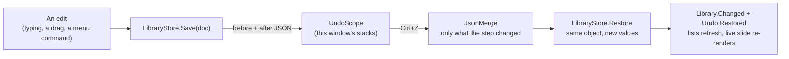

# Phase 7: the editing core

This part of Phase 7 makes editing on Windows feel safe: everything can be undone, slides and
objects can be cut, copied and pasted, things can be dragged where they belong, and text and
chords can be edited properly.

## 1. Undo and redo

### The idea

On the Mac, each window has an *undo manager*. On Windows, the same idea lives one level lower,
in the library itself: every edit ends up as a call to `LibraryStore.Save` or `LibraryStore.Delete`
(or `Extras.Save` for a Windows-only addition), so that is where undo listens.

Each time a document is saved while an **undo scope** is current, the library notes the
document's JSON just before and just after the save. Undoing puts the "before" back. That's all
an editor needs to do to get undo: save as usual.



The files: `src/MxU.Slides.Core/Undo/` (the rules, unit-tested in
`tests/MxU.Slides.Core.Tests/Undo/`), `Core/Library/LibraryStore.Undo.cs` (the library's side),
and on the app side `Infrastructure/UndoWindows.cs` and `ViewModels/MainViewModel.Undo.cs`.

### Scopes: one per window

- The main window has a scope (`MainViewModel.UndoScope`).
- Each editor window makes its own. So Ctrl+Z in the overlay editor never undoes something you
  did in the main window, and the other way round. Closing the window forgets its steps, as the
  Mac drops a closed window's undo manager.
- **Which scope a save goes to:** the window with the keyboard. A window without a scope of its
  own (a rename box, a message) uses its owner's. Inside `scope.Use()`, that scope wins, which is
  how an editor's half-second autosave still lands in the editor's scope after you've clicked
  elsewhere.
- **Not recorded:** saves on a background thread (an import), saves inside
  `Library.Undo.Unrecorded()` (the Local API and the remote, the scheduler archiving a trigger),
  and anything saved while an undo is being applied.

### Steps, and how they coalesce

- **One piece of work is one step.** Everything saved while the dispatcher handles one click or
  one key press is one step. A rename that also renames the presentation's rows in three services
  undoes in one go. (The app tells the history when the dispatcher has finished: `EndOfTurn`.)
- **Rapid edits coalesce**, using the Mac journal's rule: a step joins the one before it if it's
  the same kind of edit to the same things, within 5 seconds of the last. So a burst of typing is
  one "Typing", a drag is one "Move", and a slider is one "Change Opacity". Typing in a
  *different* box, a pause, or any structural change in between (adding a slide) starts a new step.
- **Names come from what changed**, worked out by comparing the JSON (`UndoDescription.cs`):
  "Move", "Resize", "Rotate", "Typing", "Rename", "Add Slide", "Delete Slides", "Move Slide",
  "Remove Service Item", "Arrange", "Change Font Size", "Delete Presentation"… The Edit menu and
  the toolbar's tooltip show them: "Undo Move (Ctrl+Z)".
- **50 steps** per scope, the Mac journal's number.
- A new edit clears Redo. An edit right after an undo always starts a fresh step.

### Undo never clobbers a later edit

Two windows can edit the same presentation: say the main window renames a slide, then the slide
editor retypes another slide. If the main window's undo simply wrote back its "before" copy, the
editor's typing would vanish.

So an undo is a **three-way merge** (`JsonMerge.cs`) of three versions of the document: the step's
after (where the step left it), its before (what undo wants), and the document now:

- a part nobody has touched since goes back;
- a part the step didn't change keeps what it is now;
- a part both changed keeps the newer value: the later edit wins.

Lists of things with ids (slides, objects, service rows) merge element by element, by id. Undoing
"Delete Slide" puts that slide back at its old place, without removing a slide someone else
added meanwhile. This is the same effect the Mac gets from Automerge, whose undo reverts only the
objects a change touched (`SubtreeRevert.swift`). A step that has nothing left to put back (its
document was deleted elsewhere) is dropped, and the one under it is undone instead, as the Mac's
journal does.

### What an undo does to the screen

The library keeps the document *object* it holds and replaces its properties
(`LibraryStore.Restore`), so a window holding the presentation sees the restored version at once.
The objects inside (slides, text boxes) are new. Then:

- `Library.Changed` fires for each document, as for any save, so lists refresh;
- `Library.Undo.Restored` fires with what was written. The main window rebuilds the slide grid
  and the canvas (keeping the selection), and tells the show, so **a live slide re-renders** with
  the undone version, exactly as an edit would. A song brought back from the Trash opens.

Undo never stops the show: a failure is logged and shown, and the step stays to try again.

### For anyone writing an editor window

1. In the window's constructor:

   ```csharp
   UndoWindows.AttachEditor(this, library, "Theme editor", settle: FlushPendingEdits);
   ```

   This makes a scope, focuses it when the window activates, routes Ctrl+Z, Ctrl+Y and
   Ctrl+Shift+Z to it, and forgets it when the window closes. `settle` (optional) saves anything
   your editor still has waiting before an undo, so that edit is what gets undone.
2. Save through `LibraryStore` as usual. Nothing else is needed for undo to work.
3. To name a step, or to make one step span several pieces of work (mouse-down to mouse-up):

   ```csharp
   using (scope.BeginGroup("Move")) { … saves … }
   ```

   With a key, repeats coalesce: `scope.BeginGroup("Nudge", coalesceKey: "nudge:" + objectId)`.
4. After an undo, re-read what you show by id. Listen to `Library.Undo.Restored` (it says which
   documents came back) or to `Library.Changed`.
5. A save your window makes when its window may not have the keyboard (a timer):
   `using (scope.Use()) library.Save(doc);`.

The Mac's `UndoMenuLogic` is ported (`Core/Undo/UndoMenuLogic.cs`): in an editor window, Ctrl+Z is
always the editor's; in the main window, a text box you're typing in undoes its own typing first,
and the scope after that.

## 2. Cut, copy, paste and duplicate

`Core/Editing/EditorClipboard.cs` holds the rules; `Infrastructure/AppClipboard.cs` talks to the
Windows clipboard; `ViewModels/MainViewModel.Clipboard.cs` runs the commands.

- **What's on the clipboard.** Slides go on it in a format of our own, "MxU Slides: slides" (the
  slides' JSON), and objects as "MxU Slides: slide objects". Plain text goes beside them, so pasting
  into Word or an email gets the words.
- **Where the keys go.** With a text box being typed in, Ctrl+C, Ctrl+X and Ctrl+V are the text
  box's own. With the canvas focused in Edit mode, they work on its selected objects. Otherwise they
  work on the grid's picked slides.
- **Picking several slides.** Ctrl+click adds or removes one, Shift+click picks a run, Ctrl+A picks
  them all (Edit mode). Right-click a picked slide for "Copy 3 Slides", and so on.
- **The Mac's rules:**
  - pasted slides, objects and actions get **fresh ids**, and a mask still points at its matte
    (the Mac's `freshIDCopy`);
  - **media references are kept**: a pasted slide shows the same background;
  - pasted slides **join the group** of the slide they land after, so a song's groups and
    arrangements stay consistent;
  - objects pasted back onto their own slide **step 24 points** down and right each time; grouped
    objects stay grouped, in a new group of their own.
- **Text from another app.** Pasted on the canvas, it becomes a text box. Pasted into a song's grid,
  it becomes slides, cut as the song's own slides are, through the lyrics pipeline: "Chorus" lines
  join the song's Chorus group, or start one. Files and pictures paste as media boxes on the canvas,
  or as media slides in the grid.
- **Windows extras come along.** A pasted or duplicated slide keeps its Push transition and its
  camera cuts (`WindowsExtras.CopyOwner`), and a pasted object keeps its kinetic build and its lock.
- **Merge Slides** (right-click two or more picked slides) is MxU's newest Mac command. The first
  slide keeps its settings; the others' words follow on new lines, chords and styled words along
  (`Core/Lyrics/SlideBulkEdit.cs`, the one copy kept when the engine port joined).

Every paste, cut, duplicate and merge is one undo step.

## 3. Drag and drop

`Core/Editing/Dropping.cs` holds the rules (and the Mac's `SlideGridDrop`, with its tests);
`Views/EditorDragDrop.cs` reads the mouse; `ViewModels/MainViewModel.Dropping.cs` makes the changes.

- **Slides** (Edit mode): drag the picked slides in the grid or the filmstrip. They land before the
  slide the line points at and join its group, as on the Mac. This works while a song is shown "As
  written"; an arrangement's order is changed in Edit lyrics.
- **The bins are drag sources**: media, overlays, songs and playlists.
  - Media onto a slide tile's middle becomes its **background**; onto a tile's edge or a gap, a **new
    slide** there (in front of the first slide too: MxU's latest fix).
  - Media onto the canvas becomes a **picture box** where you drop it; onto a shape, that shape's
    **fill** (a picture in a frame).
  - Anything a service can hold goes into the **service list**, at the row the line points at.
  - Music, media and overlays go onto a **timeline's lanes**, as cues where they're dropped.
- **Files from Explorer**: onto the library (imported like Import…), the media bin, the grid (media
  slides) or the canvas (picture boxes).
- **Playlists**: songs drag into a new order in the playlist editor, and in from the Music tab
  (`Views/PlaylistDrops.cs`).
- **Feedback**: a blue line shows where a drop will land, and an outline shows what it will land on
  (`Views/DropFeedback.cs`). It's drawn on the adorner layer, so it never takes the mouse. **Esc**
  cancels a drag, which is Windows' own drag-and-drop rule.
- **Safe in Show mode**: a click on a tile in Show mode does something live, so a drag only starts
  after a long pull (18 pixels). A shaky click still fires.

## 4. Layers and arranging

- **The layers list** (`Views/LayersPanel.cs`, beside the inspector in Edit mode) is the Mac's
  objects panel: the slide's objects top first, with the theme's own decor listed greyed where it's
  drawn. Click to pick (Ctrl and Shift add), double-click or F2 to rename, drag a row to restack it.
- **Hide** uses the shared `hidden` field, so a Mac hides the object too.
- **Lock** has no field in the shared format, and the Mac has no lock, so it's a Windows extra
  (`Core/Editing/ObjectLocks.cs`). A locked object can't be clicked, dragged or nudged on the canvas:
  clicks go through to what's behind it. Picked from the list, it shows a dashed amber outline. A Mac
  simply sees the object, unlocked.
- **Arranging** (`Core/Editing/Layers.cs`): bring forward and send backward (one or several, which
  keep their order among themselves), front and back, align, distribute, group (Ctrl+G) and ungroup
  (Ctrl+Shift+G). Arrow keys nudge (Shift: 10 points), and a burst of nudges is one "Move".

## 5. Text tools

- **Styling selected words** (`Views/TextFormatBar.cs`). Select words in the inspector's text box,
  then Bold, Italic, Underline, Strikethrough, All Caps, a colour, a size or letter spacing changes
  just those words. They're saved as style runs (`TextStyleRun`), the shared format's way, so a Mac
  shows them. Bold and italic pick the same family's bold or italic face, as the Mac's font manager
  does. With nothing selected, the bar styles every word.
- **Typing keeps styling and chords on their words.** A text box hands back the whole text on every
  keystroke. `ObjectText.SetText` works out the one stretch that changed (what's the same at the
  start and at the end is kept), and `TextStyleRuns.Replacing` moves the runs, chords and animation
  ranges that come after it. This is the Mac's `replaceText`, ported with `TextStyleRuns.swift` and
  its tests.
- **Text fit**, as in the Mac's typography section: Shrink to fit, Balanced wrap, Page on click, Keep
  lines whole, and the smallest size.
- **Lists**: the Mac has no bullets, so there are none here either.
- **Spell check**: the lyrics, text and notes boxes use WPF's checker (red underlines; right-click
  for suggestions).
- **Find and Replace** (Ctrl+H; `Views/FindReplaceWindow.cs`, `Core/Editing/FindReplace.cs`) works on
  the open presentation or every song in the library, with match case and whole words. Without match
  case, a replacement follows the match's capital: "Thee" becomes "You" at the start of a line.
  Replace All is one undo step however many songs it touches. The Mac has no find and replace.

## 6. Chords

- **The chord editor** (`Views/ChordEditorWindow.cs`; right-click a slide › Chords…, or the key chip
  › Edit chords…) shows each line of the slide's lyric with its chords above it, in an even-width
  font, so a chord's column is simply its position over the letters.
  - Double-click over a letter to add a chord, and type it.
  - Drag a chord along, or onto another line. Delete removes it; Enter retypes it.
  - Or type the words with chords in brackets, `[G]Amazing [C]grace`, in the box below.

  The rules are the Mac's `ChordEditing.swift` (`Core/Editing/ChordEditing.cs`, with its tests).
- **Transposing**: the key chip beside the song's title (`Views/SongKeyChip.cs`, the Mac's
  SongKeyChip) shows "Key: G → A", and picks the key the chords show in on every screen (the shared
  `displayKey`). It sets the key when a song has chords but no key yet.
- **A capo** (Windows only) is in the chip's Capo menu. The stage display then shows the shapes the
  guitarist plays: a song in A with capo 2 shows G shapes. The audience and the song itself keep the
  sounding key. It's a Windows extra (`SongCapo`), so a Mac sees the real chords.
- **The stage display** already showed chords with its "Current Over Next + Chords" layout; it now
  follows the capo (`ConfidenceSceneBuilder.Capo.cs`).

## 7. MxU's newest Mac updates in this area

Merged from main (MxU's update #10):

- **"All Caps applies to the selected text, not only the whole box."** Style runs carry
  `textTransform`, and the words bar has All Caps. Whether it shows as on reads the placeholder's
  case, as the Mac's Selection strip does: switching it off in a box whose theme writes capitals
  stores "none", not nothing.
- **"Merge Slides joins selected slides into one, chords along"** (section 2).
- **"Media dropped in front of a deck's first slide lands there, not at the end"** (section 3).
- **"Tile badges name their action on hover again, as an in-tile overlay."** Slide tiles now show
  what the slide does when it goes live (`Views/TileActionBadges.cs`), and a pause over a badge names
  it inside the tile, where it can't cover the next tile or be cut off at the window's edge.
- **"The inspector reads the theme placeholder's font before the theme family."** The Windows
  inspector already shows the placeholder's style (`SlideSceneBuilder.StyledTextFor`), so nothing
  needed to change.

## For PORTING.md

**Ported line by line**

| Swift | C# |
|---|---|
| `PresenterCore/…/MenuCommandLogic.swift` (`UndoMenuLogic`) | `MxU.Slides.Core/Undo/UndoMenuLogic.cs` |
| `PresenterCore/…/Library/MoveUndoJournal.swift` (the rules: 50 steps, 5 s coalescing, dead entries dropped, nothing recorded while restoring; `ListOrder.apply`, `ListRemoval.restore`) | `MxU.Slides.Core/Undo/UndoScope.cs`, `UndoHistory.cs`, `JsonMerge.cs` |
| `SlideScene/…/SlideBulkEdit.swift` (`freshIDCopy`, `duplicateSlides`, `deleteSlides`, `insertSlides(after:)`, `moveSlide(before:)`, `mergeSlides`) | `MxU.Slides.Core/Editing/EditorClipboard.cs`, `Dropping.cs` (`DropRules.MoveSlides`); `mergeSlides` is `MxU.Slides.Core/Lyrics/SlideBulkEdit.cs` (one copy, from the engine port) |
| `Sources/SlideEditorModel.swift` (`pasteObjects`, `duplicateSelectedObjects`, `copySlides`, `pasteSlides`, `bringForward`, `sendBackward`, `bringToFront`, `sendToBack`, `groupSelection`, `ungroupSelection`, `panelStackTopFirst`, `movePanelObject`, `applyStyleToSelection`, `toggleSelectionBold/Italic/Underline`, `mergeSlides`) | `Core/Editing/EditorClipboard.cs`, `Layers.cs`; `ViewModels/MainViewModel.Clipboard.cs`, `MainViewModel.Layers.cs`, `ObjectInspectorViewModel.TextTools.cs` |
| `PresenterCore/…/Library/SlideGridDrop.swift` | `MxU.Slides.Core/Editing/Dropping.cs` (`SlideGridDrop`, `SlideDropZones`) |
| `PresenterCore/…/Library/TextStyleRuns.swift` (with `textTransform`, schema v161; `SlideObject.replaceText`; `AnimationRanges.replacing`, `reanchor`) | `MxU.Slides.Core/Editing/TextStyleRuns.cs` (`TextStyleRuns`, `ObjectText`) |
| `PresenterCore/…/Library/ChordEditing.swift` | `MxU.Slides.Core/Editing/ChordEditing.cs` |
| `Sources/PresentGridView.swift` (`SongKeyChip`; the drop in front of the first slide; `TileHelp`/`TileTipLabel` for the action badges) | `Views/SongKeyChip.cs`, `ViewModels/MainViewModel.Dropping.cs` (`InsertMediaSlides`), `Views/TileActionBadges.cs` |
| `Sources/SlideEditorView.swift` (the objects panel; Merge N Slides) | `Views/LayersPanel.cs`; `Views/MainWindow.Editing.cs` (`AddSlideEditItems`) |
| `Sources/SlideObjectInspector.swift` (typography: Balanced Wrap, Auto-Shrink, Page on Click, Keep Lines Whole, Min Size; the Selection strip with All Caps) | `ViewModels/ObjectInspectorViewModel.TextTools.cs`, `Views/TextFormatBar.cs`, the inspector XAML |

The Mac tests ported: `MoveUndoJournalTests` (as scenarios in `UndoHistoryTests` and `JsonMergeTests`),
`MenuCommandLogicTests` (undo routing), `SlideGridDropTests`, `TextStyleRunsTests` (with
`allCapsSelectionRoundTrips`), `ChordEditingTests`, and `SlideBulkEditTests.testMergeSlides…`.

**Windows-only**

- `Core/Undo/` (undo recorded at the library: `UndoHistory`, `UndoScope`, `UndoStep`, `UndoTarget`,
  `UndoDescription`, `JsonMerge`) and `Core/Library/LibraryStore.Undo.cs`; `Infrastructure/UndoWindows.cs`,
  `ViewModels/MainViewModel.Undo.cs`, `Views/EditBar.cs`. The Mac undoes on Automerge, per document,
  plus a journal of closures; Windows records each document's JSON before and after at the library,
  and merges three ways when undoing.
- `Infrastructure/AppClipboard.cs` (the clipboard formats "MxU Slides: slides" and "MxU Slides: slide objects").
- `WindowsExtras.CopyOwner` (pasted things keep their extras); `Core/Editing/ObjectLocks.cs` (object
  locks, extra kind "object locks"); `SongCapo` and `Core/Stage/ConfidenceSceneBuilder.Capo.cs` (extra
  kind "song capo"; the stage shows capo shapes). One change to a ported file: `ConfidenceSceneBuilder.SlideText`
  takes its `DisplayKey` from `StageKey`, which is the song's own unless it has a capo.
- `Core/Editing/FindReplace.cs`, `Views/FindReplaceWindow.cs`, `ViewModels/MainViewModel.FindReplace.cs`.
- Paste rules beyond the Mac's: plain text becomes a text box; lyrics pasted into a song become slides;
  a mask pasted with its matte follows it.
- `Views/ChordEditorWindow.cs` (the Mac places chords in its canvas text editor; Windows has a lines
  view and a bracket text box), `ViewModels/MainViewModel.Chords.cs`.
- `ViewModels/MainViewModel.SlidePicks.cs` (picking several slides in the grid), `Views/EditorDragDrop.cs`,
  `Views/DropFeedback.cs`, `Views/PlaylistDrops.cs`, `ViewModels/MainViewModel.Dropping.cs`,
  `ViewModels/TimelineEditorViewModel.Drops.cs`.
- `Infrastructure/SelfTest.Editing.cs`.

**Not ported yet**

- *Undo*: the timeline editor keeps its own history (`TimelineEditHistory`) for Ctrl+Z; its saves go
  into a scope of their own, so they never mix with the main window's.
- *Clipboard*: the overlay editor's canvas has no Ctrl+C and Ctrl+V yet (its Duplicate works). Copying
  text with its chords inside a text box (the Mac's `ChordClipboard`) isn't wired; the chord editor's
  bracket box carries chords as text. Formatted text pasted from another app keeps only its words (the
  Mac's `PastedFormatting`).
- *Drag and drop*: slides dragged between presentations; the operator panels and the automation boards
  (wt\p8-operator). On the Mac, media dropped on a picture slide that waits for media fills its photo
  spot (`fillPlaceholder`, part of making slides from notes, which isn't ported yet).
- *Text*: the Mac's canvas text editor (typing on the slide itself); the inspector's text box and the
  words bar do that job here. Drawing per-selection All Caps is the renderer's (wt\up-core).
- *Chords*: Numbers, Numerals and Do-Re-Mi notation are drawn, but not chosen in the chord editor.
