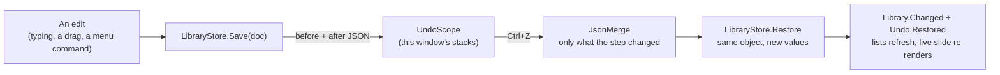

# Phase 7: the editing core

This part of Phase 7 makes editing on Windows feel safe: everything can be undone, slides and
objects can be cut, copied and pasted, things can be dragged where they belong, and text and
chords can be edited properly.

## 1. Undo and redo

### The idea

On the Mac, each window has an *undo manager*. On Windows, the same idea lives one level lower,
in the library itself: every edit ends up as a call to `LibraryStore.Save` or `LibraryStore.Delete`
(or `Extras.Save` for a Windows-only addition), so that is where undo listens.

Each time a document is saved while an **undo scope** is current, the library notes the
document's JSON just before and just after the save. Undoing puts the "before" back. That's all
an editor needs to do to get undo: save as usual.



The files: `src/MxU.Slides.Core/Undo/` (the rules, unit-tested in
`tests/MxU.Slides.Core.Tests/Undo/`), `Core/Library/LibraryStore.Undo.cs` (the library's side),
and on the app side `Infrastructure/UndoWindows.cs` and `ViewModels/MainViewModel.Undo.cs`.

### Scopes: one per window

- The main window has a scope (`MainViewModel.UndoScope`).
- Each editor window makes its own. So Ctrl+Z in the overlay editor never undoes something you
  did in the main window, and the other way round. Closing the window forgets its steps, as the
  Mac drops a closed window's undo manager.
- **Which scope a save goes to:** the window with the keyboard. A window without a scope of its
  own (a rename box, a message) uses its owner's. Inside `scope.Use()`, that scope wins, which is
  how an editor's half-second autosave still lands in the editor's scope after you've clicked
  elsewhere.
- **Not recorded:** saves on a background thread (an import), saves inside
  `Library.Undo.Unrecorded()` (the Local API and the remote, the scheduler archiving a trigger),
  and anything saved while an undo is being applied.

### Steps, and how they coalesce

- **One piece of work is one step.** Everything saved while the dispatcher handles one click or
  one key press is one step. A rename that also renames the presentation's rows in three services
  undoes in one go. (The app tells the history when the dispatcher has finished: `EndOfTurn`.)
- **Rapid edits coalesce**, using the Mac journal's rule: a step joins the one before it if it's
  the same kind of edit to the same things, within 5 seconds of the last. So a burst of typing is
  one "Typing", a drag is one "Move", and a slider is one "Change Opacity". Typing in a
  *different* box, a pause, or any structural change in between (adding a slide) starts a new step.
- **Names come from what changed**, worked out by comparing the JSON (`UndoDescription.cs`):
  "Move", "Resize", "Rotate", "Typing", "Rename", "Add Slide", "Delete Slides", "Move Slide",
  "Remove Service Item", "Arrange", "Change Font Size", "Delete Presentation"… The Edit menu and
  the toolbar's tooltip show them: "Undo Move (Ctrl+Z)".
- **50 steps** per scope, the Mac journal's number.
- A new edit clears Redo. An edit right after an undo always starts a fresh step.

### Undo never clobbers a later edit

Two windows can edit the same presentation: say the main window renames a slide, then the slide
editor retypes another slide. If the main window's undo simply wrote back its "before" copy, the
editor's typing would vanish.

So an undo is a **three-way merge** (`JsonMerge.cs`) of three versions of the document: the step's
after (where the step left it), its before (what undo wants), and the document now:

- a part nobody has touched since goes back;
- a part the step didn't change keeps what it is now;
- a part both changed keeps the newer value: the later edit wins.

Lists of things with ids (slides, objects, service rows) merge element by element, by id. Undoing
"Delete Slide" puts that slide back at its old place, without removing a slide someone else
added meanwhile. This is the same effect the Mac gets from Automerge, whose undo reverts only the
objects a change touched (`SubtreeRevert.swift`). A step that has nothing left to put back (its
document was deleted elsewhere) is dropped, and the one under it is undone instead, as the Mac's
journal does.

### What an undo does to the screen

The library keeps the document *object* it holds and replaces its properties
(`LibraryStore.Restore`), so a window holding the presentation sees the restored version at once.
The objects inside (slides, text boxes) are new. Then:

- `Library.Changed` fires for each document, as for any save, so lists refresh;
- `Library.Undo.Restored` fires with what was written. The main window rebuilds the slide grid
  and the canvas (keeping the selection), and tells the show, so **a live slide re-renders** with
  the undone version, exactly as an edit would. A song brought back from the Trash opens.

Undo never stops the show: a failure is logged and shown, and the step stays to try again.

### For anyone writing an editor window

1. In the window's constructor:

   ```csharp
   UndoWindows.AttachEditor(this, library, "Theme editor", settle: FlushPendingEdits);
   ```

   This makes a scope, focuses it when the window activates, routes Ctrl+Z, Ctrl+Y and
   Ctrl+Shift+Z to it, and forgets it when the window closes. `settle` (optional) saves anything
   your editor still has waiting before an undo, so that edit is what gets undone.
2. Save through `LibraryStore` as usual. Nothing else is needed for undo to work.
3. To name a step, or to make one step span several pieces of work (mouse-down to mouse-up):

   ```csharp
   using (scope.BeginGroup("Move")) { … saves … }
   ```

   With a key, repeats coalesce: `scope.BeginGroup("Nudge", coalesceKey: "nudge:" + objectId)`.
4. After an undo, re-read what you show by id. Listen to `Library.Undo.Restored` (it says which
   documents came back) or to `Library.Changed`.
5. A save your window makes when its window may not have the keyboard (a timer):
   `using (scope.Use()) library.Save(doc);`.

The Mac's `UndoMenuLogic` is ported (`Core/Undo/UndoMenuLogic.cs`): in an editor window, Ctrl+Z is
always the editor's; in the main window, a text box you're typing in undoes its own typing first,
and the scope after that.
